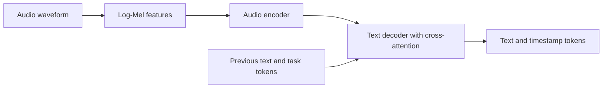

# 🎙️ Whisper: speech recognition as conditional sequence generation

Whisper uses an encoder–decoder Transformer to generate text from audio. The original work studies large-scale weak supervision across languages and tasks. Its robustness is an empirical result on evaluated data, not a guarantee for every accent, recording condition, or vocabulary.

## 🧭 Audio to text

Audio is converted into a log-Mel spectrogram, which represents time-varying energy on a perceptually motivated frequency scale. The encoder transforms these features into audio states. The decoder uses causal self-attention over previous text and cross-attention to audio states, then predicts the next token.

The original models use 80 Mel channels; later checkpoints such as large-v3 use different feature configurations. Match preprocessing to the checkpoint. The multilingual tokenizer extends a byte-level BPE approach with language, task, and timestamp tokens; English-only and multilingual configurations differ.

## 📦 Task tokens and timestamps

Control tokens distinguish transcription from translation. In the original multilingual setup, translation means speech-to-English, not arbitrary target-language translation. Timestamp tokens indicate temporal positions, but accurate word-level alignment may require additional processing and evaluation.

The original paper reports training on 680,000 hours of multilingual/multitask audio supervision. Scale and diversity improve generalization, while weak labels can still contain errors. Silence, music, overlapping speech, or unfamiliar terms can cause omissions or hallucinated text.

## 📊 A practical evaluation

Use representative recordings, reference transcripts, and an explicit normalization policy. Measure [WER/CER](asr.md), timestamp accuracy where needed, latency, and error rates on important terms. Inspect silence-only and noisy segments. Chunking long recordings introduces boundary/context choices that can affect repeated or missing words.

**Exercise.** If WER improves after removing punctuation from both transcripts, did the underlying recognizer necessarily improve? No. The evaluation normalization changed. Compare like with like.

References: [Whisper paper](https://arxiv.org/abs/2212.04356), [official implementation and checkpoint details](https://github.com/openai/whisper).
