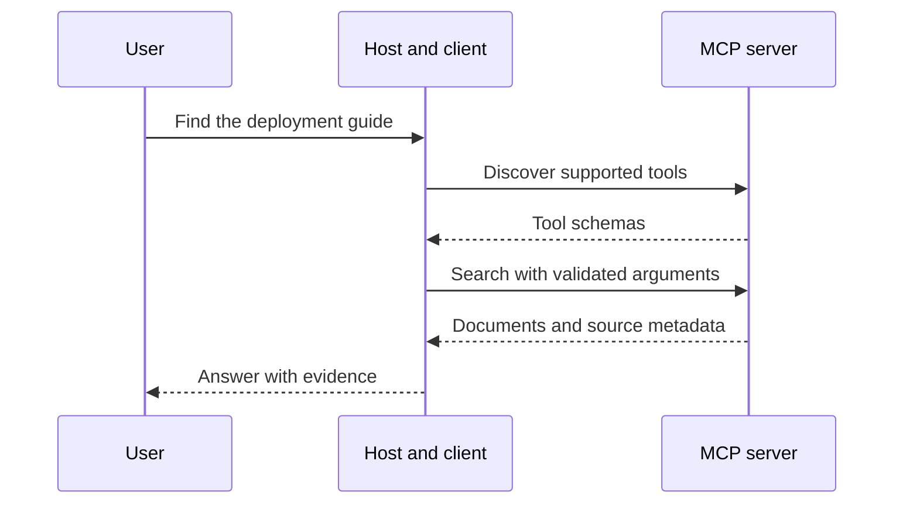

# 🔌 MCP: a common interface between AI applications and tools

The Model Context Protocol standardizes how an AI application communicates with external capabilities and context. It is an integration protocol, not a language model, a training method, or a guarantee that a model will choose the right tool.

## 🧭 Participants and responsibilities

A host application contains the model-facing experience and manages permissions and connections. An MCP client communicates with a server. A server exposes capabilities such as tools, resources, and prompts according to the negotiated protocol version. Transport and lifecycle details are versioned; use matching SDK/specification documentation.

| Primitive | Purpose | Example |
| --- | --- | --- |
| Tool | Perform a structured operation | Search a document index |
| Resource | Provide addressable context | Read a repository guide |
| Prompt | Provide a reusable interaction template | A structured review workflow |

The host decides what becomes model context and how operations are authorized. A server's description is not itself a user's permission to perform an action.

## 🔎 Follow a document-search request

The application discovers a search tool's name and input schema. The model proposes arguments such as a query string. The host validates and dispatches the call. The server returns structured results, which the application can supply to the model for an answer with citations.

## 🛠️ What an implementation must get right

Validate inputs at the server boundary, enforce the actual caller's access, and distinguish read operations from mutations. Handle timeouts and partial failures explicitly. Retrying a read is different from retrying a payment or message send; mutation tools need appropriate idempotency semantics. Treat retrieved document text as data rather than instructions that override the host's rules.

These are application design requirements, not features automatically supplied by JSON schemas. A tool may accept syntactically valid arguments while still requiring semantic checks.

**Exercise.** If a tool is listed, does that mean every user may invoke it on every resource? No. Discovery, authentication, authorization, and user intent are different checks.

Reference: [MCP architecture and versioned documentation](https://modelcontextprotocol.io/docs/learn/architecture). Compare [LangChain](langchain.md), which helps orchestrate application behavior above such integrations.
