# From Word2Vec to sequence-to-sequence models and Transformers

The progression is about removing bottlenecks in representation and information flow. Word2Vec learns useful word vectors; recurrent sequence-to-sequence models learn conditional generation; attention provides direct access to source states; Transformers build sequence processing around attention.

## 1. Word2Vec: learn a reusable lookup table

A vocabulary of size $V$ and embedding width $d$ defines a matrix $E\in\mathbb R^{V\times d}$. Multiplying a one-hot row by $E$ selects one row; implementations use an efficient lookup instead. Skip-gram predicts context words from a center word, while CBOW predicts a center word from surrounding context.

For `the cat sat on the mat`, a window around `sat` creates positive center–context pairs. Negative sampling contrasts observed pairs with sampled alternatives, avoiding a full vocabulary softmax for each pair. The input and output embedding tables play different roles. There is no hidden nonlinearity in the basic Word2Vec projection, but this does not mean all semantic relations are linear or exact.

## 2. Sequence-to-sequence: learn an input–output mapping

An encoder RNN compresses the source into states; a decoder generates the target. The earliest fixed-vector design squeezed the entire source into one summary, making long inputs difficult. Attention allows each decoder step to read a weighted combination of all encoder states. This reduces the fixed-summary bottleneck, although recurrent computation still follows a sequential dependency chain.

## 3. Transformer: track the shapes

For batch $B$, sequence length $L$, hidden width $d$, and $h$ heads:

| Operation | Output shape |
| --- | --- |
| Token lookup and positional information | $B\times L\times d$ |
| Q/K/V projections and head split | $B\times h\times L\times d_k$ when $d_k=d/h$ |
| QK transpose | $B\times h\times L\times L$ |
| Softmax-weighted values | $B\times h\times L\times d_k$ |
| Concatenate heads and output projection | $B\times L\times d$ |
| Positionwise feed-forward network | $B\times L\times d$ |

The original feed-forward block expands 512 features to 2048, applies ReLU, then projects back. Each position shares the same FFN parameters. Residual connections preserve a path for information and gradients; normalization stabilizes feature scales. Attention scores represent content-dependent compatibility, not relative position alone.

In the original encoder–decoder Transformer, the decoder has causal self-attention and cross-attention. Cross-attention takes queries from decoder states and keys/values from encoder outputs. A final vocabulary projection produces logits; softmax turns them into token probabilities.

## Original diagrams, step by step

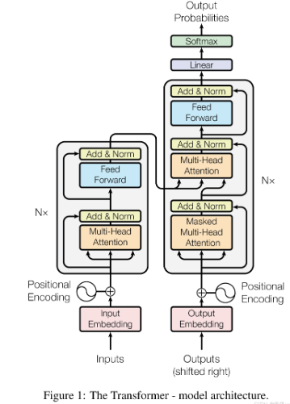

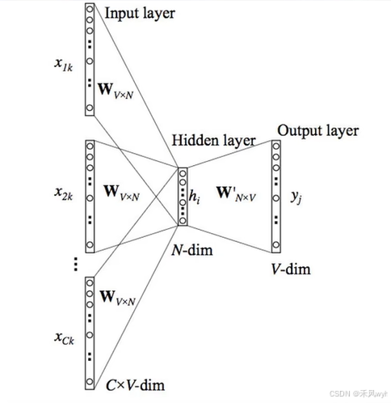

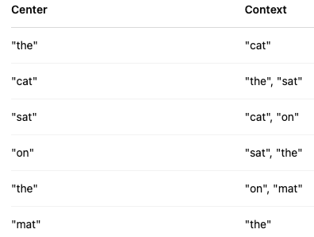

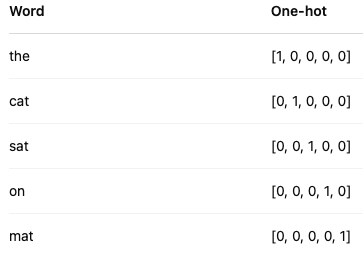

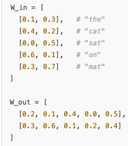

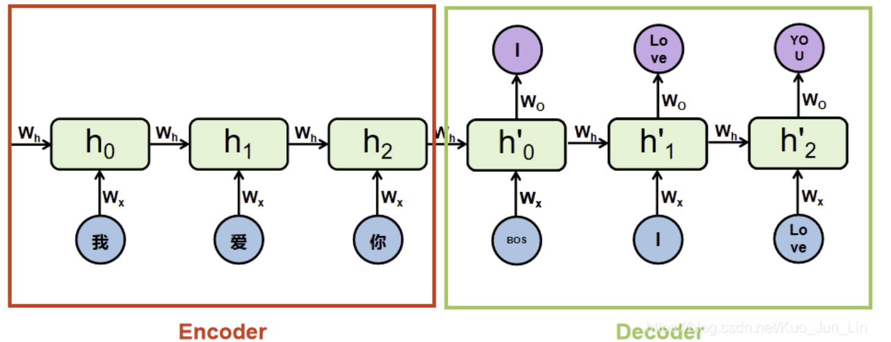

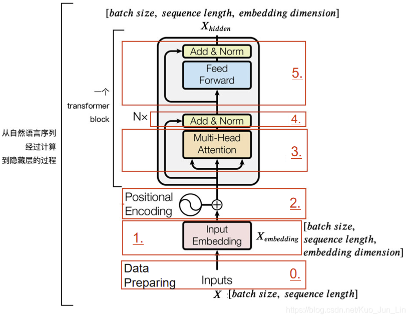

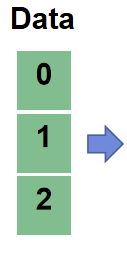

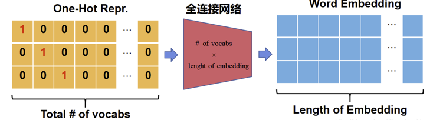

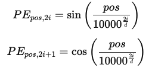

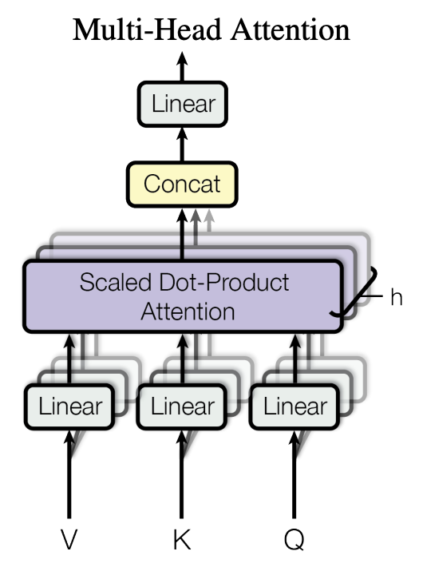

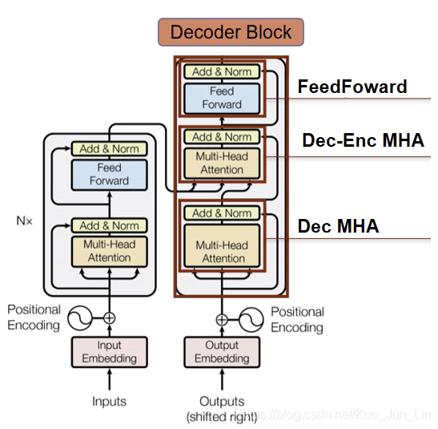

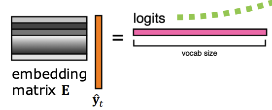

Use the figures to trace lookup, recurrent encoding, encoder self-attention, and decoder cross-attention. The factor $\sqrt d$ used for token embeddings in the original architecture is separate from the $1/\sqrt{d_k}$ factor used in attention scores.

## Check and extend

**Exercise.** With $d=512$, eight heads, and 20 tokens, what is one head's score matrix? It is $20\times20$, with each Q/K vector having width 64. The score matrix does not have width 64.

Training can compute all causal positions in parallel because the correct preceding tokens are available. Autoregressive generation still proceeds token by token unless an additional decoding method changes that workflow.

References: [Word2Vec](https://arxiv.org/abs/1301.3781), [attention for neural translation](https://arxiv.org/abs/1409.0473), [Transformer](https://arxiv.org/abs/1706.03762).
