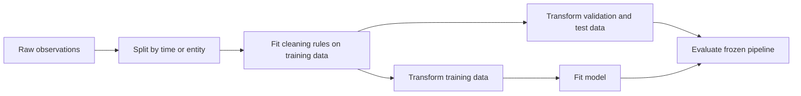

# Data cleaning: protect the meaning of the experiment

Data cleaning turns observations into reliable model inputs. Its goal is not to make every column look tidy. It is to preserve the meaning of an observation while preventing accidental access to information that would be unavailable at prediction time.

**Prerequisites:** know what one row represents and which outcome you want to predict. If neither is clear, cleaning rules will be guesses.

## Begin with a data contract

Record the unit of observation, identifier, timestamp, feature units, legal ranges, and target definition. For a daily demand forecast, “sales” and “demand” are different when inventory runs out. A missing value may mean “not measured,” “not applicable,” or “system failed.” Those mechanisms should not automatically receive the same replacement.

Inspect duplicates at the entity level. Two identical numerical rows might be genuine repeated measurements; two different rows for the same transaction might be a duplicate update. Removing duplicates without a key can discard real observations.

## Split before learning cleaning rules

Statistics such as a median, scaling mean, vocabulary, principal components, or feature-selection threshold must be fitted on the training partition. Apply those fitted rules to validation and test partitions. Refit the entire pipeline inside each cross-validation fold.



A useful question for each feature is: **Would this value exist when the prediction is made?** A refund timestamp cannot help predict whether a newly placed order will be refunded, even if the column is complete and correctly typed.

## Worked example: missing ages

Training ages are `[20, 30, None, 80]`; validation ages are `[None, 1000]`. The training median is 30. Fill the missing validation value with 30, not with a median recomputed from validation. The value 1000 requires a documented range check; it should not silently influence the imputation statistic.

```python
# runnable-example
from statistics import median
train = [20, 30, None, 80]
fill = median(x for x in train if x is not None)
valid = [None, 1000]
invalid = [x is not None and not 0 <= x <= 120 for x in valid]
assert fill == 30
assert invalid == [False, True]
```

A missingness indicator can preserve useful information, but it may also encode a collection process that changes after deployment. Evaluate both possibilities rather than interpreting missingness as inherently predictive.

## Imbalance is a modeling issue too

Do not “balance” the final test set merely to improve headline accuracy. Preserve the deployment population or explicitly report the population your estimate represents. Compare class weights, thresholds, and sampling methods against an appropriate precision–recall or cost-sensitive metric.

SMOTE constructs interpolated feature vectors. It can be inappropriate for unencoded categories, sparse text, time series, or constrained combinations. Any resampling belongs **inside the training fold**, after the split. Otherwise synthetic examples can leak information across folds.

## Going further

Version cleaning rules and monitor their effects: rejected-row rate, missingness by source, category drift, and the fraction of predictions using fallback values. A model that performs well only after dropping difficult production rows has an incomplete evaluation.

**Exercise:** a table contains a user's last purchase date calculated over the full dataset. Is it valid for predicting purchases last month? **Answer:** only if it is recomputed using information available at each historical prediction time.

Continue with [overfitting and leakage](overfitting.md), [metrics](metrics.md), and [Pandas](../pandas.md).

## Sources and further reading

- [scikit-learn: common pitfalls](https://scikit-learn.org/stable/common_pitfalls.html) documents leakage and pipeline isolation.
- [imbalanced-learn: leakage from resampling](https://imbalanced-learn.org/stable/common_pitfalls.html) illustrates incorrect evaluation practices.
