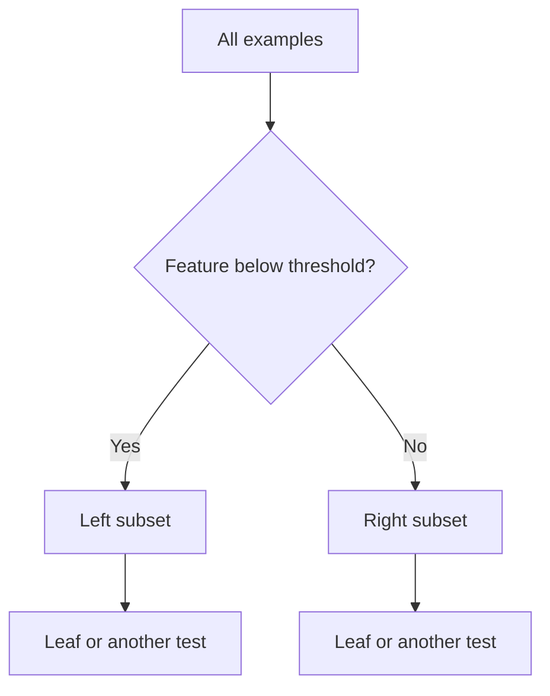

# 🌳 Decision trees: partition the feature space with questions

A decision tree predicts by following a sequence of feature tests. Each internal node asks a question such as “is temperature below 18?”; each leaf stores a prediction. Trees are useful when interactions and thresholds matter, and their paths provide a concrete way to explain individual decisions.

## ⚙️ How a split is chosen

Training searches candidate features and thresholds for a reduction in node impurity. For class proportions $p_k$, common measures are Gini impurity $1-\sum_kp_k^2$ and entropy $-\sum_kp_k\log_2p_k$. A pure node has zero impurity.

For parent node $P$ and children $L,R$, the reduction is

$$
\Delta I=I(P)-\frac{n_L}{n_P}I(L)-\frac{n_R}{n_P}I(R).
$$

The weights are **child count divided by parent count**. With sample weights, use weighted counts consistently. Reversing these fractions breaks the interpretation as average remaining impurity.

Regression trees commonly minimize squared prediction error within leaves, using the leaf mean as the prediction. Other criteria imply different leaf estimates.

## 🧩 Worked example

A parent contains six positive and four negative examples, so its Gini impurity is $1-0.6^2-0.4^2=0.48$. A candidate split creates a left child with four positives and no negatives, and a right child with two positives and four negatives. The weighted child impurity is $(4/10)0+(6/10)(4/9)=0.2667$. The reduction is approximately 0.2133.

```python
# runnable-example
def gini(counts):
    n = sum(counts)
    return 1 - sum((c / n) ** 2 for c in counts)
gain = gini([6, 4]) - 0.4 * gini([4, 0]) - 0.6 * gini([2, 4])
assert abs(gain - 0.2133333333333333) < 1e-12
```

This local improvement does not prove the final tree is globally optimal. Greedy training makes a sequence of locally attractive choices.

## 💡 Why trees overfit

Deep trees can isolate tiny groups or individual observations, fitting noise with very specific rules. Control maximum depth, minimum samples per leaf, or pruning strength using validation. A small data perturbation can change an early split and therefore a large part of the tree.



## 🚀 Going further

Axis-aligned splits create rectangular regions. A diagonal decision boundary may require many leaves. Monotonic rescaling of a numeric feature usually preserves candidate order, so standard scaling is less essential than for distance-based models. Missing-value support and categorical handling depend on the implementation; do not assume every tree library treats them identically.

Impurity-based feature importance can favor features with many possible split points. Correlated features can share or substitute for importance. Use held-out permutation analysis with awareness of correlations, and do not interpret predictive importance as causality.

**Exercise:** why might a tree with training accuracy 100% be worse than a depth-three tree? **Answer:** it may have used fine splits to memorize sample noise. Compare held-out performance and its uncertainty.

Continue with [random forests](random-forests.md), [gradient boosting](gradient-boosting.md), and [bagging versus boosting](bagging-boosting.md).

## 📚 Sources and further reading

- [scikit-learn: decision trees](https://scikit-learn.org/stable/modules/tree.html) documents criteria, pruning, and implementation limits.
- [scikit-learn: permutation importance](https://scikit-learn.org/stable/modules/permutation_importance.html) explains an alternative inspection method.
