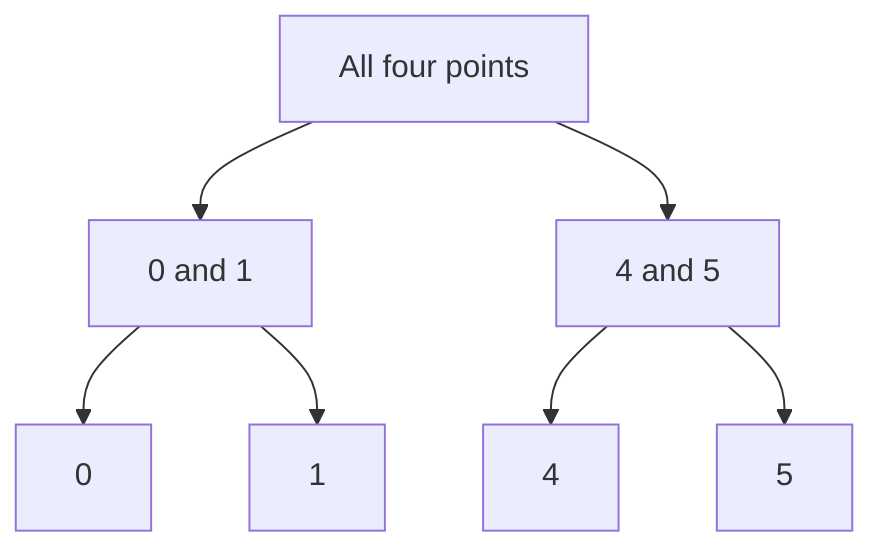

# 🗂️ Hierarchical clustering: inspect groups at several resolutions

Hierarchical clustering creates a nested family of groups instead of returning only one flat partition. A dendrogram records when clusters merge. Cutting that tree at a chosen level produces a partition, but the tree's shape depends strongly on the distance and linkage rule.

## 🧭 Agglomerative and divisive approaches

Agglomerative clustering begins with individual observations and repeatedly merges clusters. Divisive methods start with a large group and split it. In an agglomerative method, “merge the closest clusters” is incomplete until you define distance between two sets of points.

| Linkage | Distance or criterion | Characteristic behavior |
| --- | --- | --- |
| Single | Closest pair across clusters | Can connect groups through a thin chain |
| Complete | Farthest pair | Favors compact diameter; sensitive to extreme pairs |
| Average | Average cross-cluster distance | Balances across pairs |
| Ward | Increase in within-cluster squared error | Variance-based; ordinarily requires Euclidean geometry |

Ward linkage is not simply another way to average pairwise distances. It follows a specific variance-minimization criterion.

## 🧩 Worked example

For points `[0, 1, 4, 5]`, the nearest merges create `{0,1}` and `{4,5}`. Between those two clusters, single-link distance is 3, complete-link distance is 5, and average-link distance is $(4+5+3+4)/4=4$.

The same observations therefore produce different merge heights depending on linkage. Heights are not probabilities, and a tall gap does not automatically prove the existence of a natural class boundary.

This diagram shows nested membership, not a quantitatively scaled dendrogram. In a plotted dendrogram, merge heights carry the distance information.

## 🔍 Read the result carefully

Leaf order can change without changing the hierarchy. Adjacent leaves in a drawing are not necessarily the closest pair unless the merge structure says so. A flat clustering needs a cut rule, such as a target number of groups or a distance threshold, and those choices should be tied to the use case.

Scaling features changes distances. So do missing-value handling and the inclusion of irrelevant dimensions. A hierarchy computed from a poor representation can look visually convincing while being unhelpful.

## 🚀 Going further

Agglomerative decisions are usually irreversible: an early merge is not reconsidered globally. This makes noise, chaining, and local ambiguities consequential. Compare stability under resampling and inspect representative members of proposed groups.

Many implementations require substantial pairwise-distance work or memory as sample count grows. Connectivity constraints can restrict admissible merges and encode local structure, but they also change the clustering problem. If the graph is disconnected, examine how the implementation handles it.

**Exercise:** if one outlier is far from every other point, which linkage is particularly affected by its largest distances? **Answer:** complete linkage uses the farthest cross-cluster pair directly. Ward can also be sensitive through squared distances; the precise outcome depends on cluster sizes and geometry.

Continue with [DBSCAN](dbscan.md), [K-means](kmeans.md), and [distance-preserving embeddings](isomap.md).

## 📚 Sources and further reading

- [SciPy: hierarchical linkage](https://docs.scipy.org/doc/scipy/reference/generated/scipy.cluster.hierarchy.linkage.html) gives exact linkage definitions.
- [scikit-learn: hierarchical clustering](https://scikit-learn.org/stable/modules/clustering.html#hierarchical-clustering) describes connectivity constraints.
