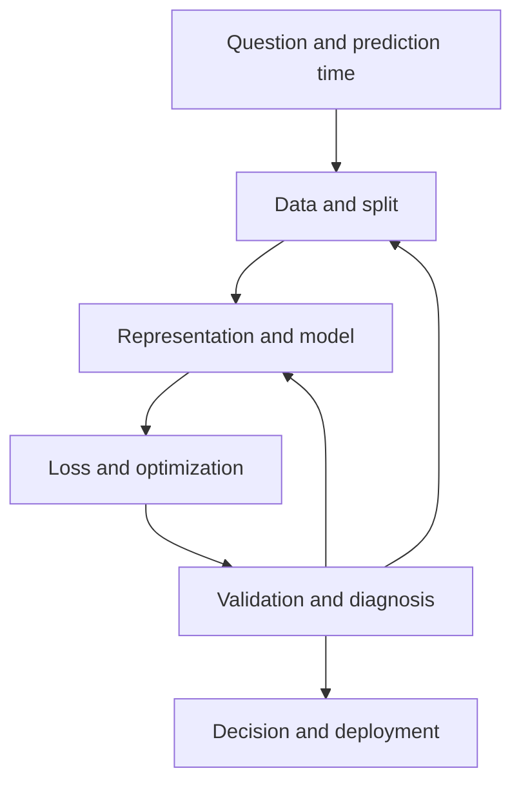

# 📐 Machine-learning foundations: build a model you can explain and evaluate

This section develops the tools needed to turn observations into reliable predictions. You do not need to memorize every algorithm before starting. Learn how a problem becomes a dataset, how an objective becomes an update, and how an evaluation can fail even when the code runs correctly.

## A beginner's route

Start with [learning paradigms](learning-paradigms.md), then define one row and one prediction target. Read [data cleaning](data-cleaning.md) before training: a leaking timestamp can matter more than the model family. Use [linear and logistic regression](linear-logistic.md) as transparent baselines, and learn [metrics](metrics.md) alongside [loss functions](loss-functions.md).

A useful first project is binary classification on a small tabular dataset. Establish a train/validation/test split, fit preprocessing only on training data, compare a baseline with a tree, and explain the confusion matrix at a chosen threshold. The deliverable is an understandable experiment, not just a high score.

## The conceptual map

The feedback arrows represent controlled experiments. They are not permission to repeatedly tune against the final test set.

## Choose a model family for a reason

| Situation | Start here | Main question |
| --- | --- | --- |
| Interpretable linear baseline | [Linear/logistic models](linear-logistic.md) | Is the representation adequate? |
| Nonlinear tabular interactions | [Trees](decision-trees.md), [forests](random-forests.md), [boosting](gradient-boosting.md) | How much complexity generalizes? |
| Similarity-based prediction | [k-NN](nearest-neighbors.md), [SVM](svm.md) | Does the distance or kernel make sense? |
| Sparse text baseline | [Naive Bayes](naive-bayes.md) | Are likelihood assumptions acceptable? |
| Unlabeled grouping | [K-means](kmeans.md), [DBSCAN](dbscan.md), [hierarchical clustering](hierarchical-clustering.md) | What does a group mean? |
| Compression or visualization | [PCA](pca.md), [LDA](lda.md), [t-SNE](tsne.md), [Isomap](isomap.md) | Which geometry or labels are preserved? |

## An advanced route

Revisit [covariance and bias–variance](covariance-correlation.md), [eigenvectors](eigenvectors.md), and [regularization](overfitting.md). Derive at least one objective rather than only calling its API. For trees, calculate an impurity reduction; for boosting, calculate a residual update; for PCA, explain the eigenvalue ratio.

Then study [activations](activation-functions.md), [optimizers](optimizers.md), and [normalization](dropout-batchnorm.md). Use [training diagnosis](training-challenges.md) and [experiment design](improving-networks.md) to connect equations to actual failures. Compare [XGBoost](xgboost.md) and [LightGBM](lightgbm.md) through measured trade-offs, not brand-level claims.

## A completion exercise

Take one dataset and report: the prediction time; information available then; split strategy; baseline; training objective; validation metric; chosen threshold; major error slices; and runtime cost. Explain one experiment that failed and what it ruled out.

If you can defend those choices, you have a stronger foundation than someone who can list many algorithms but cannot detect leakage or interpret an uncertainty estimate. Next, continue to [language models](../llm/index.md), [SQL](../sql.md), and [Pandas](../pandas.md).

## Sources and further reading

- [scikit-learn user guide](https://scikit-learn.org/stable/user_guide.html) provides the algorithm and evaluation reference used throughout this section.
- [Stanford CS229 materials](https://cs229.stanford.edu/materials.html) develop mathematical foundations.
