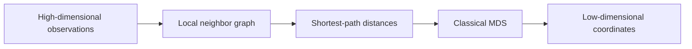

# 🗺️ Isomap: unfold a curved space using neighborhood paths

Isomap seeks a low-dimensional representation that preserves distances **along a manifold** rather than straight-line distances through the surrounding space. A rolled sheet illustrates the motivation: points on different layers of the roll can be close in three-dimensional space yet far apart along the sheet.

## 🔄 Three stages

First, build a graph connecting nearby observations, using either a fixed neighbor count or a radius. Weight edges by local distances. Second, compute shortest-path distances on this graph as approximations to geodesic distances. Third, use classical multidimensional scaling (MDS) to embed those distances.

The graph is the critical approximation: it decides which local movements are valid. Too few edges disconnect the data; too many create shortcuts across folds.

## 🧩 Worked intuition

Imagine points sampled along a U-shaped curve. The two tips are close across the opening but far apart when traveling around the U. A well-chosen local graph follows the curve and preserves the long path. If the neighborhood radius connects the two tips directly, the estimated geodesic distance collapses and the unfolding can fail.

This explains why a neighbor count cannot be chosen solely from dataset size. Sampling density, noise, and local curvature matter.

## 📌 What classical MDS actually computes

Given squared graph distances $D^{\circ2}$ and centering matrix $H=I-\mathbf1\mathbf1^T/n$, classical MDS forms

$$
B=-\frac12HD^{\circ2}H.
$$

Its leading positive eigenvalues and eigenvectors yield coordinates. This is a spectral construction. Describing it simply as directly minimizing raw pairwise-distance squared error conflates classical MDS with other stress-based formulations.

Large negative eigenvalues can indicate that the supplied distances are not well represented by Euclidean coordinates. Keeping only a few positive directions is an approximation, not a guarantee of perfect unfolding.

## 🚀 Going further

Isomap assumes that local neighborhoods and graph paths approximate meaningful manifold geometry. Holes, disconnected components, nonuniform sampling, and noise can all complicate that assumption. A visually plausible embedding does not prove the existence of the inferred manifold.

All-pairs shortest paths and dense distance representations can be expensive. The practical cost depends on graph sparsity, sample count, solver, and implementation. Some libraries provide an out-of-sample transform using the fitted structure, but this does not make arbitrary extrapolation reliable.

Compare results across neighborhood choices and inspect whether local graph connections cross semantic boundaries. If the desired downstream task is classification, evaluate that task directly; geometric preservation and label separation are different objectives.

## ✅ Check your understanding

**Question:** why can adding graph edges make Isomap worse? **Answer:** a shortcut can underestimate true along-manifold distance, distorting many shortest paths simultaneously.

**Exercise:** what happens if a local graph has two disconnected components? **Answer:** some graph distances are infinite or require implementation-specific repairs. Inspect and address the graph rather than blindly trusting the resulting coordinates.

Continue with [eigenvectors](eigenvectors.md), [PCA](pca.md), and [t-SNE](tsne.md).

## 📚 Sources and further reading

- [Tenenbaum, de Silva, and Langford: Isomap](https://web.mit.edu/cocosci/Papers/sci_reprint.pdf) introduces geodesic-distance preservation.
- [scikit-learn: Isomap](https://scikit-learn.org/stable/modules/manifold.html#isomap) explains the implementation stages and complexity.
