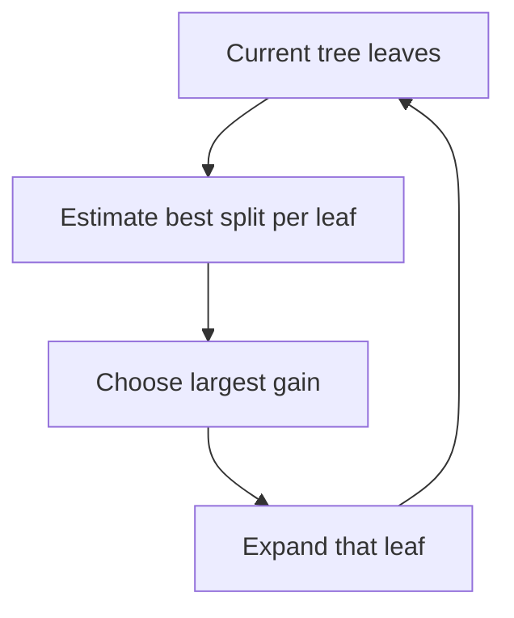

# 💡 LightGBM: make tree boosting efficient at scale

LightGBM belongs to the gradient-boosted decision-tree family. Its distinguishing ideas concern how candidate splits, samples, and features are processed efficiently. They do not remove the need for a suitable loss, representative validation data, and regularization.

## 🧭 Histogram splitting

Continuous features are discretized into bins. Instead of examining every distinct raw value at each node, the algorithm accumulates statistics per bin and searches bin boundaries. This reduces memory and split-search work, at the cost of approximating threshold locations.

A feature with one million distinct values might use a few hundred bins. The best exact threshold may lie inside a bin, so bin count is a speed–resolution trade-off. It also affects reproducibility across dataset construction choices.

## 🧩 Leaf-wise growth

Leaf-wise, or best-first, growth expands the leaf with the largest estimated loss reduction. At a fixed number of leaves, this can reduce training loss efficiently, but it may produce an unbalanced deep tree. Control leaf count, minimum leaf data, depth limits where appropriate, and regularization.

This is not proof that LightGBM always outperforms level-wise methods. XGBoost also supports more than one growth policy, and implementation settings matter.

## 🧩 Worked example: which leaf grows?

Suppose three current leaves have best split gains 0.8, 3.2, and 0.4. Best-first growth expands the second leaf. If it contains very few examples, the apparent gain may be noise; minimum-data or Hessian constraints can reject the split. A large training gain is not a substitute for validation improvement.

## 🚀 GOSS and EFB

Gradient-based One-Side Sampling (GOSS) retains large-gradient examples and samples some small-gradient examples, with correction weights used in estimating gains. The goal is to retain informative training statistics while reducing work. Large gradients are not always valuable examples: mislabeled or corrupted observations can also have large gradients.

Exclusive Feature Bundling (EFB) packs sparse features that rarely or never take nonzero values simultaneously. This reduces the effective feature-processing burden. It is not arbitrary dimensionality reduction and does not imply that correlated dense columns can simply be merged without loss.

These are documented techniques and configurable behavior, not assumptions that every LightGBM run automatically uses every optimization in the same way.

## 🚀 Going further

Begin with a modest leaf budget and a validation-based stopping rule. Jointly tune learning rate and number of rounds. For sparse high-dimensional data, inspect whether sparsity and feature structure actually match the intended optimizations. For small datasets, constrain leaves strongly and compare with simpler models.

Training speed depends on sample count, feature count, bins, sparsity, hardware, threading, and configuration. Benchmark end-to-end time, including dataset construction, instead of repeating a general claim that one package is faster.

**Question:** why can increasing the number of bins improve fit but cost more memory? **Answer:** it gives the split search finer threshold resolution while increasing histogram storage and processing.

Continue with [XGBoost](xgboost.md), [decision trees](decision-trees.md), and [overfitting](overfitting.md).

## 📚 Sources and further reading

- [LightGBM features](https://lightgbm.readthedocs.io/en/stable/Features.html) explains histograms and leaf-wise growth.
- [LightGBM paper](https://proceedings.neurips.cc/paper/2017/hash/6449f44a102fde848669bdd9eb6b76fa-Abstract.html) introduces GOSS and EFB.
