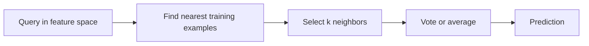

# k-nearest neighbors: predict from nearby labeled examples

k-nearest neighbors (k-NN) is a supervised method: it stores labeled examples and predicts using the labels of nearby observations. It is not a clustering algorithm. Most of its modeling assumptions are hidden in the representation, distance metric, and neighborhood rule.

## The prediction procedure

For a query $x$, find the $k$ closest training observations. Classification aggregates their labels, possibly weighted by distance; regression averages their target values. There may be little parameter fitting, but prediction can be expensive because neighbor search is real computation.

Euclidean distance makes a particular assumption about geometry. A feature measured in thousands can dominate one measured in tenths. Standardize or otherwise transform features according to their meaning, fitting those transformations on training data only.

## Worked example

Three neighbors of a query have distances `[0.1, 0.2, 1.0]` and labels `[A, B, B]`. Uniform voting predicts B. Inverse-distance weights `[10, 5, 1]` give A total weight 10 and B total weight 6, so weighted voting predicts A.

Neither answer is automatically correct: the weighting rule changes the model. Define behavior at zero distance, where a naive inverse-distance formula would divide by zero.

For regression with neighbor targets `[10, 14, 30]`, uniform averaging gives 18. A far-away outlier can influence this prediction, motivating careful distance and weighting choices.

## Choosing the neighborhood size

Small $k$ produces a flexible boundary that can follow noise. Large $k$ smooths across more observations but may mix genuinely different populations. Select $k$ using a valid validation split, not a rule that an odd number is always best. Odd $k$ avoids a simple two-class equal-vote tie, but multiclass ties and distance ties can still occur.

## Going further: high dimensions and scale

As dimensionality grows, distances can become less discriminative and data become sparse relative to the space. Irrelevant dimensions can swamp meaningful neighborhoods. Feature selection or a learned embedding may matter more than changing $k$.

Brute-force search, tree indexes, and approximate neighbor search trade memory, preprocessing, and query cost. Approximation can change the neighbor set, so measure the effect on prediction quality as well as search recall. Dense embeddings used for retrieval also require a deliberate similarity choice, such as cosine similarity or normalized inner product.

Store only appropriate training data and account for updates: retaining all historical examples may be expensive and can preserve outdated relationships. Avoid leakage from nearly duplicate items or the same entity on both sides of the split.

**Exercise:** why is evaluating a 1-NN classifier on its own training rows misleading? **Answer:** each row can retrieve itself at distance zero, producing memorization rather than evidence of generalization.

Continue with [K-means](kmeans.md) to contrast supervised neighbors with unsupervised centers.

## Sources and further reading

- [scikit-learn: nearest neighbors](https://scikit-learn.org/stable/modules/neighbors.html) explains classifiers, regressors, and search algorithms.
- [scikit-learn: scaling example](https://scikit-learn.org/stable/auto_examples/preprocessing/plot_scaling_importance.html) illustrates why units matter.
