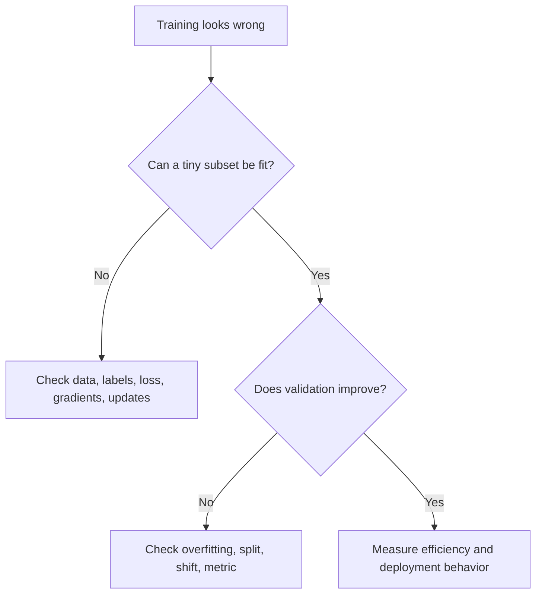

# Neural-network training challenges: diagnose the failure mode

When training fails, changing the architecture is often the most expensive first move. Start by deciding whether the problem is data, objective, implementation, optimization, generalization, or deployment mismatch. Similar-looking loss curves can have different causes.

## Establish that the experiment can learn

Use a tiny, fixed dataset with augmentation and strong regularization temporarily disabled. A sufficiently expressive model should fit a small consistent task. If it cannot, inspect target alignment, tensor shapes, loss reduction, frozen parameters, and whether optimizer updates actually occur.

A language-model example is off-by-one alignment: the logit at position $t$ usually predicts token $t+1$ under a next-token objective. Training a model to reproduce the token already visible at the same position can yield an impressive but meaningless loss.

## Vanishing and exploding gradients

Backpropagation multiplies local Jacobians. Repeated contractions can make a distant gradient tiny; repeated amplification can make it huge. Saturating activations, depth, recurrent transitions, initialization, and numerical precision all affect this product.

Inspect norms by layer rather than only a global average. Residual connections provide shorter routes for signal propagation; suitable initialization and normalization help preserve useful scales. Gradient clipping limits an update's magnitude but does not repair incorrect labels or guarantee that a recurrent network learns long dependencies.

A global norm clip with threshold $c$ replaces gradient $g$ by $g\min(1,c/\|g\|)$. If $\|g\|=20$ and $c=5$, every component is scaled by 0.25. The direction is preserved; clipping coordinates independently would generally change it.

## Numerical failures

NaNs may originate in the forward pass before gradients exist: division by zero, log of a nonpositive value, exponent overflow, or invalid masking can all cause them. Find the first nonfinite tensor. Combined logits-based losses avoid many avoidable instabilities.

In mixed precision, small gradients may underflow and large activations may overflow. Loss scaling addresses some gradient underflow, not every overflow. Different floating-point formats have different exponent ranges and significand precision; “16-bit” alone is not a sufficient diagnosis.

## Separate optimization from generalization

High training and validation error can indicate insufficient capacity, poor optimization, wrong features, or noisy targets. Lowering the learning rate and training longer is not always the answer: too-small steps may already be the problem.

Low training error with high validation error calls for a split audit, learning curves, regularization, or more representative data. A low validation score alone does not identify which intervention is appropriate. See [overfitting](overfitting.md).

## Going further

Measure the actual training loop: examples or tokens per second, time waiting for data, accelerator utilization, peak memory, and communication time. Gradient checkpointing exchanges recomputation for activation memory. Larger batches may improve hardware efficiency while changing optimization and reducing the number of updates for a fixed epoch count.

**Exercise:** the loss is constant and every gradient is `None`. Would gradient clipping help? **Answer:** no. Investigate detached tensors, disabled gradient tracking, frozen parameters, or a loss disconnected from trainable weights.

## Sources and further reading

- [PyTorch: autograd mechanics](https://docs.pytorch.org/docs/stable/notes/autograd.html) explains graph construction.
- [Deep Residual Learning](https://arxiv.org/abs/1512.03385) motivates residual paths.
- [PyTorch: automatic mixed precision examples](https://docs.pytorch.org/docs/stable/notes/amp_examples.html) covers scaling and accumulation.
