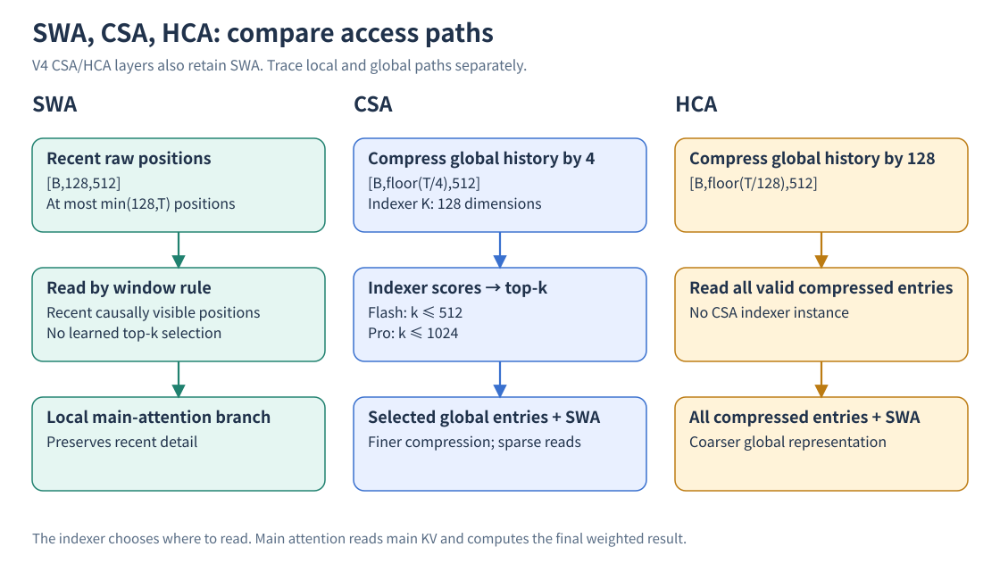

# 🔎 SWA, CSA, HCA, and indexers: what a query actually reads

Separate **what the cache retains** from **which positions a query reads**. SWA bounds a recent window; CSA/HCA compress global history; an indexer selects useful candidate positions.

This page follows DeepSeek-V4, then contrasts GLM DSA and V4.1 CSA2.

??? note "Configuration and implementation sources"

    Mechanisms follow [DeepSeek-V4 §2.3](https://arxiv.org/html/2606.19348v1#S2.SS3) and the pinned [official implementation](https://huggingface.co/deepseek-ai/DeepSeek-V4-Flash/blob/60d8d70770c6776ff598c94bb586a859a38244f1/inference/model.py). Values refer to this reference's [Flash/Pro configs](deepseek-v4.md), rather than universal parameters for every model using these terms.

## 🗺️ Four responsibilities

<figure class="model-figure" markdown="1">

<figcaption markdown="span">These are access paths. V4 CSA/HCA layers also retain an SWA branch; they are not three mutually exclusive layer components.</figcaption>

</figure>

| Term | Question | V4 implementation |
| --- | --- | --- |
| SWA: Sliding Window Attention | How is recent detail retained? | Read up to 128 recent positions |
| CSA: Compressed Sparse Attention | How can finer global history be read sparsely? | Compress by 4, then select top-k with an indexer |
| HCA: Heavily Compressed Attention | How can global coverage remain inexpensive? | Compress by 128, then read all completed compressed entries |
| Indexer | Which candidate positions are worth reading? | Score smaller queries/keys and return position IDs |

## 🪟 SWA: retain a recent window

### Positions read

Read the most recent causally visible window. A window of 128 reads at most `min(128,T)` local positions; a short prefix does not invent 128 valid tokens.

### State retained

V4 local state uses shared latent KV with logical window `[B,128,512]`. It does not store a complete K/V pair separately for every query head.

Reference decode updates a ring buffer. Raw local KV can leave that window while extra compressed global paths still represent older history.

## 🧩 CSA: compress, then select

### One query's path

1. **Compress history.** Project and gate-pool groups of hidden states into a shorter global KV sequence.

2. **Score candidates.** An indexer uses smaller queries/keys to assess compressed positions.

3. **Select top-k.** Keep up to k causally valid compressed position IDs.

4. **Run main attention.** The main query reads the SWA window and selected compressed KV.

V4 uses ratio 4 here. The learned gated compressor includes overlapping groups; it is not simply subsampling every fourth token or taking a fixed average.

### Which dimension shrinks?

Let completed compressed-entry count be $M_4=\lfloor T/4\rfloor$:

| Object | Logical shape |
| --- | --- |
| Global main KV | `[B,M4,512]` |
| Index keys | `[B,M4,128]` |
| Main query | Flash `[B,S,64,512]`; Pro `[B,S,128,512]` |
| Selected IDs | `[B,S,min(k,M4)]`, additionally subject to each query's causal boundary |

The k caps are 512 for Flash and 1024 for Pro. Top-k limits **this query's reads**; unselected compressed entries may remain cached for future queries.

## 🗜️ HCA: compress more, then read globally

HCA trades greater compression for a shorter global sequence. These V4 configs use ratio 128 and main global shape `[B,floor(T/128),512]`.

This path does not instantiate CSA's learned indexer. It reads all completed, causally valid compressed entries together with local SWA positions.

**No indexer does not mean no global information.** HCA represents global history more coarsely, whereas CSA selects a few positions from a finer compressed history.

## 🔎 An indexer outputs addresses, not the final attention result

### Reference computation

1. Project the low-rank Q state into index queries: V4 uses `[B,S,64,128]`.

2. Represent compressed history as index keys `[B,M4,128]`.

3. Compute per-head relevance, apply ReLU and head weights, and combine into `[B,S,M4]` scores.

4. Mask invalid/future positions and return top-k IDs; main attention reads the 512-dimensional main KV at those positions.

The indexer's 128-dimensional key is distinct from 512-dimensional main KV. Selection determines where to read; main attention performs the final content weighting.

!!! note "Sparse main attention still has selection costs"

    A fixed main-attention read budget does not remove scoring over a growing candidate sequence. Account separately for compression, scoring, top-k, main attention, and cache access.

## 🧮 Worked example: T = 65536

Assume complete compression groups and a current query that can see them all. This counts positions rather than reporting bandwidth or latency.

| Path | Global retained entries | Maximum main-attention reads |
| --- | ---: | --- |
| SWA only | No global branch | 128 local positions |
| Flash CSA | 65536 / 4 = 16384 | 128 local + 512 selected compressed positions |
| Pro CSA | 16384 | 128 local + 1024 selected compressed positions |
| HCA | 65536 / 128 = 512 | 128 local + all 512 compressed positions |

Flash CSA and HCA can both read 640 positions here, with different information granularity and selection costs. Equal position counts do not establish equal quality, arithmetic, or latency.

## 🔄 Back to GLM, V4, and V4.1

| Model | Indexer candidates | Cross-layer reuse |
| --- | --- | --- |
| GLM-5.1 DSA | Index keys corresponding to historical tokens | Independent indexers |
| GLM-5.2 IndexShare | Index keys corresponding to historical tokens | Top-k selection; main MLA KV remains per-layer |
| V4 CSA | Ratio-4 compressed positions | Per-layer cache ownership in these V4 configs |
| V4 HCA | No learned top-k selection | Read heavily compressed global entries |
| V4.1 CSA2 | Shared global positions generated by source layers | Main KV, index keys, and/or selection have distinct reuse rules |

V4.1 Full/Reindex/Reuse describes resource responsibilities, rather than V4's alternating 4/128 ratios. See [V4.1 ownership](deepseek-v4-1.md) and [GLM-5.2 IndexShare](glm-5-2.md) for exact layer maps.

## 📌 Read a config in this order

1. Identify the layer's local and global paths.

2. Check compression ratios, valid lengths, and incomplete-group state.

3. Check whether an indexer exists and whether k selects raw positions or compressed entries.

4. Identify owners and aliases for main KV, index keys, and selected IDs.

5. Calculate main-attention reads, cache bytes, and execution costs separately.

Continue with [V4 Flash/Pro](deepseek-v4.md) for layer placement and projections, or [layerwise execution](../ml/llm/inference/layerwise-inference.md) for consumption and transfer dependencies.
