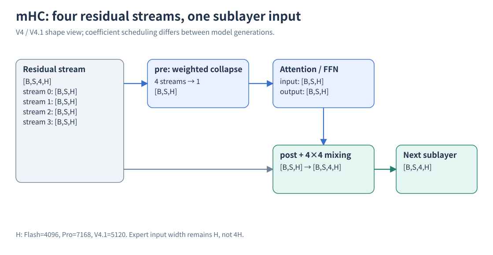
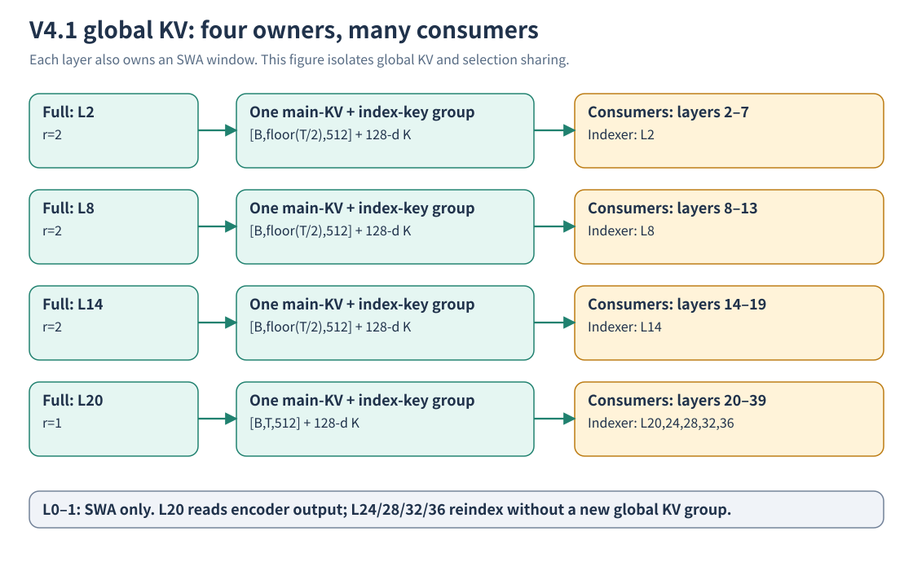
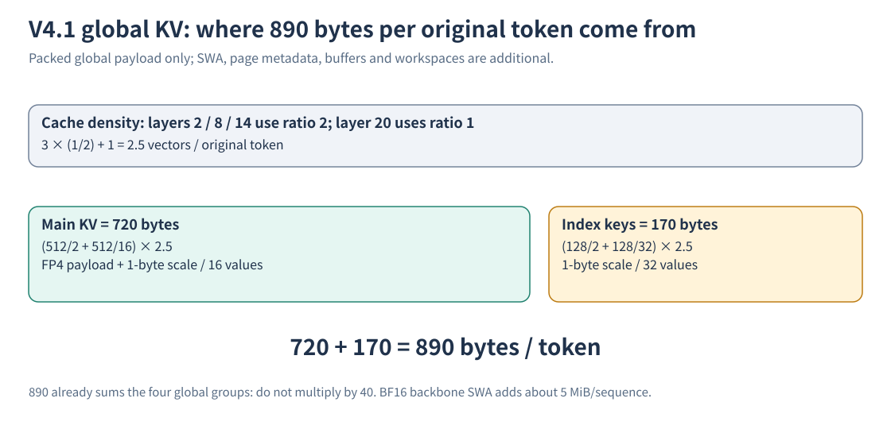
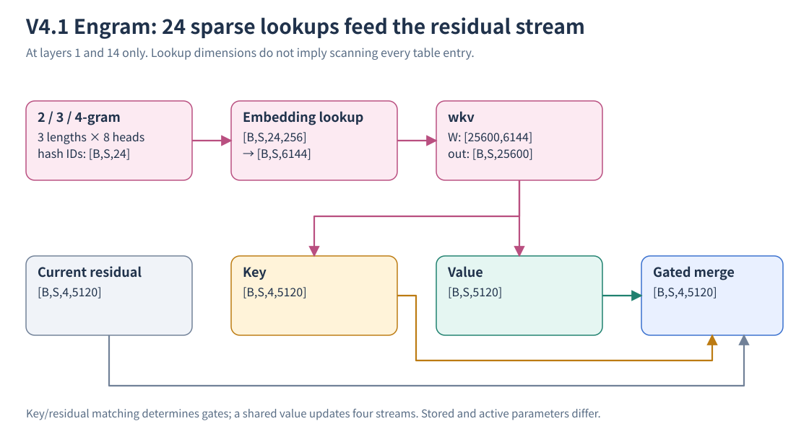
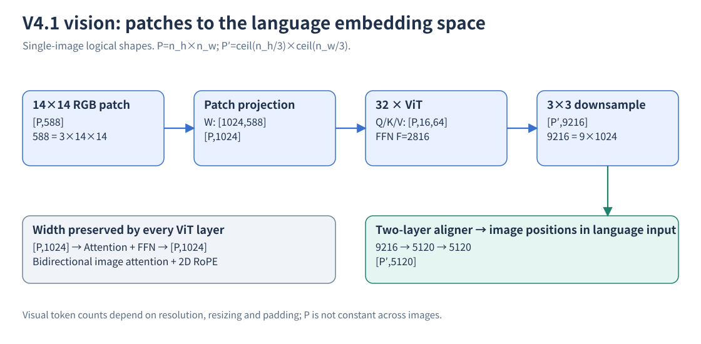
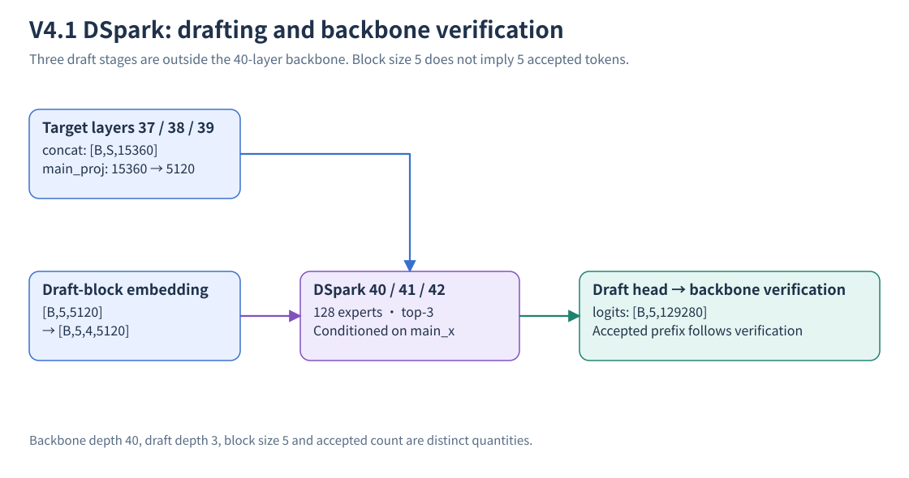

# 🧠 DeepSeek-V4.1 Flash: CED, shared KV, Engram, and vision shapes

V4.1 Flash centers on **CED and cross-layer KV sharing**. Start with its 40-layer text backbone, then inspect Engram, the vision encoder, and DSpark separately.

??? note "Pinned configuration, implementation, and scope"

    This page pins the [official V4.1-Flash config](https://huggingface.co/deepseek-ai/DeepSeek-V4.1-Flash/blob/314113f8a7dadb388215396ba5fbee2c610a04d6/config.json) and matching [text reference implementation](https://huggingface.co/deepseek-ai/DeepSeek-V4.1-Flash/blob/314113f8a7dadb388215396ba5fbee2c610a04d6/inference/model.py). The checked Flash-1017 config is equal, without establishing equal weights. No guessed V4.1-Pro dimensions are supplied.

## 🗺️ More than a width change from V4

| Setting | Configuration |
| --- | --- |
| Text backbone / H / vocabulary | 40 layers / 5120 / 129280 |
| CED placement | Causal encoder 0–19, decoder 20–39 |
| Main Q heads / width / Q rank | 64 / 512 / 1280 |
| O groups / rank per group | 8 / 1024 |
| Routed experts / top-k / shared / F | 384 / 6 / 1 / 2304 |
| SWA window / mHC expansion | 128 / 4 |
| Main KV sources | 2, 8, 14, 20 |
| Indexer execution layers | 2, 8, 14, 20, 24, 28, 32, 36 |
| Index heads / width / top-k | 32 / 128 / 512 |
| Engram layers / extra DSpark layers | 1, 14 / 3 |
| Vision backbone | 32 layers, H=1024, 16 heads, FFN=2816, patch=14 |

The official **Causal Encoder–Decoder (CED)** provides decoder global KV from final encoder states, rather than generating a separate global cache from each decoder layer. This changes data dependencies; it is not simply renaming a decoder-only model or importing a conventional bidirectional translation encoder. See the [official model card](https://huggingface.co/deepseek-ai/DeepSeek-V4.1-Flash/blob/314113f8a7dadb388215396ba5fbee2c610a04d6/README.md).

## 📐 Main projections in each text layer

<figure class="model-figure" markdown="1">

</figure>

Inter-layer residuals are `[B,S,4,5120]`, while sublayer input/output is `[B,S,5120]`. Attention/FFN mHC projections each have shape `[24,20480]`. Single-Pass mHC uses computed mixing coefficients in subsequent sublayers; do not copy V4's execution order unchanged.

| Module | Logical weight / activation |
| --- | --- |
| Embedding / untied head | Each `[129280,5120]` |
| `wq_a` / Q norm / `wq_b` | `[1280,5120]` / `[1280]` / `[32768,1280]` |
| Q and attention output | `[B,S,64,512]`; last 64 dimensions are RoPE |
| Local `wkv` / KV norm | `[512,5120]` / `[512]` |
| Grouped `wo_a` | Storage `[8192,4096]`, operation `[8,1024,4096]` |
| `wo_b` | `[5120,8192]` |
| Router | `[384,5120]`; scores `[N,384]`, selected IDs/weights `[N,6]` |
| One expert gate/up → down | Each `[2304,5120]` → `[5120,2304]` |
| Shared expert | One matching F/H expert processing every token |

Every layer retains its own recent SWA KV, while only a few layers own **global** KV. The global projection/compressor is also separate from local `wkv`.

## 🔎 CSA2: Full, Reindex, and Reuse

<figure class="model-figure" markdown="1">

<figcaption markdown="span">Figure: layers 20–39 share one global KV group; layers 24, 28, 32, and 36 only reselect positions. Per-layer SWA windows remain separate.</figcaption>

</figure>

| Layers / mode | Produce global KV / index keys? | Recompute top-k? | Global KV used |
| --- | --- | --- | --- |
| 0, 1: SWA | No global path | No | None |
| 2, 8, 14: Full | Yes, sequence ratio 2 | Yes | New local cache group |
| 20: Full | Yes, ratio 1, from encoder output | Yes, plus candidate blocks | Layer 20's group |
| 24, 28, 32, 36: Reindex | Reuse shared keys | Yes | Layer 20's group |
| Other layers: Reuse | No | Reuse latest index source | Latest Full layer's group |

Main global KV shapes are `[B,floor(T/2),512]` at layers 2, 8, and 14, and `[B,T,512]` at layer 20. Matching index keys have the same sequence lengths and width 128; only four owners hold them. Index queries are `[B,S,32,128]`, with `wq_b=[4096,1280]`; owners derive index keys from latents using `wk=[128,512]`.

Layer 20 selects at most 2048 candidate blocks of 8 positions. Deeper Reindex layers select top-512 inside this pool. `Full` identifies resource-producing layers, not dense attention over all history. `Reuse` does not skip a layer's Q, SWA, or FFN.

## 🧮 Deriving 890 bytes per token

<figure class="model-figure" markdown="1">

</figure>

In the documented packed format, main KV uses one byte of scale per 16 FP4 values, and index keys use one per 32 FP4 values. Four cache groups contribute `3/2+1=2.5` vectors per original token:

$$b_{main}=(512/2+512/16)\times2.5=720,$$
$$b_{index}=(128/2+128/32)\times2.5=170.$$

Total global payload is **890 bytes per original token**. It excludes SWA, compressor state, allocation rounding, routing/page metadata, and DSpark state; do not multiply it by 40 again. This is a derivation from dimensions and quantization format; reference numerical simulation can retain unpacked buffers. The [model card](https://huggingface.co/deepseek-ai/DeepSeek-V4.1-Flash/blob/314113f8a7dadb388215396ba5fbee2c610a04d6/README.md) reports the same global payload figure.

If all 40 backbone `[B,128,512]` SWA windows remain BF16-resident, B=1 uses **5 MiB**, without linear growth with history length. Bounded replay can rebuild recent SWA state; retention, offloading, and replay depend on execution. Window state still needs accounting.

## 🗃️ Engram conditional memory at layers 1 and 14

<figure class="model-figure" markdown="1">

</figure>

### Start with the two tables

| Layer | Embedding shape |
| --- | --- |
| 1 | `[384006168,256]` |
| 14 | `[384016682,256]` |

Together they hold **196,613,849,600 logical parameters**. Eight Engram heads are distinct from the 384 MoE experts.

### Follow one lookup

1. **Hash addresses:** hash 2/3/4-grams across eight heads, giving 24 addresses.

2. **Read and flatten:** `[B,S,24,256]` becomes `[B,S,6144]`.

3. **Project keys and values:** `wkv=[25600,6144]` produces key `[B,S,4,5120]` and value `[B,S,5120]`.

4. **Gate the update:** matching against the residual stream updates `[B,S,4,5120]`.

A token accesses selected rows rather than traversing all 196.6B table elements. The [official Engram implementation](https://huggingface.co/deepseek-ai/DeepSeek-V4.1-Flash/blob/314113f8a7dadb388215396ba5fbee2c610a04d6/inference/engram.py) defines hashing/layout; text model code defines projections and gating.

### Keep parameter counts separate

- **Backbone:** the model card's 552B backbone count.

- **Conditional memory:** roughly 196B Engram parameters; weight-file totals can include auxiliary modules.

- **Per-token activity:** the card reports 8B prefill / 16B decode under its CED execution model.

These counts differ from quantized storage bytes. A reference script's scheduling is not automatically the production optimum.

## 🖼️ Per-layer vision shapes

<figure class="model-figure" markdown="1">

</figure>

For one image with `n_h×n_w` 14×14 patches, let P be patch count and `P'=ceil(n_h/3)×ceil(n_w/3)`. Resizing and resolution make P dynamic; a fixed visual-token count does not describe every image.

| Vision module | Weight / output |
| --- | --- |
| Patch projection | `[1024,588]`, 588=3×14×14; `[P,588] → [P,1024]` |
| ViT layers 0–31: QKV / O | `[3072,1024]` / `[1024,1024]`; Q/K/V each `[P,16,64]` |
| ViT layers 0–31: fused gate+up / down | `[5632,1024]` / `[1024,2816]`; each branch width 2816 |
| ViT layer input/output and final norm | `[P,1024]`, norm `[1024]` |
| 3×3 pixel-unshuffle | `[P,1024] → [P',9216]`, with boundary padding |
| Two-layer aligner | `[5120,9216]` → `[5120,5120]`; output `[P',5120]` |

ViT uses image-local bidirectional attention and 2D RoPE. Visual embeddings replace image positions in the language sequence before the backbone. This table uses single-image reference views; a batched backend may add B. See [official vision code](https://huggingface.co/deepseek-ai/DeepSeek-V4.1-Flash/blob/314113f8a7dadb388215396ba5fbee2c610a04d6/inference/vision.py).

## ⏩ Three DSpark layers are auxiliary

<figure class="model-figure" markdown="1">

</figure>

Separate three configuration quantities:

- **Draft depth:** prediction layers 40–42, or three extra stages.

- **Draft block size:** five positions.

- **Backbone taps:** target layers `[37,38,39]`.

Follow the draft shapes in order:

1. Concatenate the three tapped hidden states to width **15360**.

2. Apply `main_proj=[5120,15360]`; draft hidden states can be `[B,5,4,5120]`.

3. Use **128 experts with top-3** in the draft network, versus backbone 384/top-6.

4. Produce `[B,5,129280]` logits, then verify and accept drafts.

The final three zero compression ratios belong to prediction stages, outside the 40-layer backbone. **Accepted-token count** follows verification rather than draft depth or block size. See [speculative decoding](../ml/llm/inference/multi-token-prediction.md).

## 🪜 Complete text backbone map

<!-- BEGIN GENERATED LAYERS deepseek-v4-1-flash -->
??? info "DeepSeek-V4.1-Flash · 40 backbone layers"

    | Layer | Four-stream residual in/out | Attention | FFN | Global KV owner / valid length | Indexer source |
    | --- | --- | --- | --- | --- | --- |
    | 0 | `[B,S,4,5120]` | SWA | MoE | — | — |
    | 1 | `[B,S,4,5120]` | SWA | MoE + Engram | — | — |
    | 2 | `[B,S,4,5120]` | CSA2 Full, r=2 | MoE | L2: `[B,floor(T/2),512]` | L2; K from L2 |
    | 3 | `[B,S,4,5120]` | CSA2 Reuse, r=2 | MoE | L2: `[B,floor(T/2),512]` | L2; K from L2 |
    | 4 | `[B,S,4,5120]` | CSA2 Reuse, r=2 | MoE | L2: `[B,floor(T/2),512]` | L2; K from L2 |
    | 5 | `[B,S,4,5120]` | CSA2 Reuse, r=2 | MoE | L2: `[B,floor(T/2),512]` | L2; K from L2 |
    | 6 | `[B,S,4,5120]` | CSA2 Reuse, r=2 | MoE | L2: `[B,floor(T/2),512]` | L2; K from L2 |
    | 7 | `[B,S,4,5120]` | CSA2 Reuse, r=2 | MoE | L2: `[B,floor(T/2),512]` | L2; K from L2 |
    | 8 | `[B,S,4,5120]` | CSA2 Full, r=2 | MoE | L8: `[B,floor(T/2),512]` | L8; K from L8 |
    | 9 | `[B,S,4,5120]` | CSA2 Reuse, r=2 | MoE | L8: `[B,floor(T/2),512]` | L8; K from L8 |
    | 10 | `[B,S,4,5120]` | CSA2 Reuse, r=2 | MoE | L8: `[B,floor(T/2),512]` | L8; K from L8 |
    | 11 | `[B,S,4,5120]` | CSA2 Reuse, r=2 | MoE | L8: `[B,floor(T/2),512]` | L8; K from L8 |
    | 12 | `[B,S,4,5120]` | CSA2 Reuse, r=2 | MoE | L8: `[B,floor(T/2),512]` | L8; K from L8 |
    | 13 | `[B,S,4,5120]` | CSA2 Reuse, r=2 | MoE | L8: `[B,floor(T/2),512]` | L8; K from L8 |
    | 14 | `[B,S,4,5120]` | CSA2 Full, r=2 | MoE + Engram | L14: `[B,floor(T/2),512]` | L14; K from L14 |
    | 15 | `[B,S,4,5120]` | CSA2 Reuse, r=2 | MoE | L14: `[B,floor(T/2),512]` | L14; K from L14 |
    | 16 | `[B,S,4,5120]` | CSA2 Reuse, r=2 | MoE | L14: `[B,floor(T/2),512]` | L14; K from L14 |
    | 17 | `[B,S,4,5120]` | CSA2 Reuse, r=2 | MoE | L14: `[B,floor(T/2),512]` | L14; K from L14 |
    | 18 | `[B,S,4,5120]` | CSA2 Reuse, r=2 | MoE | L14: `[B,floor(T/2),512]` | L14; K from L14 |
    | 19 | `[B,S,4,5120]` | CSA2 Reuse, r=2 | MoE | L14: `[B,floor(T/2),512]` | L14; K from L14 |
    | 20 | `[B,S,4,5120]` | CSA2 Full, r=1 | MoE | L20: `[B,T,512]` | L20; K from L20 |
    | 21 | `[B,S,4,5120]` | CSA2 Reuse, r=1 | MoE | L20: `[B,T,512]` | L20; K from L20 |
    | 22 | `[B,S,4,5120]` | CSA2 Reuse, r=1 | MoE | L20: `[B,T,512]` | L20; K from L20 |
    | 23 | `[B,S,4,5120]` | CSA2 Reuse, r=1 | MoE | L20: `[B,T,512]` | L20; K from L20 |
    | 24 | `[B,S,4,5120]` | CSA2 Reindex, r=1 | MoE | L20: `[B,T,512]` | L24; K from L20 |
    | 25 | `[B,S,4,5120]` | CSA2 Reuse, r=1 | MoE | L20: `[B,T,512]` | L24; K from L20 |
    | 26 | `[B,S,4,5120]` | CSA2 Reuse, r=1 | MoE | L20: `[B,T,512]` | L24; K from L20 |
    | 27 | `[B,S,4,5120]` | CSA2 Reuse, r=1 | MoE | L20: `[B,T,512]` | L24; K from L20 |
    | 28 | `[B,S,4,5120]` | CSA2 Reindex, r=1 | MoE | L20: `[B,T,512]` | L28; K from L20 |
    | 29 | `[B,S,4,5120]` | CSA2 Reuse, r=1 | MoE | L20: `[B,T,512]` | L28; K from L20 |
    | 30 | `[B,S,4,5120]` | CSA2 Reuse, r=1 | MoE | L20: `[B,T,512]` | L28; K from L20 |
    | 31 | `[B,S,4,5120]` | CSA2 Reuse, r=1 | MoE | L20: `[B,T,512]` | L28; K from L20 |
    | 32 | `[B,S,4,5120]` | CSA2 Reindex, r=1 | MoE | L20: `[B,T,512]` | L32; K from L20 |
    | 33 | `[B,S,4,5120]` | CSA2 Reuse, r=1 | MoE | L20: `[B,T,512]` | L32; K from L20 |
    | 34 | `[B,S,4,5120]` | CSA2 Reuse, r=1 | MoE | L20: `[B,T,512]` | L32; K from L20 |
    | 35 | `[B,S,4,5120]` | CSA2 Reuse, r=1 | MoE | L20: `[B,T,512]` | L32; K from L20 |
    | 36 | `[B,S,4,5120]` | CSA2 Reindex, r=1 | MoE | L20: `[B,T,512]` | L36; K from L20 |
    | 37 | `[B,S,4,5120]` | CSA2 Reuse, r=1 | MoE | L20: `[B,T,512]` | L36; K from L20 |
    | 38 | `[B,S,4,5120]` | CSA2 Reuse, r=1 | MoE | L20: `[B,T,512]` | L36; K from L20 |
    | 39 | `[B,S,4,5120]` | CSA2 Reuse, r=1 | MoE | L20: `[B,T,512]` | L36; K from L20 |
<!-- END GENERATED LAYERS deepseek-v4-1-flash -->

PP or layerwise KV offloading must preserve ownership and references: a layer that does not produce global KV still needs historical information. See [parallelism](../ml/llm/inference/parallelism.md) and [layerwise lifetimes](../ml/llm/inference/layerwise-inference.md).
