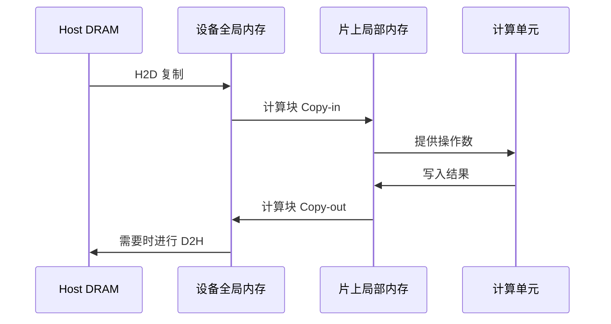
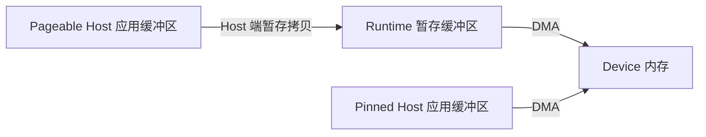

# 🔄 数据搬运：H2D、DMA 与异步复制

一个张量已经能被 CPU 访问，并不代表加速器内核已经能使用它。搬到设备全局内存是一环，把一个计算块加载进片上存储又是一环。区分两者，才能解释很多看似属于“计算”的瓶颈。

H2D 完成不意味着所有操作数已经位于 AI Core 的局部缓冲区。内核调度和内部搬运仍然影响执行。

## 🔄 方向、引擎和路径分别是什么

| 术语 | 它说明什么 | 它没有说明什么 |
| --- | --- | --- |
| H2D / D2H | Host 到 Device / Device 到 Host 的方向 | 具体链路、引擎和同步语义 |
| D2D | 设备内或设备之间复制，取决于 API | 是否涉及另一张物理卡 |
| H2H | 两端都是 Host 内存 | 两端是否在同一台机器 |
| P2P | 对等设备访问或传输能力 | 最终选中哪条路径，是否发生回退 |
| DMA | 专用引擎搬运，避免 CPU 逐字节复制 | 初始化、协调和完成处理不需要 CPU |
| SDMA | 昇腾场景中的设备搬运引擎或路径术语 | 它与 AI Core 的 MTE 完全相同 |
| MTE | AI Core 存储层级之间的搬运及支持的转换 | 它是通用网络传输协议 |
| RDMA | 对通信所需内存准备完成后进行远程访问 | 任意 Device 指针都能自动被远端访问 |

常见 H2D 会经过 PCIe 等 Host I/O 路径。设备传输可能经过 PCIe、专用互联或网络。分析时分别回答：端点在哪里、物理路线是什么、使用什么 API、通过什么机制确认完成。

## 🧷 普通内存为什么会多一次缓冲区拷贝？ {#pageable-staging}

CANN 9.0 [官方《Host 锁页内存使用》](https://www.hiascend.com/document/detail/zh/CANNCommunityEdition/900/programug/acldevg/runtime_doc_dev_0006.html)描述的 H2D 路径可以画成下面两条：

因此，**调用一个使用 DMA 的复制接口，不代表整条路径都省去了 Host 端拷贝**。在上述普通内存路径中，DMA 搬运的是后半段；暂存步骤仍有额外开销。图中的暂存缓冲区不同于 AI Core 的片上局部缓冲区。

锁页路径省去的是这一步暂存，Host→Device 传输仍然存在，不能称为完全没有数据复制。进一步推论，如果应用先把已有普通缓冲区手动复制到锁页缓冲区，这次 Host 端拷贝仍应计入成本；让数据直接生成在可复用的锁页缓冲区中，才可能省去它。内存类型、注册与释放方式见[锁页内存说明](memory-addressing.md#host-pinned-memory)。

### 同一个 Async 接口，返回时机也要看内存类型 {#cann-copy-completion}

官方[内存管理总述](https://www.hiascend.com/doc_center/source/en/CANNCommunityEdition/900/programug/acldevg/runtime_doc_dev_0004.html)将 `aclrtMemcpy` 与 `aclrtMemcpyAsync` 分别用于同步和异步拷贝。但 9.0 的 [`memcpy_async` 接口参考（含 `aclrtMemcpyAsync` C 原型）](https://www.hiascend.com/doc_center/source/en/CANNCommunityEdition/900/API/runtimeapi/aclpythondevg_01_0121.html)还按 Host 内存类型细分返回语义：

| 调用场景 | 返回语义 |
| --- | --- |
| `aclrtMemcpy` | 同步拷贝；普通 Host 内存仍可能走暂存路径 |
| `aclrtMemcpyAsync` + 锁页 Host 内存 | 成功表示任务已提交，完成状态仍需另行确认 |
| `aclrtMemcpyAsync` + 非锁页 Host 内存 | 按所引 9.0 文档，复制任务完成后才返回 |

这说明 **Async 名称、Host 缓冲区类型、实际完成点必须一起判断**。所引接口还要求源、目的地址 64 字节对齐；产品形态、复制方向及版本支持应以对应接口文档为准。这里的 64 字节约束属于拷贝接口，前一章的 4KB 首地址约束属于 `aclrtHostRegisterV2`，两者不能互相替代。

锁页 H2D 的生命周期可以记为：`aclrtMallocHost → 填充数据 → aclrtMemcpyAsync → aclrtSynchronizeStream 确认完成 → 在所有使用者结束后复用或 aclrtFreeHost`。等待前不要改写或释放 DMA 仍可能读取的源缓冲区；D2H 则还需在完成后才能消费目标数据。

### 实测：HugeTLB 不自动等于 Runtime 的 pinned Host 内存 {#hugetlb-runtime-pinned}

**操作系统层面的“不可 swap”，不等于 CANN Runtime 已将该缓冲区识别并准备为可走 pinned 异步复制路径的 Host 内存。** HugeTLB 提供大页与驻留方面的语义；`aclrtMallocHost` 提供 Runtime 管理的锁页 Host 分配。仅仅使用 HugeTLB，不能直接套用 `aclrtMallocHost` 的异步返回行为。

以下是笔记提供者报告的实测记录，所有数值均为约数。**调用阶段**指 Host 侧复制 API 的调用耗时，**同步阶段**指随后 stream 同步的等待耗时；逐条路径按原记录的调用阶段口径保留，不将其解释为每个小拷贝的单次耗时。此处未附完整的软件/硬件版本、复制数据量、批次数和计时边界，因此用于说明本次行为，不作为通用带宽基准。

| Host 缓冲区来源 | 复制路径 | API 调用阶段 | 后续 stream 同步 |
| --- | --- | --- | --- |
| HugeTLB / hugetlb | `aclrtMemcpyBatchAsync` | 约 3.5 ms | 约 6 µs |
| `aclrtMallocHost` | `aclrtMemcpyBatchAsync` | 约 0.33 ms | 约 2.67 ms |
| HugeTLB / hugetlb | 逐条 `aclrtMemcpyAsync` | 约 3.5 ms | 约 9 µs |

这组时间分布可以这样理解：

1. **HugeTLB 的 BatchAsync：**耗时主要落在 API 调用阶段，之后同步只需约 6 µs，符合拷贝在 API 返回前已完成、后续 stream 中几乎没有这批拷贝需要等待的行为。
2. **`aclrtMallocHost` 的 BatchAsync：**调用约 0.33 ms，随后同步约 2.67 ms，符合 API 下发后由 stream 异步推进拷贝、同步接口等待剩余工作完成的行为。拷贝可以在提交后立即开始，不是等到调用同步接口才启动。
3. **HugeTLB 的逐条 MemcpyAsync：**调用约 3.5 ms、同步约 9 µs，同样呈现主要在调用阶段等待的分布；这个观察不只出现在批量接口上。

因此，**本次 HugeTLB 缓冲区没有表现出 `aclrtMallocHost` 缓冲区对应的 Runtime pinned 异步复制行为，不能仅凭它不可 swap 就将两者等同。** 这一解释与前述官方 `aclrtMemcpyAsync` 对非锁页/锁页 Host 内存返回语义的区分一致；批量路径的结论在此以所报告的实测为依据。计时本身不能证明 Runtime 内部的登记方式、是否使用某个暂存缓冲区或具体执行路径。

评估时要一起看**调用时间和后续同步时间**，不能只凭约 0.33 ms 的返回时间计算拷贝带宽或宣称全部搬运已完成。复测时还应固定数据量、复制次数、stream 初始状态和内存放置，检查复制及同步返回值、校验目标数据，并结合运行时日志或设备时间线确认内部路径。是否能对 HugeTLB 内存执行额外的 Host 注册，应另查对应版本的支持范围，不能从“不可 swap”推导出注册必然成功。

相关概念：[Linux HugeTLB](page-tables-huge-pages.md#linux-hugetlb)、[Host 锁页内存与注册](memory-addressing.md#host-pinned-memory)。

## 🧩 异步意味着必须管理生命周期

同步接口有文档规定的完成点，具体保证仍应查阅接口定义。异步接口可能在操作入队后就返回。应用必须让源、目标缓冲区持续有效，并在相应操作完成前避免冲突访问。

流水线的目标依赖关系是 `填充输入 → 复制 → 计算 → 消费输出`。Stream 或 Queue 保证部分顺序，Event 用于连接跨 Stream 依赖。提交后立即复用 Host 缓冲区，可能与 DMA 读取产生竞争。只测入队调用的时间，得到的是提交开销，不是传输带宽。

页锁定 Host 内存可以减少准备开销，并支持高效 DMA 路径；它也是有限资源，适合用有界内存池复用，而不是无限制锁页。重叠执行还要求硬件引擎支持、任务独立和依赖正确，仅仅使用异步接口并不能证明发生了重叠。

## 🧮 估算瓶颈

一阶模型是 $T(S)=L+S/B$，其中 $L$ 为固定开销，$S$ 为字节数，$B$ 为持续带宽。若 $L=10\,\mu s$、$B=20$ GB/s，复制 4 KB 约需 $10.2\,\mu s$，复制 20 MB 约需 $1.01$ ms。小传输适合通过批处理摊薄开销，大传输更容易暴露带宽限制。

有效带宽不会超过参与路径中最慢的内存、链路或引擎；争用还会进一步降低它。NUMA 放置、共享 PCIe 上行链路、内存注册和同步都会贡献开销。

记录方向、大小、次数、缓冲区类型、NUMA 放置、预热和完成计时方式。对比稳态大块复制与大量小复制，检查是否存在多余往返。继续阅读[性能测量](performance-tools.md)。

来源：[昇腾 AI Core 架构与 MTE](https://www.hiascend.com/doc_center/source/en/canncommercial/800/opdevg/tbeaicpudevg/atlasopdev_10_0008.html)。文档描述特定版本的架构，实际引擎行为需要对应产品的编程指南。
