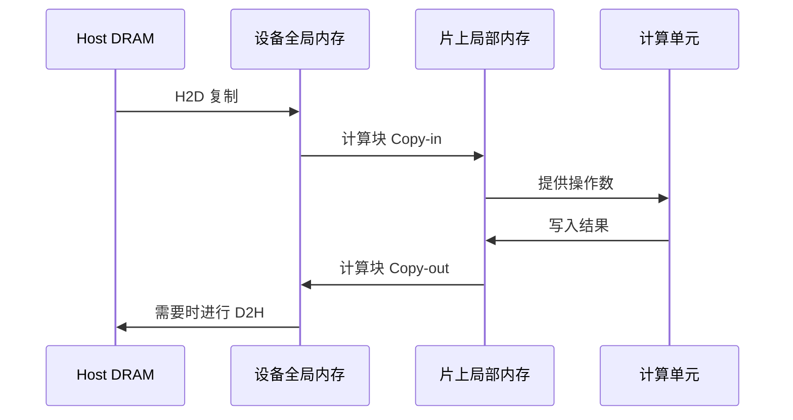

# 数据搬运：H2D、DMA 与异步复制

一个张量已经能被 CPU 访问，并不代表加速器内核已经能使用它。搬到设备全局内存是一环，把一个计算块加载进片上存储又是一环。区分两者，才能解释很多看似属于“计算”的瓶颈。

H2D 完成不意味着所有操作数已经位于 AI Core 的局部缓冲区。内核调度和内部搬运仍然影响执行。

## 方向、引擎和路径分别是什么

| 术语 | 它说明什么 | 它没有说明什么 |
| --- | --- | --- |
| H2D / D2H | Host 到 Device / Device 到 Host 的方向 | 具体链路、引擎和同步语义 |
| D2D | 设备内或设备之间复制，取决于 API | 是否涉及另一张物理卡 |
| H2H | 两端都是 Host 内存 | 两端是否在同一台机器 |
| P2P | 对等设备访问或传输能力 | 最终选中哪条路径，是否发生回退 |
| DMA | 专用引擎搬运，避免 CPU 逐字节复制 | 初始化、协调和完成处理不需要 CPU |
| SDMA | 昇腾场景中的设备搬运引擎或路径术语 | 它与 AI Core 的 MTE 完全相同 |
| MTE | AI Core 存储层级之间的搬运及支持的转换 | 它是通用网络传输协议 |
| RDMA | 对通信所需内存准备完成后进行远程访问 | 任意 Device 指针都能自动被远端访问 |

常见 H2D 会经过 PCIe 等 Host I/O 路径。设备传输可能经过 PCIe、专用互联或网络。分析时分别回答：端点在哪里、物理路线是什么、使用什么 API、通过什么机制确认完成。

## 异步意味着必须管理生命周期

同步接口有文档规定的完成点，具体保证仍应查阅接口定义。异步接口可能在操作入队后就返回。应用必须让源、目标缓冲区持续有效，并在相应操作完成前避免冲突访问。

流水线的目标依赖关系是 `填充输入 → 复制 → 计算 → 消费输出`。Stream 或 Queue 保证部分顺序，Event 用于连接跨 Stream 依赖。提交后立即复用 Host 缓冲区，可能与 DMA 读取产生竞争。只测入队调用的时间，得到的是提交开销，不是传输带宽。

页锁定 Host 内存可以减少准备开销，并支持高效 DMA 路径；它也是有限资源，适合用有界内存池复用，而不是无限制锁页。重叠执行还要求硬件引擎支持、任务独立和依赖正确，仅仅使用异步接口并不能证明发生了重叠。

## 估算瓶颈

一阶模型是 $T(S)=L+S/B$，其中 $L$ 为固定开销，$S$ 为字节数，$B$ 为持续带宽。若 $L=10\,\mu s$、$B=20$ GB/s，复制 4 KB 约需 $10.2\,\mu s$，复制 20 MB 约需 $1.01$ ms。小传输适合通过批处理摊薄开销，大传输更容易暴露带宽限制。

有效带宽不会超过参与路径中最慢的内存、链路或引擎；争用还会进一步降低它。NUMA 放置、共享 PCIe 上行链路、内存注册和同步都会贡献开销。

记录方向、大小、次数、缓冲区类型、NUMA 放置、预热和完成计时方式。对比稳态大块复制与大量小复制，检查是否存在多余往返。继续阅读[性能测量](performance-tools.md)。

来源：[昇腾 AI Core 架构与 MTE](https://www.hiascend.com/doc_center/source/en/canncommercial/800/opdevg/tbeaicpudevg/atlasopdev_10_0008.html)。文档描述特定版本的架构，实际引擎行为需要对应产品的编程指南。
