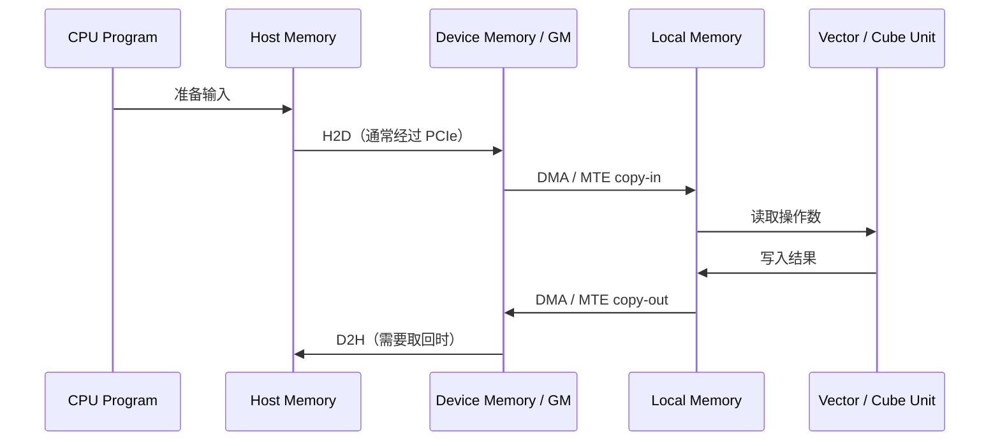

!!! info "中文版正在逐篇更新"

    英文优化版已完成。本页暂时保留原笔记，中文版优化正文正在编写。

# 数据搬运与 H2D

## 一个张量的典型旅程

注意两类容易混淆的搬运：

- **Host ↔ Device**：跨 CPU/NPU 地址空间，常见名称是 H2D、D2H。
- **Device Global ↔ On-chip Local**：发生在 NPU 内部存储层次之间，常由 DMA/MTE 完成。

H2D 完成只表示数据进入了 Device Memory，不表示它已经位于 AI Core 可直接高效计算的片上缓冲区。

## 同步与异步

- **同步复制**：API 返回时复制通常已经完成，编程简单，但调用线程可能等待。
- **异步复制**：复制进入 Stream/Queue 后即可返回，可以与计算重叠，但必须正确管理依赖、事件和缓冲区生命周期。
- **Pinned Host Memory**：页锁定内存可减少驱动准备 DMA 的额外成本，通常更适合高吞吐 H2D/D2H。
- **Batching**：大量小复制容易被提交开销和延迟主导，合并成较大批次往往更有效。

## 带宽为什么达不到链路标称值

端到端有效带宽受最窄环节限制：

`B_effective ≤ min(B_host_memory, B_PCIe, B_device_memory, B_copy_engine)`

还要扣除协议开销、传输粒度、NUMA 跨节点访问、PCIe Switch 共享、内存注册、同步等待和并发争用。

## 排查 H2D/D2H 的最小清单

1. 记录方向、大小、次数以及同步还是异步，避免只说“拷贝慢”。
2. 确认 Host 缓冲区是否为页锁定内存，以及 CPU 内存所在 NUMA 节点。
3. 查看 NPU 和 CPU/PCIe Root Complex 的拓扑，确认是否跨 Socket 或共享 PCIe 上行链路。
4. 分开测量冷启动、稳态大块传输和大量小块传输。
5. 区分 API 提交时间、Stream 完成时间和端到端业务时间。
6. 检查复制能否与计算重叠，以及是否存在多余的 H2D → D2H 往返。

## 方向速查

| 源 | 目标 | 常用简称 | 常见路径 |
| --- | --- | --- | --- |
| Host DRAM | Device Memory | H2D | CPU 内存 → PCIe → NPU 内存 |
| Device Memory | Host DRAM | D2H | NPU 内存 → PCIe → CPU 内存 |
| Device A | Device B | D2D / P2P | PCIe、专用互联或网络，依拓扑而定 |
| Host A | Host B | H2H | 本机内存复制或跨节点 Host 传输，依上下文而定 |
| Device GM | AI Core Local Memory | Copy-in | DMA/MTE 片内搬运 |
| AI Core Local Memory | Device GM | Copy-out | DMA/MTE 片内搬运 |

## 传输方向不等于通信协议

H2D 只说明数据从 Host Memory 移动到 Device Memory，并不直接说明使用哪一种 API、硬件引擎或链路。
P2P 也只说明两个对等设备之间存在直接传输关系。分析一次数据移动时，需要分别回答：

1. 数据起点和终点在哪里？
2. 数据经过哪些总线、交换器件或网络？
3. 哪个软件接口和硬件引擎负责搬运？
4. 完成状态通过轮询、事件还是通知确认？

## DMA、SDMA、RDMA 和 MTE

| 术语 | 所在层次 | 重点 |
| --- | --- | --- |
| DMA | 通用数据搬运机制 | 专用引擎搬运内存数据，避免 CPU 逐字节复制 |
| SDMA | 昇腾设备传输语境 | 常见于设备内或特定设备互联的数据搬运路径 |
| RDMA | 网络访问语义 | 远端直接访问已注册内存，减少 CPU 参与和额外复制 |
| MTE | AI Core 内部 | 在 GM、L1、L0、UB 等存储层次间搬运和转换数据 |

MTE 和 SDMA 不能直接当作同一种硬件引擎；不同产品对这些名称的具体实现也可能不同。

## 参考资料

- [昇腾 C 文档](https://asc.gitcode.com/)：《异构系统》。
- [昇腾文档中心](https://www.hiascend.com/document)：《带宽测试》。
