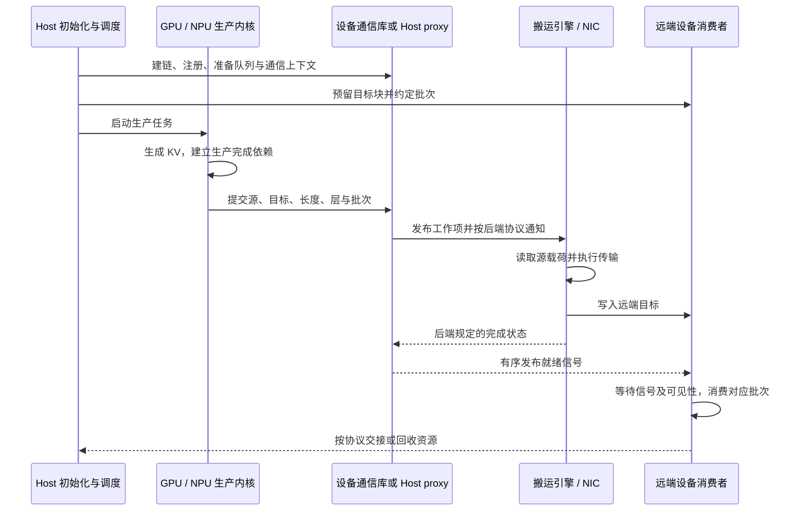

# 🚦 NPU / GPU 如何驱动数据拷贝并推送到远端

“数据在设备上”“设备发起通信”“网卡直接读设备内存”描述不同的事情。本章跟踪一个计算内核产出的 KV 块：谁决定发送、谁提交工作项、哪个引擎搬运，以及远端什么时候才能读取。

队列术语先看 [WQE、SQE、CQE 与 Doorbell](work-queues.md)。

## 🧩 三种提交路径

| 模式 | 谁提出搬运请求 | 谁向通信引擎提交 | 载荷是否可以设备直达 |
| --- | --- | --- | --- |
| Host 发起 | CPU 上的框架/连接器 | CPU 通信库、驱动或 Runtime | 可以，取决于注册和硬件路径 |
| Device 发起、Host 代理 | GPU/NPU 内核写请求 | CPU proxy 读取请求并提交 | 可以；CPU 代理控制不等于 CPU 复制载荷 |
| Device 直接提交 | 受支持的设备内核 | 设备侧通信库直接操作引擎队列 | 可以；依赖特定设备与后端 |

- **Host 发起：**CPU 只提交控制信息，网卡可以 DMA 读取 HBM，不必先 D2H。

- **设备发起、Host 代理：**通信需求从设备产生，仍由 CPU proxy 处理提交。

- **设备直接提交：**缩短逐次提交的控制路径；初始化、注册、建链和故障处理仍可能需要 Host。

!!! note "载荷直达与任务提交是两件事"

    **GPUDirect RDMA 提供设备内存直达能力，不等于 GPU 已经获得网卡任务提交能力。**

    参见 [GPUDirect RDMA](https://docs.nvidia.com/cuda/gpudirect-rdma/)及 [NVSHMEM IBGDA 机制](https://developer.nvidia.com/blog/improving-network-performance-of-hpc-systems-using-nvidia-magnum-io-nvshmem-and-gpudirect-async/)。

## 🛠️ 初始化：先准备“可以提交”的环境

1. 绑定进程、Device、Rank 和 NIC，发现对端及支持的传输路径。

2. 分配源/目标缓冲区；完成后端要求的映射、注册或对称内存分配。

3. 建立 Endpoint、队列及完成资源，交换地址描述、权限、长度和有效期。

4. 若设备发起，准备设备可访问的通信上下文、队列或代理请求区，并启动必要的推进线程。

5. 为每次搬运分配请求标识、层号、块号、generation 和完成状态；预留有界队列容量。

这是逻辑准备清单，不要求各库都公开同名对象。远端指针必须通过通信库规定的寻址方式使用；例如对称地址通常还需结合目标 PE/Rank 解析，不能把本机指针的数值当作任意远端有效地址。[内存与注册](memory-addressing.md)、[GVA](gva-unified-addressing.md)进一步解释地址上下文。

## 🔄 下发和执行：源数据就绪之后发生什么



图中通知是逻辑职责，有的后端用 put-with-signal 一次表达“写载荷再更新信号”，有的分开发送控制消息。若 CPU 下发，则用“Host 等待生产事件后调用传输接口”替代设备提交。

无论谁提交，**生产 → 引擎读取、远端写入 → 消费、完成 → 复用**三条依赖都要成立。

本地 `cudaMemcpyAsync` / `aclrtMemcpyAsync` 是 Runtime 拷贝接口；跨服务器传输还需要远端寻址和通信连接，不能只把本地目的地址替换成另一台机器上的指针。

[数据搬运](data-movement.md)说明本地异步拷贝和内存类型的区别。

## 🟩 GPU 实例：NVSHMEM 与 IBGDA

NVSHMEM 允许在 GPU 内核中调用通信操作。对于受支持的 IBGDA 路径，SM 可创建网卡 WQE、更新所需队列记录并通知 NIC；NIC 读取描述符和 GPU 载荷，再把完成信息写回。

代理路径则由 CPU 线程处理设备提出的请求。这里对机制的说明基于 [NVIDIA IBGDA 技术文章](https://developer.nvidia.com/blog/improving-network-performance-of-hpc-systems-using-nvidia-magnum-io-nvshmem-and-gpudirect-async/)；实际硬件、驱动和传输条件见 [NVSHMEM 使用指南](https://docs.nvidia.com/nvshmem/api/latest/using.html)，不能据此推断任意 GPU/NIC 组合都支持直接提交。

下面是协议伪代码，不是可直接编译的程序；调用范围、线程协作、初始化及错误处理需要按实际库补齐：

```text
发送侧：
  等待本块生产完成，并满足设备通信 API 的可见性要求
  put_with_signal_nbi(目标块, 源块, 长度, 目标信号, generation, peer)
  在复用源块前等待该操作要求的完成条件

接收侧：
  使用通信库的 signal_wait 等待预期 generation
  按库的可见性约定读取目标块
  若目标缓冲区要复用，消费结束后再归还 credit
```

NVSHMEM 的 put-with-signal 把对应载荷交付与信号更新建立联系；不要用普通无序写 flag 代替它。`fence` 主要表达规定范围内的顺序，`quiet` 等待其作用范围内的通信完成；二者都不能替代任意其他线程尚未完成的生产任务。 具体语义分别见[信号操作](https://docs.nvidia.com/nvshmem/api/latest/gen/api/signal.html)与[内存顺序接口](https://docs.nvidia.com/nvshmem/api/latest/gen/api/ordering.html)。

## 🟦 NPU 实例：区分算子访存与 Host 传输接口

MemFabric 的[特性说明](https://github.com/Ascend/memfabric_hybrid/blob/master/doc/feature.md)区分了几类入口：

| 入口 | 文档中的职责 | 如何理解提交方 |
| --- | --- | --- |
| BM | 池化内存、统一地址及拷贝 | Host C/Python 接口不自动意味着设备发起 |
| TRANS | 注册用户 HBM，执行跨 Server 读写 | `smem_trans_write/read` 等是 Host 接口示例 |
| SHM | 面向算子的共享空间及 AI Core 细粒度访问 | 文档描述超节点内通过 MTE 访问共享空间及设备侧 copy 接口 |

据此应分别追踪两条链：`Host TRANS 调用 → 后端提交 → 支持的传输路径`，以及 `Host 准备共享空间 → 启动算子 → AI Core 使用设备接口访问`。SHM 示例入口见 [ShiftPutGet](https://github.com/Ascend/memfabric_hybrid/blob/master/examples/hbm_share_memory/ShiftPutGet/README.md)。

**不能从“AI Core 能访问 GVA”推导出“MTE 能向任意跨服务器网卡下发 RDMA”。** 跨节点设备发起能力，要检查对应产品、CANN、通信库版本的设备 API、引擎支持范围与同步要求。

MTE、SDMA、RDMA 各自负责的路径不同；已有 Host TRANS API 也不能直接在设备内核中调用。

## ✅ 把完成状态与缓冲区所有权一起设计

| 状态 | 含义 | 此时不能做什么 |
| --- | --- | --- |
| Produced | 源内容生成并对读取方可见 | 未确认传输完成就覆盖源内容 |
| Submitted | 任务已经入队 | 将 API 返回当作远端就绪 |
| Source reusable | 后端已不再读取这一份源缓冲区 | 推断远端计算已结束 |
| Remote ready | 接收方已满足本批数据的读取条件 | 覆盖仍被消费的目标块 |
| Consumed / credit returned | 消费完成，协议允许复用目标槽位 | 让旧批次的迟到通知激活新批次 |

用单调 generation 和明确的 ownership/credit 区分缓冲区的多次使用；重试还需核对请求身份和幂等策略。超时不会自动停止 DMA，应先让在途操作退出或隔离资源再回收。

若要按层发送 KV，继续看[逐层执行与传输流水线](../ml/llm/inference/layerwise-inference.md)。

## 📊 怎样证明设备发起值得使用

分别记录生产事件、请求发布、引擎取任务、传输完成、远端可读和消费开始的时间。对比 Host、proxy 与设备直接提交时，保持载荷大小、路径、批处理和并发一致；设备 busy-wait、占用计算核心和队列争用也要计入成本。

单纯看到 CPU 占用降低，不能证明 TTFT 或吞吐改善。

先验证带 generation 的已知数据模式，再测试小块高频提交与大块带宽。模型推理还要检查 TP 分片、层号和 KV 布局，而不只校验字节数。完整应用协议见[端到端传输](end-to-end-transfer.md)。
