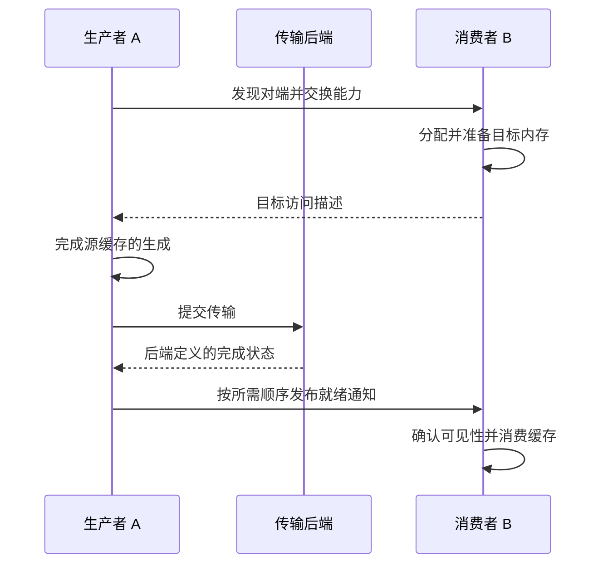

# 跟踪一次端到端 KV Cache 传输

设想服务器 A 上运行 Prefill Worker，服务器 B 上运行 Decode Worker。缓存当前在 A 的 NPU HBM 中，需要在 B 的 HBM 中变得可用。“把指针发过去”无法完成这件事：指针表示某个地址上下文中的内存，不是可以跨机器直接使用的张量内容。

## 四个阶段，各自有哪些失败方式

| 阶段 | 工作 | 成功证据 |
| --- | --- | --- |
| 初始化 | 发现对端、确认能力、建立 Endpoint 和队列 | Rank、Device、Endpoint 映射正确，连接可用 |
| 内存准备 | 分配、映射、注册，交换访问描述 | 长度、权限、内存类型和生命周期有效 |
| 搬运 | 提交支持的 Read、Write 或 Send 操作 | 操作被接受，传输状态持续推进 |
| 完成与消费 | 观察所需完成状态、发布就绪通知、保证可见性 | 目标安全读取预期批次的数据 |

图中是逻辑协议。有的后端提供接收侧完成或集成通知，有的需要显式发送就绪消息。本地完成并不普遍意味着远端应用已经观察到数据。必须遵守 API 对顺序和可见性的保证。

## 对比实际物理路径

Host 中转路径为 `HBM A → DRAM A → 网络 → DRAM B → HBM B`。它可以复用 Host 网络栈，但增加复制、缓冲区和同步。受支持的直达路径为 `HBM A → 通信引擎/网卡 → 网络 → HBM B`。能否直达取决于可达性、注册、权限和后端能力，不能只根据配置名称判断。

若缓存为 1 GB，三段串行传输的持续带宽分别为 20、10、20 GB/s，则仅搬运就至少需要 $0.05+0.10+0.05=0.20$ 秒，尚未计入固定开销。分块流水线能重叠不同阶段，稳态吞吐可接近最慢阶段；但首尾数据块仍需承担启动和排空成本。这是计算模型示例，不是硬件实测数据。

## MemFabric 在其中承担什么职责

内存池和句柄提供资源；发现、建链构成控制流程；读写操作执行搬运；完成处理负责成功、错误和超时。具体模块边界及 API 随后端和版本变化。结合 [MemFabric 源码](https://gitcode.com/Ascend/memfabric_hybrid)及其接口文档分析。

对于缓存应用，还要校验词元数、张量布局、数据类型、层编号和模型版本。即便每个字节都传输正确，模型不兼容的缓存仍然是应用错误。

## 按依赖顺序排障

先检查身份映射，再检查连接状态、内存可达性和权限、路径健康、提交进度、完成可见性，最后解释性能。存在在途操作时，缓冲区和注册句柄必须保持有效；超时不一定会取消已经提交的 DMA。

一个有效的小实验是传输已知数据模式，在完成后验证目标内容，再分别扩大大小与并发。报告既要包含完成状态，也要包含内容完整性。相关章节：[地址与注册](memory-addressing.md)、[完整 PD 服务流程](serving-frameworks.md)、[网络平面](network-planes.md)和 [KV Cache 大小](../ml/llm/inference/kv-cache.md)。
