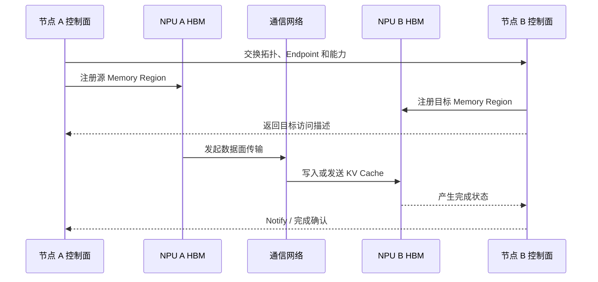

!!! info "中文版正在逐篇更新"

    英文优化版已完成。本页暂时保留原笔记，中文版优化正文正在编写。

# 一次端到端数据传输

假设服务器 A 的 NPU HBM 中有一份 KV Cache，需要传输到服务器 B 的 NPU HBM。把过程拆开以后，前面
学习的控制面、数据面、内存注册、网络平面和完成通知就能放进同一张图。

## 四个阶段

| 阶段 | 主要操作 | 对应知识点 |
| --- | --- | --- |
| 1. 初始化 | 发现对端、交换 Endpoint、建立连接、准备队列 | 控制面、拓扑、协议 |
| 2. 内存准备 | 分配、映射、注册源和目标内存，交换访问描述 | HBM、VA、MR、Key |
| 3. 数据搬运 | 发起 Read/Write/Send，执行实际传输 | 数据面、RDMA/URMA、DMA |
| 4. 完成同步 | 读取完成状态，通知对端数据可用 | Completion、Notify、Event |



## 两类常见数据路径

### Host 中转

```text
HBM A → Host DRAM A → 网络 → Host DRAM B → HBM B
```

这条路径可能包含 D2H、Host 网络传输和 H2D 三段。它通常更容易复用成熟的 Host 通信栈，但会增加复制、
同步和 Host 内存带宽压力。

### 设备侧直达

```text
HBM A → 设备通信引擎 / NIC → 网络 → 设备通信引擎 / NIC → HBM B
```

设备侧直达有机会减少 Host 中转，但是否真正实现 Device-to-Device DMA，取决于硬件可达性、内存注册、
协议能力和具体实现。不能只根据配置名称判断。

## 与 MemFabric 的关系

以 MemFabric 数据搬运为例，可以把职责粗略分成：

- **资源层**：管理 Host/Device 内存池、地址和生命周期。
- **控制面**：发现远端、交换 Endpoint、建立连接和注册内存。
- **数据面**：执行 BatchRead、BatchWrite 或其他实际读写操作。
- **完成层**：查询、轮询或等待传输完成，处理超时和错误。

这里的划分用于建立分析框架，不代表所有后端都有完全相同的模块边界。

## 端到端排障顺序

1. **对象是否正确**：Rank、Device、Die、端口和内存类型的映射是否符合预期？
2. **控制面是否完成**：Endpoint、连接、队列和能力协商是否成功？
3. **内存是否可达**：地址、长度、注册、权限和生命周期是否正确？
4. **链路是否正常**：PCIe、设备互联、NIC、出框口和交换网络是否健康？
5. **数据面是否启动**：操作是否真正提交，队列是否前进，是否命中正确后端？
6. **完成是否可见**：完成队列、事件和通知是否被正确处理？
7. **性能是否合理**：问题是固定开销、带宽瓶颈、拥塞，还是同步等待？

不要一看到跨节点失败就直接归因于网络。地址注册错误、Device 映射错误和完成通知丢失，也会表现为传输超时。
