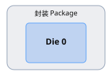
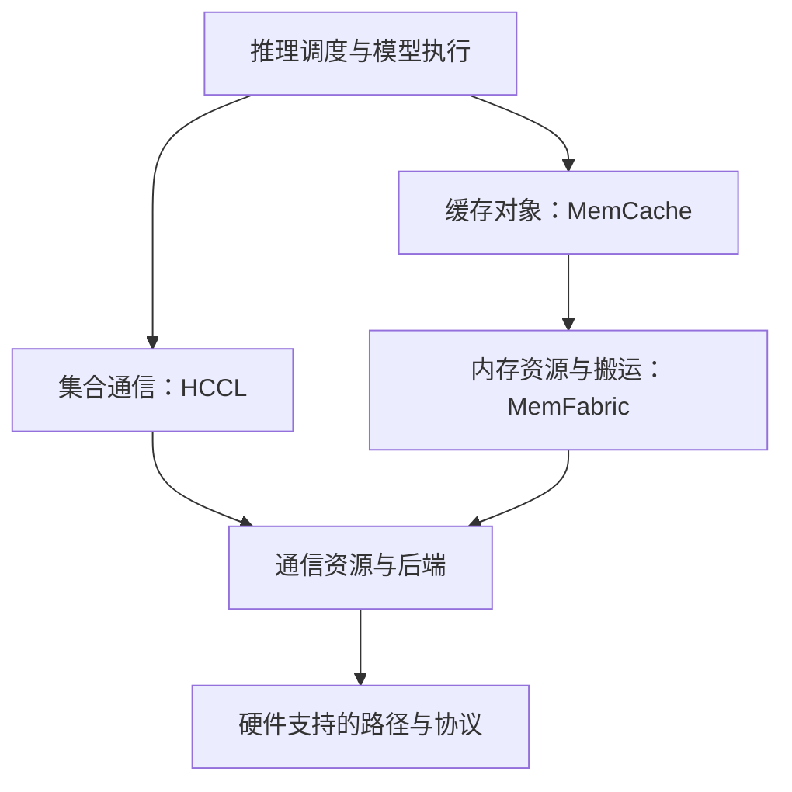

# 🏗️ Infra：从一颗 NPU 到分布式系统

只有正确的数据在正确的时间到达正确的内存，加速器才能完成有效计算。本路线把昇腾 NPU 的基础概念，与分布式推理、MemFabric 和 KV Cache 搬运联系起来。A2、A3、A5 表示产品背景，并不意味着拓扑、地址映射和协议支持相同；分析时要同时确认实际硬件和软件版本。

## 🏗️ 先建立层次地图

| 层次 | 要回答的问题 | 后续章节 |
| --- | --- | --- |
| 硬件 | 谁负责计算？Die、封装、Device 和 Rank 有何区别？ | [硬件层级](hardware.md) |
| 内存 | 字节放在哪里？哪个地址空间能够描述它们？ | [内存与地址](memory-addressing.md) |
| 分页与转换 | 页表、PTE、MMU、TLB 如何配合？大页为何能减少映射数量？ | [页表、PTE、大页与地址转换](page-tables-huge-pages.md) |
| 全局寻址 | 如何通过 GVA 统一定位跨进程、跨设备、跨节点的 DRAM 与 HBM？ | [GVA 统一编址原理](gva-unified-addressing.md) |
| 推理服务 | vLLM、SGLang 如何规划 HBM、复用 KV，并完成 Prefill 到 Decode 的交接？ | [推理框架](serving-frameworks.md) |
| 搬运 | 谁搬数据？方向是什么？何时才能使用？ | [数据搬运](data-movement.md) |
| 互联 | 哪条路径和哪种传输机制能到达目标？ | [互联与通信](interconnects.md) |
| 组织 | 不同网络分别承载什么流量？ | [网络平面](network-planes.md) |
| 测量 | 时间花在初始化、搬运还是等待上？ | [性能分析](performance-tools.md) |

CPU、GPU、NPU 描述不同的设计侧重点，而不是互斥的计算能力。CPU 通常承担调度和控制，加速器更强调并行张量计算。HBM 存储权重、激活和 KV Cache，更小的片上缓冲区为计算单元提供操作数；Host DRAM 和远端存储以更高访问代价扩展容量。

## 🧩 物理身份与软件身份

Die 是一块硅片。封装将一个或多个 Die 及其连接组合起来。板卡可以包含封装及其他器件。运行时的 Device 是软件可见对象，Rank 则是通信组中的参与者编号。这些边界不一定重合。

这两张原图展示单 Die 和多 Die 封装的通用概念，不是某款昇腾产品的规格图。先查清实际映射，再判断“跨 Device”是否意味着“跨卡”或“跨服务器”。

## 📌 将软件职责联系起来

这是职责关系图，不要求每个部署都使用所有组件，也不规定固定的依赖链。HCCL 提供 AllReduce、AllGather 等集合通信。HCOMM 在支持的软件栈中提供通信资源和操作能力。MemFabric 管理内存资源及数据搬运；缓存层管理可复用对象及其生命周期。实际数据路径由后端选择决定。

Endpoint 表示通信端点。初始化阶段发现对端和能力、准备队列、交换访问描述；数据路径随后提交搬运操作并观察完成状态。注册内存是在准备访问条件，并没有把张量发送出去。

## 🧩 贯穿全文的例子：搬运 KV Cache

假设 Prefill Worker 生成了一份 Decode Worker 要使用的缓存。先根据层数、KV 头数、头维度、序列长度和数据类型计算大小；再定位源、目标内存，判断支持直达还是必须经过 Host 中转；最后在解码消费数据前，建立完成状态和可见性保证。

同样是“Decode 一直等待”，原因可能是缓存过大、注册失败、Rank 映射错误、链路拥塞，也可能是通知丢失。[推理框架](serving-frameworks.md)跟踪完整请求，[端到端传输](end-to-end-transfer.md)则拆解搬运过程。

## 🔄 学习顺序与自测

1. 画出 Device、Die、NUMA 节点及互联关系。
2. 标出 H2D、D2H 和设备间传输，再补上地址空间与注册关系。
3. 区分按流量用途划分的网络与控制面、数据面职责。
4. 跟踪初始化、提交、完成和消费四个环节。
5. 测量延迟、带宽、并发和重叠执行。

你能解释为什么 H2D 是方向、RDMA 是访问机制、出框口是物理边界吗？能解释为什么跨 Die 不一定跨服务器吗？弄清这些关系后，[术语表](glossary.md)就可以作为查阅工具，而不必成为死记硬背的词汇表。

资料来源：[昇腾文档中心](https://www.hiascend.com/document)、[昇腾 C 文档](https://asc.gitcode.com/)和 [MemFabric Hybrid 实现](https://gitcode.com/Ascend/memfabric_hybrid)。产品能力应以对应版本的文档为准。
