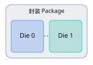

# 昇腾 NPU 基础知识学习手册

面向 Ascend A2 / A3 / A5，重点结合 MemFabric、MemCache、HCCL、HCOMM、RDMA、URMA 和大模型推理场景。

学习 NPU，最难的往往不是某一个 API，而是同时遇到很多不同层级的概念：Die、HBM、NUMA 是硬件和
内存概念；参数面、业务面、出框口是网络概念；H2D、D2D、P2P 是数据搬运方向；RDMA、URMA、HCCS
则涉及通信协议和互联技术。

建议先建立一张完整的知识地图，再逐步理解每个术语在实际系统中的位置。

## 一、NPU 整体知识地图

下面的概念层次表示逻辑关系，而不是严格的硬件物理连接。可以把 NPU 系统理解成五个层次：

| 层次 | 关键概念 | 要理解的问题 |
| --- | --- | --- |
| 硬件层 | NPU、Die、AI Core、HBM | 谁负责计算，数据存在哪里？ |
| 内存层 | Host、Device、NUMA、VA、PA | 内存由谁管理，地址如何访问？ |
| 搬运层 | H2D、D2H、D2D、P2P、DMA | 数据从哪里搬到哪里？ |
| 通信层 | HCCS、PCIe、RoCE、RDMA、URMA | 数据通过什么链路传输？ |
| 网络与软件层 | 参数面、业务面、出框口、HCCL | 网络如何组织，软件怎样管理通信？ |

## 二、硬件基础：Die、NPU、HBM、AI Core

### 2.1 CPU、GPU、NPU 的区别

| 对比项 | CPU | GPU | NPU |
| --- | --- | --- | --- |
| 主要特点 | 通用计算 | 大规模并行计算 | 面向 AI 工作负载优化 |
| 典型任务 | 系统调度、逻辑处理 | 图形、矩阵及通用并行计算 | 矩阵计算、神经网络推理与训练 |
| 常见内存 | DRAM | HBM / GDDR | HBM / DDR，取决于型号 |
| AI 系统角色 | Host 调度与管理 | AI 计算 Device | AI 计算 Device |

在昇腾服务器中，通常是 CPU 负责启动和管理任务，NPU 负责主要的模型计算。

### 2.2 Die 是什么？

**Die = 裸片 / 晶粒。** Die 是从晶圆切割出来的单块半导体芯片实体。

需要特别区分三个概念：

- **Die**：物理硅片单元。
- **Chip / Package**：封装后的芯片产品，可能包含一个或多个 Die。
- **NPU Device**：软件层面识别和管理的计算设备，不一定与 Die 一一对应。

<div class="diagram-pair">
  <figure class="diagram-card">
    
    <figcaption>单 Die 示意</figcaption>
  </figure>
  <figure class="diagram-card">
    
    <figcaption>多 Die 示意</figcaption>
  </figure>
</div>
<p class="diagram-caption">通用封装示意，不代表某一款昇腾产品的实际 Die 数量或布局。</p>

为什么需要关注 Die？因为数据传输可能涉及：

- 同 Die 内搬运；
- 同一封装内跨 Die 搬运；
- 跨 NPU Device 搬运；
- 跨服务器搬运。

这些路径可能经过不同的硬件互联、地址映射和通信引擎，性能也可能不同。

**注意：跨 Die 不等于跨卡，跨 Device 也不一定等于跨物理封装。** 分析 A5 等设备时，需要结合
实际拓扑判断。

### 2.3 AI Core、AICPU、HBM

| 术语 | 含义 | 作用 |
| --- | --- | --- |
| AI Core | AI 计算核心 | 执行矩阵、向量等计算 |
| Cube | 矩阵计算单元 | 高效执行矩阵乘法 |
| Vector | 向量计算单元 | 执行向量、逐元素运算等 |
| AICPU | 设备侧辅助处理器 | 执行部分控制、调度或特定算子任务 |
| HBM | High Bandwidth Memory | 高带宽设备内存 |
| SRAM | Static Random-Access Memory | 片上高速缓存或工作存储 |
| DMA | Direct Memory Access | 不依赖 CPU 逐字节复制的数据搬运机制 |

对推理来说，HBM 中通常存储模型权重、激活值和 KV Cache。

## 三、网络基础：参数面、数据面、业务面、出框口

这是最容易混淆的部分，因为“面”在不同上下文里不是同一种分类。

### 3.1 参数面、业务面、存储面

在昇腾 AI 集群的网络规划中，常见以下网络平面：

| 网络平面 | 主要用途 | 典型流量 |
| --- | --- | --- |
| 参数面 | 分布式 AI 通信 | 梯度同步、模型参数或推理通信数据 |
| 业务面 | 业务管理与调度 | SSH、部署、镜像、系统访问 |
| 存储面 | 访问存储系统 | 模型权重、训练数据、Checkpoint |
| 带外管理面 | 独立管理硬件 | BMC、服务器硬件维护 |

例如，大模型分布式训练时，多个 NPU 之间的梯度同步通常使用参数面网络。分布式推理时，跨节点的 KV Cache
传输也可能使用高性能数据网络，但它是否与参数面共用，需要看具体部署和网络规划。

### 3.2 控制面和数据面

这与上一节的“参数面”不是一个维度。

<div class="concept-grid">
  <div class="concept-card">
    <div class="concept-title">
      <span class="sliders-icon" aria-hidden="true"></span>
      <strong>控制面 Control Plane</strong>
    </div>
    <p>决定如何通信。</p>
    <small>资源初始化、拓扑发现、连接建立、资源管理。</small>
  </div>
  <div class="concept-card">
    <div class="concept-title">
      <span class="transfer-icon" aria-hidden="true">⇄</span>
      <strong>数据面 Data Plane</strong>
    </div>
    <p>执行实际通信。</p>
    <small>数据读取、写入、复制、同步及通信操作。</small>
  </div>
</div>

以 MemFabric 为例：

```text
控制面
1. 发现远端节点
2. 交换 Endpoint 信息
3. 注册 Memory Region
4. 建立连接并准备传输资源

数据面
5. 发起 BatchRead / BatchWrite
6. DMA / RDMA / URMA 搬运数据
7. 查询或等待传输完成
```

简单记忆：**控制面解决“怎么连”，数据面解决“怎么传”。**

### 3.3 出框口是什么？

出框口通常是硬件组网中的说法，指连接到当前框体或设备边界之外的物理通信端口。

```text
       框体 / 服务器 A               框体 / 服务器 B

       NPU 0 ─── 内部互联 ─── NPU 1
                              │
                           出框口
                              │
                         外部交换网络
                              │
                           出框口
                              │
                             NPU 2
```

| 术语 | 含义 |
| --- | --- |
| 框内通信 | 同一框体内部设备间的通信 |
| 跨框通信 | 不同框体间的通信 |
| 出框口 | 连接框体外部网络或设备的物理端口 |
| 端口带宽 | 端口可提供的理论或额定传输能力 |
| 链路带宽 | 实际连接链路的能力 |
| Full Mesh | 节点之间两两直连的拓扑结构 |
| Switch | 用于连接多个通信端点的交换设备 |

!!! warning "出框口不是协议"

    出框口不是某一种通信协议。具体采用什么物理链路、支持什么协议，要看 A2/A3/A5 的产品形态和组网
    设计，也不能简单把所有跨框通信都等同于跨服务器通信。

## 四、数据搬运：H2D、D2H、D2D、P2P

这是理解 MemFabric 性能优化的核心。

### 4.1 四种常见传输方向

H2D/D2H 表示 Host 与 Device 的方向；P2P 表示设备间对等传输。D2D 在不同 API 或测试工具中的精确定义
可能不同。

| 缩写 | 全称 | 数据方向 | 常见用途 |
| --- | --- | --- | --- |
| H2D | Host to Device | CPU 内存 → NPU 内存 | 模型数据加载、KV Cache 回迁 |
| D2H | Device to Host | NPU 内存 → CPU 内存 | KV Cache Offload |
| D2D | Device to Device | Device 内或 Device 间 | 本地内存复制、设备间数据搬运 |
| H2H | Host to Host | CPU 内存 → CPU 内存 | 主机内存拷贝 |
| P2P | Peer to Peer | NPU A ↔ NPU B | 跨设备直接传输 |

昇腾 `ascend-dmi` 带宽测试工具支持 H2D、D2H、D2D 和 P2P 等测试类型。具体 D2D/P2P 定义和支持范围
应以当前设备与工具版本的帮助信息为准。

### 4.2 传输方向不等于通信协议

这是必须掌握的一点。

H2D 只说明 Host 内存向 Device 内存搬运数据，并不直接决定使用 PCIe、DMA 或其他链路与机制。同样，
P2P 只表示两个 Device 之间的传输关系，具体可能涉及 PCIe、HCCS 或其他互联方式。

实际分析一次数据传输，需要明确三个问题：

1. 数据的起点和终点是什么？
2. 数据实际经过了哪些硬件链路？
3. 哪个通信引擎负责执行搬运？

### 4.3 DMA、SDMA、RDMA、MTE

| 术语 | 核心含义 | 重点 |
| --- | --- | --- |
| DMA | Direct Memory Access | 避免 CPU 逐字节参与内存搬运 |
| SDMA | 昇腾语境中的本地 DMA 通信路径 | 常用于节点内或特定设备互联场景 |
| RDMA | Remote Direct Memory Access | 使用远程直接内存访问技术通信 |
| MTE | Memory Transfer Engine | AI Core 内部的数据搬运与转换单元 |
| `aclrtMemcpy` | 运行时内存复制接口 | 根据源、目标及复制类型完成搬运 |

MTE 和 SDMA 不能直接视为同一种硬件引擎。MTE 更接近 AI Core 内部的数据搬运执行单元，SDMA 则经常
出现在设备通信和内存传输性能分析中。

## 五、通信技术：PCIe、HCCS、RoCE、RDMA、URMA、UB

### 5.1 常见互联技术对照

| 技术 | 是什么 | 常见用途 |
| --- | --- | --- |
| PCIe | 高速外设互联总线 | CPU ↔ NPU、设备互联 |
| HCCS | 昇腾设备高速互联技术 | NPU 间高速通信 |
| Ethernet | 以太网 | 服务器和网络设备连接 |
| RoCE | RDMA over Converged Ethernet | 基于以太网承载 RDMA |
| RDMA | 远程直接内存访问 | 跨节点高性能数据传输 |
| UB | Unified Bus | 统一互联体系 |
| URMA | UB 体系的远程内存访问机制 | UB 网络上的远端内存操作 |
| UBoE | UB over Ethernet | 在以太网基础设施上承载 UB 通信 |

还要区分：

- **网络链路 / 承载**：PCIe、HCCS、Ethernet 等。
- **访问与传输语义**：RDMA、URMA 等。
- **通信软件库**：HCCL、HCOMM 等。

它们不在同一个抽象层次，不能直接作为完全等价的选项。

### 5.2 RDMA 和 URMA 有什么区别？

RDMA 更像是一类远程直接内存访问技术的统称。URMA 则是 UB 体系中用于远程内存访问的机制，通常涉及
专门的资源管理、内存注册、远端访问和完成通知。

在 MemFabric 的实践中，可以重点关注：

| 概念 | 含义 |
| --- | --- |
| Endpoint | 通信端点 |
| EID | Endpoint Identifier，端点标识 |
| Memory Region | 注册用于通信访问的内存区域 |
| Register Memory | 注册内存，准备供通信引擎访问 |
| Remote Read | 从远端内存读取 |
| Remote Write | 向远端内存写入 |
| Completion | 传输完成状态 |
| Notify | 通知或同步机制 |

昇腾 A5 等产品公开资料中的通信协议枚举可能包含 RoCE、UB、UBoE 等类型，不同通信引擎支持的协议不同。
不能简单认为每个引擎都能使用所有协议。

### 5.3 HCCL、HCOMM、MemFabric 的关系

<div class="software-stack">
  <div class="stack-card">
    <strong>vLLM / SGLang</strong>
    <small>模型推理与业务调度</small>
  </div>
  <div class="stack-arrow" aria-hidden="true">⇅</div>
  <div class="stack-split">
    <div class="stack-card stack-blue">
      <strong>HCCL</strong>
      <small>集合通信</small>
    </div>
    <div class="stack-card stack-teal">
      <strong>MemFabric</strong>
      <small>内存池化与数据搬运</small>
    </div>
  </div>
  <div class="stack-arrow" aria-hidden="true">↓</div>
  <div class="stack-card">
    <strong>通信接口与底层资源管理</strong>
    <small>HCOMM / 其他通信后端</small>
  </div>
  <div class="stack-arrow" aria-hidden="true">↓</div>
  <div class="stack-card">
    <strong>PCIe / HCCS / RoCE / UB 等互联能力</strong>
  </div>
</div>
<p class="diagram-caption">简化的软件关系图，HCCL 与 MemFabric 并非严格上下级关系；具体依赖随后端实现而变化。</p>

- **HCCL** 主要解决多设备通信算子问题，如 AllReduce、AllGather。
- **HCOMM** 提供底层通信资源和通信操作能力。
- **MemFabric** 主要面向数据存储位置、内存资源管理、跨设备和跨节点数据搬运。
- **MemCache** 在更上层管理缓存对象、KV Cache 的存取与复用。

## 六、内存与地址：HBM、DRAM、NUMA、VA、PA

这一部分对 A5、MemFabric Hybrid 和 KV Cache Offload 特别重要。

### 6.1 内存层次

概念上，越靠近计算单元，通常越侧重低延迟和高带宽；具体容量、速度和可达性取决于硬件。

| 名称 | 位置 | 特点 |
| --- | --- | --- |
| L0 / L1 / UB | AI Core 内部 | 高速局部存储 |
| HBM | NPU 设备侧 | 高带宽，容量较有限 |
| DRAM | CPU Host 侧 | 容量相对较大 |
| Remote DRAM | 其他服务器 | 通过网络访问 |
| SSD | 本地或远端存储 | 持久化、大容量 |

!!! note "不要混淆 L1"

    AI Core 的 L1 Buffer 与 SGLang HiCache 的 L1 缓存不是同一个概念。前者是硬件存储，后者是软件
    缓存层级。

### 6.2 NUMA 是什么？

NUMA = Non-Uniform Memory Access，即非一致性内存访问架构。在多 CPU / 多 NUMA 节点服务器中，不同
CPU 访问不同内存节点的延迟和带宽可能不同。

```text
               CPU / NUMA 0
                    │
              Local DRAM 0
                    │
               互联结构
                    │
               CPU / NUMA 1
                    │
              Local DRAM 1
```

假设 NPU 连接在与 NUMA 0 更近的 PCIe 拓扑上，访问 NUMA 0 内存可能优于访问 NUMA 1 内存，但具体仍需
测量实际硬件拓扑。这就是为什么 NUMA 亲和会影响 MemFabric 的 Host Memory Offload、内存注册和数据
搬运性能。

### 6.3 VA、PA、GVA、SVM 等地址概念

| 术语 | 含义 |
| --- | --- |
| VA | Virtual Address，虚拟地址 |
| PA | Physical Address，物理地址 |
| IOVA | I/O Virtual Address，设备 I/O 虚拟地址 |
| MMU | Memory Management Unit，内存管理单元 |
| IOMMU | I/O Memory Management Unit，I/O 地址转换与隔离 |
| SVM | Shared Virtual Memory，共享虚拟内存 |
| GVA | 上下文相关；部分实现中指 Global Virtual Address |
| Memory Mapping | 建立虚拟地址与实际资源之间的映射 |

当日志出现 `TransformVa no mapping`、`RegisterMemory failed`、`ImportMemory invalid memory type` 时，
应先确认地址空间、内存类型、映射和注册是否正确，而不一定是网络链路故障。

## 七、放到 MemFabric 中，完整理解一次数据传输

假设现在需要把服务器 A 的 NPU HBM 中的一份 KV Cache 传输到服务器 B 的 NPU HBM。下面是跨节点
KV Cache 传输的逻辑示意，实际硬件路径需要根据具体协议和通信后端确定。

一次完整传输可以分成四个阶段：

| 阶段 | 主要操作 | 对应知识点 |
| --- | --- | --- |
| 1. 初始化 | 建立 Endpoint、交换信息、准备通信资源 | 控制面 |
| 2. 内存准备 | 分配、映射、注册源和目标内存 | HBM、VA、MR |
| 3. 数据搬运 | 发起 Read/Write，执行实际传输 | 数据面、RDMA/URMA |
| 4. 完成同步 | 等待完成状态，确认目标数据可用 | Notify、Completion |

如果启用了 Host DRAM 作为中间缓冲，路径可能变成：

```text
HBM A → DRAM A → 网络 → DRAM B → HBM B
```

设备直连方案可能减少 Host 内存中转。但是否真正实现设备端到设备端的直接 DMA，需要根据协议、注册方式
和实现验证，不能仅凭配置名推断。

## 八、性能分析必懂术语

| 术语 | 含义 | 使用场景 |
| --- | --- | --- |
| Bandwidth | 带宽，单位时间传输的数据量 | GB/s、Gbps |
| Latency | 延迟，完成一次操作的耗时 | μs、ms |
| Throughput | 吞吐量 | 整体有效处理能力 |
| IOPS | 每秒完成的 I/O 操作数 | 小数据传输性能 |
| P50 / P99 | 延迟分位数 | 性能稳定性、长尾 |
| Chunk Size | 单块数据大小 | 批量复制 |
| Batch Size | 每批操作数量 | I/O 聚合 |
| Queue Depth | 并发在途请求数量 | 通信引擎调优 |
| Overlap | 操作重叠执行 | 计算与通信并行 |
| Full Duplex | 全双工 | 双向同时传输 |
| PFC | Priority Flow Control | 以太网流控 |
| NUMA Affinity | NUMA 亲和 | 访问本地 DRAM |

例如，传输 1 GiB 数据耗时 20 ms，按 GiB/s 计算：

```text
Bandwidth = 1 GiB / 0.02 s = 50 GiB/s
```

还要注意两个常见误区：

- 带宽大不代表小包延迟一定低。
- 端口标称 400 Gbps 不代表应用能够得到 50 GB/s 的有效数据吞吐，协议、包头、控制和软件开销都会
  影响实际带宽。

## 九、实操工具与命令

先掌握下面几个非常实用的命令：

| 目的 | 命令 |
| --- | --- |
| 查看 NPU 状态 | `npu-smi info` |
| 查看设备 PCIe 信息 | `lspci -vv` |
| 查看 NUMA 拓扑 | `numactl -H` |
| 查看 CPU 亲和与 NUMA | `lscpu` |
| 查看 PCIe 设备拓扑 | `lspci -tv` |
| 查看网络接口 | `ip -br link` |
| 查看 RDMA 设备 | `rdma link show` |
| 查看网卡能力 | `ethtool <网卡名>` |

昇腾环境中还可以使用 `ascend-dmi` 测试 H2D、D2H、P2P 带宽，或检查 HCCS、PCIe、RoCE 链路信号
质量。具体能力和命令参数与设备及工具版本相关。

## 十、NPU 基础知识自测

### 1. H2D 描述的是什么？

- A. 一种通信协议
- B. Host 到 Device 的数据传输方向
- C. 一种 NPU 计算核心

??? success "查看答案"

    B。H2D 描述数据方向，不直接指定通信协议或硬件引擎。

### 2. 控制面主要负责什么？

- A. 拓扑与通信资源管理
- B. 执行所有矩阵乘法
- C. 代替 HBM 存储数据

??? success "查看答案"

    A。控制面负责发现、配置、建链、注册和状态管理。

### 3. 跨 Die 是否一定等于跨服务器？

- A. 一定
- B. 不一定

??? success "查看答案"

    B。多个 Die 可能位于同一封装、板卡或服务器内。

### 4. 出框口通常指什么？

- A. 某一种 RDMA API
- B. 对外连接的物理通信端口
- C. HBM 内存地址

??? success "查看答案"

    B。还需要明确“框”所指的物理边界。

### 5. RDMA 和 H2D 是不是同一类概念？

- A. 是
- B. 不是

??? success "查看答案"

    B。H2D 描述数据方向，RDMA 描述远程内存访问技术与语义。

## 十一、建议的学习顺序

结合昇腾 A5 和 MemFabric 的开发场景，建议按以下顺序学习。

### 阶段 1：硬件和设备拓扑

```text
NPU → Die → AI Core → HBM → PCIe → NUMA
```

目标：能看懂服务器有几张卡、几个设备、内存和设备之间如何互联。

### 阶段 2：数据搬运和地址

```text
H2D / D2H → DMA / SDMA → VA / PA → 内存注册
```

目标：能看懂一次 `memcpy` 的数据来源、目标和潜在瓶颈。

### 阶段 3：网络与通信

```text
参数面 / 业务面 → HCCS / RoCE → RDMA / URMA → Endpoint
```

目标：能看懂跨卡与跨节点通信路径、协议和组网拓扑。

### 阶段 4：系统软件与同步

```text
CANN → HCCL / HCOMM → MemFabric → Notify / Completion
```

目标：能分析初始化失败、注册失败、通信超时等问题。

### 阶段 5：性能分析与优化

```text
Bandwidth → Latency → Batch → NUMA → Overlap
```

目标：能定位数据传输瓶颈，并理解带宽、延迟和并行调优。

建议先以这份笔记作为总纲。后续学习中，尤其要训练一种思维方式：

> 每看到一个新术语，先判断它属于硬件、内存、传输方向、协议、网络拓扑，还是软件层。

这样遇到跨 Die 通信、A5 异构协议混合传输、Host ↔ Device URMA、KV Cache Offload 等复杂问题时，
就能把不同层次的知识连起来，而不是孤立记忆名词。

## 参考资料

- [昇腾文档中心](https://www.hiascend.com/document)：产品、CANN、HCCL、HCOMM 与运维工具文档。
- [昇腾 C 文档](https://asc.gitcode.com/)：异构系统、AI Core 架构与编程模型。
- [MemFabric Hybrid](https://gitcode.com/Ascend/memfabric_hybrid)：内存管理与跨设备数据搬运实现。
