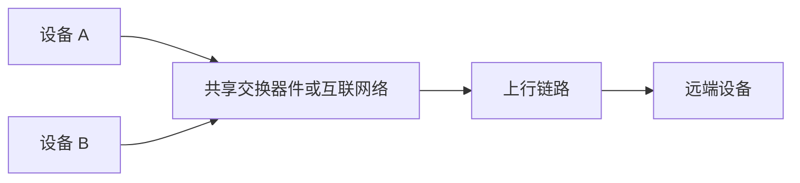

# 互联：链路、内存访问与通信库

两个加速器要交换张量，物理路径、受支持的访问机制和软件协议必须相互匹配。“PCIe、RDMA、HCCL”这样的列表混合了三个层次。把它们分开，才能理解为什么启用某个软件选项，并不能创造硬件原本没有的可达性。

## 把术语放回对应层次

| 层次 | 示例 | 职责 |
| --- | --- | --- |
| 物理或系统连接 | PCIe、HCCS、Ethernet | 连接设备，承载流量 |
| 传输与内存访问 | RDMA、RoCE、UB/URMA 相关机制 | 规定如何使用通信资源和远端内存 |
| 通信软件 | HCCL、HCOMM、MemFabric 后端 | 提供操作，管理资源 |
| 应用操作 | AllReduce、缓存传输、远程读取 | 表达要完成的有效工作 |

PCIe 连接 Host 和 I/O 设备，Root Complex 与 Switch 会影响路径共享。HCCS 是昇腾高速互联的名称，能力取决于具体产品。Ethernet 提供网络承载，RoCE 在以太网上运行 RDMA。受支持的 RDMA 路径可以减少 CPU 逐字节复制，但仍需要初始化、内存准备和完成处理。

Unified Bus、URMA、UBoE 属于另一套互联与访问体系。URMA 提供远程内存访问资源及操作；UBoE 在以太网基础设施上承载 UB 通信。这些名称不代表所有引擎、协议和内存类型之间都兼容。此处 UB 与 AI Core 的 Unified Buffer 无关。

## Scale-up、Scale-out 与拓扑

Scale-up 强调紧耦合通信域内的扩展，Scale-out 通过更大的网络连接多个系统。紧耦合域可能超过一台服务器，因此不能把“服务器内”作为通用定义。Full Mesh 将端点两两直连，$n$ 个端点需要 $n(n-1)/2$ 条无向连接。交换拓扑减少直接布线，但引入共享链路和路由约束。

即便 A、B 各自的本地链路都很快，同时访问远端时仍可能共享上行链路。因此，仅看端点带宽不足以预测总吞吐。

## RDMA 资源与完成语义

远程操作需要通信端点、准备好的内存、访问权限和传输机制支持。Read 从远端拉取数据，Write 向远端推送数据；许多 API 的 Send/Receive 则要求匹配接收资源。内存 Key 或访问描述不是可以随意解引用的普通指针。

本地完成、远端到达、远端可见和应用收到通知，是不同问题。应选择文档规定的同步原语，让消费者正确使用数据。正确传输还依赖生命周期约束：操作尚在途时注销或复用内存，会使访问失效。

RoCE 部署通常结合拥塞控制、流量分类和流控配置。PFC 可以暂停特定优先级的流量，但不能替代拥塞控制，也不能保证良好的长尾延迟。修改网络设置前，先检查计数器和拓扑。

## 软件职责与实践检查项

HCCL 提供集合操作，HCOMM 提供受支持的通信原语和资源，MemFabric 组织内存与搬运。具体依赖关系随后端变化。比较不同实现时，应保持载荷、端点、完成保证和预热条件一致。

对每条路径记录设备代际、运行时和驱动版本、Endpoint 在 Host 还是 Device、协议、注册内存类型、权限与完成机制。[昇腾通信资源文档](https://www.hiascend.com/doc_center/source/en/CANNCommunityEdition/910/commlib/hixlug/llmcrv2_42_25.html)明确区分协议与端点放置，其能力表适用于对应版本。继续阅读[网络平面](network-planes.md)和[端到端传输](end-to-end-transfer.md)。
