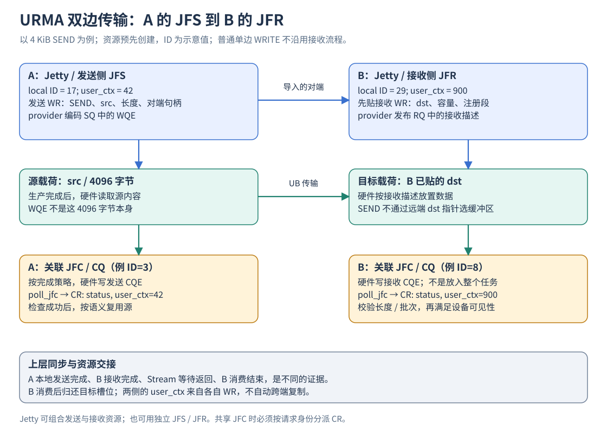
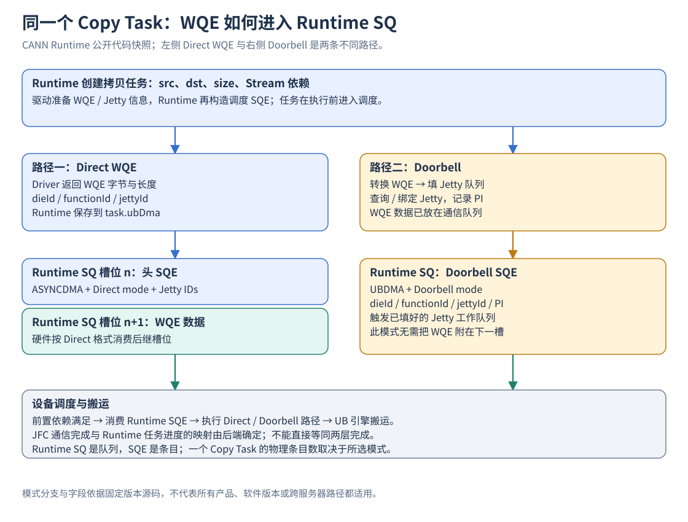
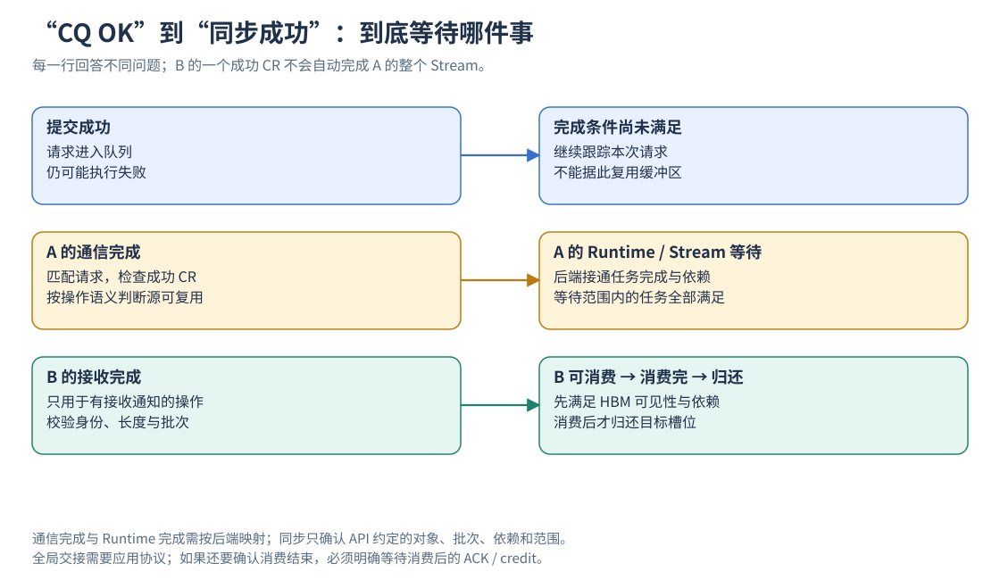

# 🛶 从 Jetty 到 Runtime：一次拷贝的队列与完成

把一次传输画清楚，需要同时标出**两端通信资源、载荷去向、Runtime 调度描述、完成条件**。其中，“A 的 JFS 发、B 的 JFR 收、两侧 JFC 报完成”适合解释 **Send/Recv**；“`src / dst / size` 转 WQE，再构造 Runtime SQE”则对应特定的 **UB 异步拷贝实现**。两者不能不加区分地拼成一条流程。

本章先画双边消息，再对照公开 CANN Runtime 源码画实际拷贝任务。术语基础与 verbs 对照见[工作队列与门铃](work-queues.md)。

## 🧩 资源、队列、描述符不是同一个对象

| 对象 | 职责 | 本次传输中怎样使用 |
| --- | --- | --- |
| Jetty | URMA 通信端点对象，组织发送配置与关联接收资源 | 可以创建组合式 Jetty，也可采用独立 JFS/JFR；不要求每次拷贝重新创建 |
| JFS | Jetty for Send，发送资源 | 关联发送队列 SQ；支持发送、单边读写等主动操作 |
| JFR | Jetty for Receive，接收资源 | 关联接收队列 RQ；双边消息先提供接收缓冲区描述 |
| JFC | Jetty for Completion，完成资源 | 关联完成队列 CQ；多个通信资源可以共享，需按身份分派完成 |
| WR / WQE | 软件请求 / 硬件工作描述 | 应用或 Runtime 提供参数，provider/驱动转换成设备格式 |
| CQE / CR | 硬件完成项 / URMA 返回的软件完成记录 | 硬件写 CQE，`urma_poll_jfc` 返回 `urma_cr_t`，仍要检查状态 |
| Runtime Task / SQ / SQE | 软件任务 / 调度队列 / 队列项 | Task 关联地址、Stream 和后端状态；Runtime 构造 SQE 供设备调度 |

**完成后进入 CQ 的是完成记录，不是把整个 copy task 搬进 CQ。** 同样，应说“SQE 进入 Runtime 的 SQ”，而不是“加入 Runtime 的 SQE”。URMA 的软件类型与完成字段可对照[固定版本头文件](https://github.com/openeuler-mirror/umdk/blob/ec61c9507624c5135a935f40abc242543784e790/src/urma/lib/urma/core/include/urma_types.h)。

部分 UB/设备文档也把**通信发送队列项**称为 SQE。本章的“Runtime SQE”专指调度层描述；同名缩写不表示结构相同。

### Jetty ID 和请求 ID 各自标识什么

- **通信对象身份：**URMA 的 `urma_jetty_id_t` 包含 `eid / uasid / id`，不能只拿一个整数 `id` 当作全局地址。
- **本地完成关联：**WR 的 `user_ctx` 随本地完成返回；A 的发送标识不会自动成为 B 的接收标识。
- **Runtime 调度定位：**后文的 `dieId / functionId / jettyId` 用来定位硬件提交目标，`stream_id / task_id` 标识 Runtime 工作。
- **应用批次：**层号、块号、generation 由上层协议管理；Jetty ID 本身不表示“这是第几次用这个目标块”。

## 📬 图一：4 KiB Send/Recv，两端各自如何推进

<figure class="model-figure" markdown="1">

[](../../assets/transfer-diagrams/zh/jetty-send-recv.svg)

<figcaption markdown="span">图：双边 SEND 的资源与数据流。ID 为示意值；假定设备查询允许本次消息大小。发送完成与接收完成由各自一端处理。</figcaption>

</figure>

假设 A 要把 `src` 的 4096 字节交给 B。双方已完成设备上下文、通信资源和内存注册；按传输模式完成对端导入、必要的绑定/建链。以下使用独立 JFS/JFR API 名称；组合 Jetty 可使用对应 `urma_post_jetty_*_wr` 接口。

| 步骤 | A：发起端 | B：接收端 |
| --- | --- | --- |
| 1. 准备目标 | 等待目标槽位授权 | 预留 `dst`，准备容量足够的已注册接收缓冲区 |
| 2. 发布接收 | 尚未发数据 | 填接收 WR，记录 `user_ctx=900`，调用 `urma_post_jfr_wr`；provider 发布接收 WQE |
| 3. 准备发送 | 等源生产完成；填 SEND WR：`src`、长度、导入的对端句柄、`user_ctx=42`、完成策略 | 保持接收资源与目标块有效 |
| 4. 提交 | 调用 `urma_post_jfs_wr`；provider 编码发送 WQE，按设备协议发布并通知硬件 | 等待硬件接收；不必逐字节执行 CPU 拷贝 |
| 5. 搬运 | 硬件读取源载荷，经支持的 UB 路径传输 | 硬件按已贴的接收描述放置载荷 |
| 6. 完成上报 | 按策略向关联 JFC/CQ 写发送 CQE | 向关联 JFC/CQ 写接收 CQE |
| 7. 检查 | Poll 得 CR，匹配 `user_ctx=42` 并检查成功状态；按操作语义回收源 | Poll 得 CR，匹配 `user_ctx=900`、方向、长度及应用批次 |
| 8. 消费与回收 | 等 B 归还目标块 credit，之后才能覆盖其槽位 | 满足内存可见性与执行依赖后消费；消费完归还 credit，并为后续消息补贴接收资源 |

接收 WR 描述的是 B 的缓冲区；在本次 API 快照中该 SGL 字段名为 `urma_jfr_wr_t.src`，不应因字段叫 `src` 就把它误读成 A 的源地址。

**SEND 的发送请求不靠填写 B 的 `dst` 指针来选择目标。** 它选择对端通信资源；目标缓冲区由 B 的接收 WR 决定。需要明确指定远端 `dst` 的是单边 Write 一类操作。官方[URMA 示例](https://github.com/openeuler-mirror/umdk/blob/ec61c9507624c5135a935f40abc242543784e790/src/urma/examples/urma_sample.c)展示了预贴接收、提交发送和检查 CR 的实际用法。

### 换成单边 Write，不能照搬这张接收图

| 操作 | 目标缓冲区从哪里来 | B 是否每笔预贴接收描述 | B 是否自动得到对应接收完成 |
| --- | --- | --- | --- |
| Send/Recv | B 接收 WR 的缓冲区 | 是 | 按双边接收语义上报 |
| 普通 Write | 请求中的远端目标地址与注册段 | 不要求每笔贴 Recv | 通常没有；要另外约定就绪通知 |
| 普通 Read | 发起方提供本地目标，指定远端源段 | 不要求每笔贴 Recv | 通常没有目标应用接收通知 |
| 带 immediate / notify 的扩展操作 | 由操作定义 | 按实际 API、provider 与版本确认 | 按该操作的通知与完成语义确认 |

**“两端需要有效的通信、地址和权限资源”成立，不等于“所有 copy 都由 B 的 JFR 消耗一条接收描述，再报一条接收 CQE”。** 驱动中存在远端 JFR/Jetty 上下文，也不能据此推出这笔操作是 SEND。

另一个接口差异是：本次 URMA 头文件的 immediate/notify 数据为 64 位且采用 Host 字节序；前章 ibverbs 示例的 immediate 为 32 位网络字节序。不要直接复制字段处理。[URMA 类型定义](https://github.com/openeuler-mirror/umdk/blob/ec61c9507624c5135a935f40abc242543784e790/src/urma/lib/urma/core/include/urma_types.h)与[用户指南](https://docs.openeuler.org/zh/docs/24.03_LTS_SP3/unifiedbus/unifiedbus/urma/URMA%20User%20Guide.ch.html)提供了这两个编程边界。

## 🏗️ 图二：真实 Runtime 拷贝，驱动返回什么

以下绑定 **CANN Runtime 公开镜像快照 `8ff82a21f152`**，分析它的 UB 异步拷贝分支，不能泛化为任意设备、CANN 版本或跨服务器路径。源/目标必须已经通过该后端的资源与地址准备；本地 `memcpy` 不能仅换一个远端指针就自动变成跨服务器拷贝。

<figure class="model-figure" markdown="1">

[](../../assets/transfer-diagrams/zh/runtime-ubdma-modes.svg)

<figcaption markdown="span">图：同一个逻辑 copy task 的两种表示。Direct 模式确实把 WQE 数据放进 Runtime SQ 的后继槽位；Doorbell 模式则触发已经填好的 Jetty 工作队列。</figcaption>

</figure>

### ① 先有 Runtime Task，执行前完成转换和提交

`ConvertAsyncDma` 从任务取出 `src / destPtr / size`，并带上 `tsId / sqId / copyType`。普通分支调用 `CreateAsyncDmaWqe`；绑定或软件 SQ 分支进入 Jetty 管理路径。这些发生在**执行前**，不是等两端 CQ 成功后再将任务交给 Runtime。[转换入口](https://github.com/hicann/runtime/blob/8ff82a21f1527e56834ffa89117e6f7d21dc7b56/src/runtime/core/src/task/task_info/memory/memory_task_v200_base.cc#L1064)

`NpuDriver::CreateAsyncDmaWqe` 把请求转换成 HAL 参数并调用 `halAsyncDmaCreate`：

| 类别 | 字段 | 含义 |
| --- | --- | --- |
| 输入载荷描述 | `src / dst / len` | 从哪里搬到哪里，多少字节 |
| 输入提交上下文 | `tsId / sqId / type / async_dma_type` | 使用哪类任务、哪条调度资源关联 |
| 输出硬件定位 | `dieId / functionId / jettyId` | 后续调度描述用来定位 Jetty |
| 输出工作描述 | `wqe / size` | WQE 字节指针及描述符长度；这里 `size` 不是原始载荷字节数 |
| HAL 其他进度字段 | `pi` 等 | 不同分支使用队列进度；不能在所有模式中按同一方式解释 |

**这条接口不是同时返回“完整 Runtime SQE + WQE”。** 驱动提供 WQE/定位信息；Runtime 保存到 `task.ubDma` 后构造调度 SQE。参见[驱动封装](https://github.com/hicann/runtime/blob/8ff82a21f1527e56834ffa89117e6f7d21dc7b56/src/runtime/driver/npu_driver_standard_soc.cc#L66)和 [HAL 输入输出定义](https://github.com/hicann/runtime/blob/8ff82a21f1527e56834ffa89117e6f7d21dc7b56/pkg_inc/driver/ascend_hal_define.h#L1282)。

### ② Direct WQE：头 SQE 后面确实跟着 WQE 数据

`ConstructDavidAsyncDmaSqe` 构造 ASYNCDMA 类型的头 SQE，设置 Direct WQE 模式及 Jetty 定位信息；随后把保存的 WQE 字节复制到 `command + 1`，或对应的下一 SQ 槽位。

```text
同一个 Runtime copy task
  Runtime SQ 槽位 n    ：调度头 SQE {Direct 模式, die/function/jetty ID, ...}
  Runtime SQ 槽位 n + 1：WQE 字节 {操作、地址、长度等硬件格式}
```

所以，**语义上 SQE 与 WQE 负责不同层次，物理上这条实现允许二者连续放在 Runtime SQ 中**。不能只画成两个永远分离的内存区域，也不能将这个布局推广成所有 WQE 的规则。[Direct 构造函数](https://github.com/hicann/runtime/blob/8ff82a21f1527e56834ffa89117e6f7d21dc7b56/src/runtime/core/src/task/task_info/memory/memory_task_v200.cc#L131)

### ③ Doorbell：先填 Jetty，再用 SQE 发布进度

Jetty 管理路径通过 `AsyncDmaWqeConvert` 生成 WQE，按批次将其填入 Jetty 工作队列，绑定/查询 Jetty 后回填任务定位信息。`ConstructDavidAsyncUbDbSqe` 再构造 UBDMA Doorbell SQE，携带 `jettyId / functionId / dieId / pi` 等信息。

```text
Jetty 工作队列：WQE[0], WQE[1], ...    ← 先准备
Runtime SQ    ：Doorbell SQE {Jetty 定位, PI, ...}
设备调度      ：前置依赖满足后执行通知，触发 Jetty 队列
```

此时 WQE 不必附在这个头 SQE 的下一槽。一个 task 可关联多个 WQE；PI 是队列进度，不是本次载荷长度。对应代码见 [Jetty 转换、填充与回填](https://github.com/hicann/runtime/blob/8ff82a21f1527e56834ffa89117e6f7d21dc7b56/src/runtime/feature/jetty/stream_jetty_handler.cc#L103)和 [Doorbell SQE 构造](https://github.com/hicann/runtime/blob/8ff82a21f1527e56834ffa89117e6f7d21dc7b56/src/runtime/core/src/task/task_info/memory/memory_task_v200.cc#L173)。

驱动快照还显示：UB 异步拷贝可根据地址方向选 **Read 或 Write**，例如 D2D 根据执行设备与目标设备关系选择。因此上层都叫 copy，也可能是目标拉取或源端推送，并非都走 SEND/JFR 接收描述。[驱动操作选择与 WQE 生成](https://github.com/hicann/driver/blob/b94e5d02eea5164f3f6894a8005fdef44b264042/src/ascend_hal/trs/core/urma/master/trs_master_async.c#L438)

## ✅ 图三：接收 CQ 成功，是否就代表上层同步成功

<figure class="model-figure" markdown="1">

[](../../assets/transfer-diagrams/zh/jetty-completion-scope.svg)

<figcaption markdown="span">图：先明确同步 API 等待的对象与范围；B 的接收完成不会自动完成 A 的全部 Stream 工作。</figcaption>

</figure>

**只有当上层等待的条件就是“B 这笔接收已经成功”，并且完成身份、批次、长度与所需可见性都满足时，才能把它作为该等待的成功证据。** “任意 CQ 有一条 OK”不够。

| 观察点 | 能确认什么 | 不能直接确认什么 |
| --- | --- | --- |
| 提交 API 返回成功 | 请求被接受 | 搬运完成、远端可读 |
| `urma_poll_jfc` 返回记录数大于 0 | 取到一些 CR | 这些 CR 全成功、恰好属于当前请求 |
| 匹配的发送 CR 成功 | 该操作达到发送侧规定完成点 | B 已消费，B 目标槽可覆盖 |
| 匹配的接收 CR 成功 | 具有接收语义的该操作达到接收完成点 | 任意 NPU/GPU 内核已满足读取依赖、A 的 Stream 已结束 |
| Runtime/Stream 同步返回成功 | 后端正确接入完成与依赖后，所等待范围满足 API 契约 | 所有远端 Rank 的计算和消费都结束 |
| 消费后 ACK / credit | 达到应用约定的消费或槽位释放点 | 超出协议约定的其他工作也完成 |

URMA 路径要检查 `status`、发送/接收方向、`user_ctx`、`local_id`，并在字段有效的操作上检查 `completion_len` 等；共享 JFC 时尤其需要分派。Runtime 的任务完成、调度 CQE、错误推进又属于另一层，**不能直接把一次 JFC 完成等同于 Runtime 任务完成**。两层的通知、队列与完成如何映射，由实际后端决定。

运行时可能由驱动或设备内部处理通信完成，不要求应用自己 Poll 每个 JFC。若要证明某个 `Synchronize` 的确等待了本次跨端 copy，必须继续追踪对应产品后端怎样将通信完成、任务进度和错误接到等待条件；仅凭 WQE/SQE 构造代码还不能证明整个同步契约。

将本章流程接到设备生产与逐层消费，可继续看[设备发起传输](device-initiated-transfer.md)、[端到端 KV 交接](end-to-end-transfer.md)和[逐层推理与传输](../ml/llm/inference/layerwise-inference.md)。
