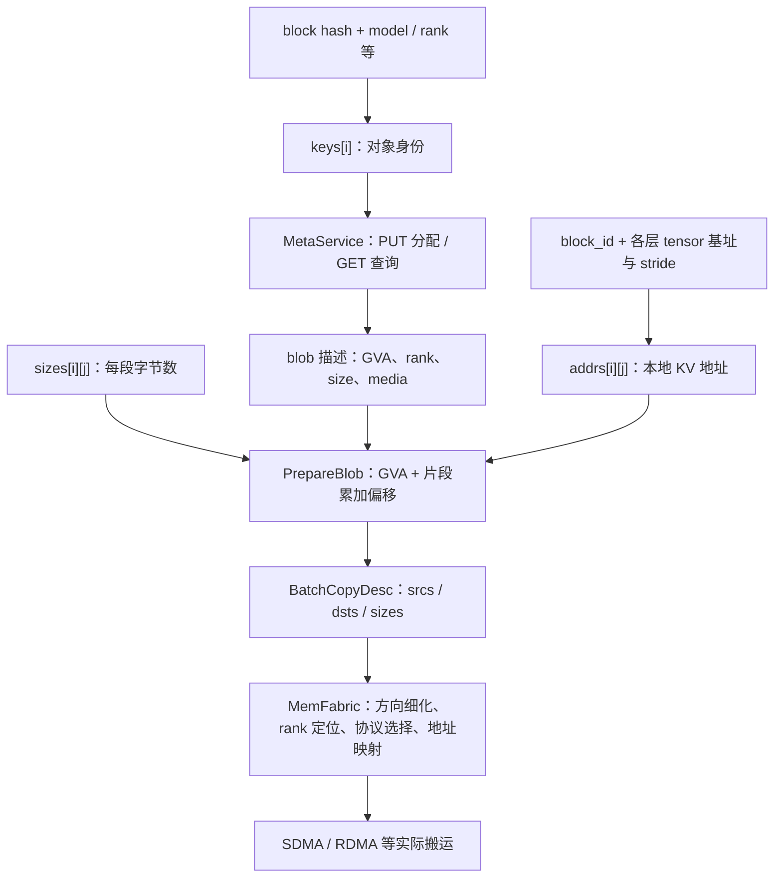

# 🗝️ vLLM Ascend KV 池：从 key 到 MemFabric 拷贝地址

这条调用链的核心是：**key 查出池内 blob 的 GVA，vLLM 根据 block_id 算出本地 KV 地址；两条线在 `PrepareBlob()` 汇合，展开成 `(src, dst, size)` 清单，再交给 MemFabric。**

可以把它想成行李寄存：key 是行李牌，MetaService 管柜号，GVA 是柜子在池中的坐标，`addrs` 是各包行李当前的位置，`PrepareBlob()` 开搬运单，MemFabric 按单执行。

## 📌 源码版本与阅读范围

核对日期：2026-11-25。以下使用固定提交，函数名、key 格式和行号均以这些版本为准。

| 项目 | 固定提交 | 本文跟踪的入口 |
| --- | --- | --- |
| vLLM Ascend | [6e1ed5a][va-backend] | `MemcacheBackend.put()` / `get()` |
| MemCache | [54dbfe6][mc-store] | `batch_put_from_layers` / `batch_get_into_layers` |
| MemFabric Hybrid | [0491206][mf-bm] | `smem_bm_copy_batch` / `hybm_data_batch_copy` |

主线是 HBM／DRAM 中的对象读写。SSD、回温及直接存储读取有额外分支。本文中的“IO 地址”指提交给拷贝接口的源、目的端点；继续下钻时要分别使用 GVA、DVA、HVA、注册内存等准确名称。

## 🗺️ 两条地址线在哪里汇合



**key 表示内容身份，block_id 表示当前进程中的缓存槽位。** 相同 key 在另一个 Worker 加载时，可以落入不同的 block_id 和本地地址。

## 📥 vLLM 实际传入哪些参数

`MemcacheBackend` 显式指定设备方向，调用形态如下。这里是接口示意，需要已经初始化并注册缓冲区的真实 store。

```python
store.batch_put_from_layers(keys, addrs, sizes, 0)  # 本地 HBM → 全局池
store.batch_get_into_layers(keys, addrs, sizes, 1)  # 全局池 → 本地 HBM
```

| 参数 | 类型与形状 | 含义 |
| --- | --- | --- |
| `keys` | `list[str]`，长度 N | N 个对象，通常对应 N 个逻辑 KV block |
| `buffer_ptrs`，vLLM 中称 `addrs` | `list[list[int]]` | 第 i 个对象的第 j 段本地内存地址；传指针数值，而非 Tensor 内容 |
| `sizes` | `list[list[int]]` | 对应片段的字节数 |
| `direct` | `int` | PUT 为 `0 = COPY_L2G`；GET 为 `1 = COPY_G2L` |
| `replicateConfig` | PUT 的可选参数 | 副本数及偏好的 LocalService；这条 vLLM 调用采用默认配置，默认单副本 |

`L` 是本地设备 HBM，`H` 是本地 Host 内存，`G` 是全局池空间。Python API 的默认方向是 Host 方向，vLLM 显式传入的 0／1 会覆盖默认值。全局端最终落在 HBM 还是 DRAM，由池配置与分配结果决定。

两个维度要分清：

```text
addrs = [
  [A_layer0_K, A_layer0_V, A_layer1_K, A_layer1_V, ...],  ← key A
  [B_layer0_K, B_layer0_V, B_layer1_K, B_layer1_V, ...],  ← key B
]
 ↑ 外层：不同对象        ↑ 内层：同一对象的多个片段
```

实际片段数取决于 KV 布局；K/V 分开、合并或 MLA 会有差别。MemCache 把这一行当作有序 buffer 列表处理，并不解释其中哪些字节属于 K、V 或某个模型层。不同对象的片段数可以不同，但每行地址数必须等于该行长度数，且长度为正。参见 [binding][mc-binding]、[参数包装与校验][mc-store]。

## 🧠 key 与本地地址分别怎样生成

这版非 layerwise key 使用 `ChunkedTokenDatabase` 的前缀加 block hash，完整字符串形态为：

```text
<model>@dcp:<dcp_rank>@head_or_tp_rank:<rank>@pp_rank:<pp_rank>@group:<group_id>@cache_role:kv@cache_family:default@<block_hash>
```

`cache_role`、`cache_family` 等字段会随缓存类型变化。MemCache 将最终字符串作为对象 key 接收；vLLM 的模型、并行分片和布局信息已经编码在其中。参见 [`_get_key_prefix()` 与 key 迭代器][va-metadata]。

本地地址来自 `prepare_value()`。对普通完整 block，可以简化为：

```text
本地片段地址 = tensor 基址 + block_id × block_stride
```

分段或部分 block 还要考虑片段覆盖范围，完整关系为：

```text
addr = base_addr + block_id × block_stride + byte_start
size = byte_end - byte_start
```

因此 `keys`、`addrs`、`sizes` 通过同一个对象索引 i 对齐，但有不同来源：内容身份产生 key，当前缓存分配产生本地地址。参见 [`prepare_value()`][va-prepare]；地址类别的基础见[内存与地址](memory-addressing.md)。

## 📦 PUT：先分配对象，再搬运，再发布可读状态

```text
KVCacheStoreSendingThread
  → MemcacheBackend.put(keys, addrs, sizes)
  → DistributedObjectStore.batch_put_from_layers(...)
  → pybind：整数指针 → void*
  → MmcacheStore::BatchPutFromLayers()
      → GetBufferArrays()
  → MmcClientDefault::BatchPut()
  → DoBatchPut()
      ├─ BatchAllocRequest → MetaService 分配 blob
      ├─ PutData2Blobs()
      │   → PrepareMultiBlobs() → PrepareBlob()
      │   → SubmitPutTask()
      │   → MmcBmProxy::BatchDataPut() → MemFabric
      └─ 同步更新 WRITE_OK / WRITE_FAIL
```

`GetBufferArrays()` 为每个 key 构造一个 `MmcBufferArray`，其中每段为 `{addr, type, offset=0, len}`。`TotalSize()` 累加各段长度；包装描述本身不搬数据。

`DoBatchPut()` 发送 key、总大小、分配选项及操作身份。服务端链路是：

```text
MetaNetServer::HandleBatchAlloc()
  → MmcMetaMgrProxy::BatchAlloc()
  → MmcMetaManager::Alloc()
  → MmcGlobalAllocator::Alloc()
  → MmcBlobAllocator::Alloc()
```

LocalService 预先将池的 GVA 基址、容量和介质注册给 MetaService。分配器按策略选定池，再切出空闲范围：

```text
blob.gva = 池的 GVA 基址 bmAddr_ + 分配到的 targetOffset
```

随后 `MmcMetaManager::Alloc()` 建立 `key → 对象元数据 → blob` 关系。返回的 `MmcMemBlobDesc` 包含 GVA、rank、大小、介质和状态等字段；多副本对应多个 blob。GVA 来自空间分配，key 用于索引这份结果。参见[对象分配][mc-meta]、[分配器][mc-allocator]。

客户端收到描述后拷贝数据，等待相关任务完成，再同步上报写结果。成功写入通过 `WRITE_OK` 将对象从 `ALLOCATED` 推进到 `READABLE`；分配完成与对象可读是两个阶段。参见 [`DoBatchPut()`][mc-client] 和[状态机][mc-state]。

## 🧩 PrepareBlob：把一个 key 展开成多条 IO

设第 i 个对象的 GVA 为 `Gi`，第 j 段本地地址为 `Aij`，长度为 `Sij`：

```text
Oij = sizes[i][0] + ... + sizes[i][j-1]

PUT：src = Aij，      dst = Gi + Oij，len = Sij
GET：src = Gi + Oij， dst = Aij，     len = Sij
```

`PrepareBlob()` 用 `shift` 保存上述累加偏移。PUT 的 `blobIsSrc=false`，GET 为 `true`；它们交换全局端与本地端的位置。`PrepareMultiBlobs()` 为所有写副本重复这一展开过程。参见 [`PrepareBlob()`][mc-prepare]。

假设两个 key，每个 key 两个片段，分别为 4 KiB、2 KiB。下列地址均为便于阅读的教学数值，并非真实 NPU 地址。

| 对象／片段 | 本地地址 | 分配的 blob GVA | 片段池内地址 | 字节数 |
| --- | --- | --- | --- | --- |
| A／片段0 | `0x100000` | `0x900000` | `0x900000` | `0x1000` |
| A／片段1 | `0x200000` | `0x900000` | `0x901000` | `0x0800` |
| B／片段0 | `0x101000` | `0xA00000` | `0xA00000` | `0x1000` |
| B／片段1 | `0x200800` | `0xA00000` | `0xA01000` | `0x0800` |

PUT 展开为：

```text
srcs  = [0x100000, 0x200000, 0x101000, 0x200800]
dsts  = [0x900000, 0x901000, 0xA00000, 0xA01000]
sizes = [0x1000,   0x0800,   0x1000,   0x0800  ]
```

下面的可运行例子只模拟描述展开，不访问设备，也不发起 DMA：

```python
# runnable-example
addrs = [[0x100000, 0x200000], [0x101000, 0x200800]]
sizes = [[0x1000, 0x0800], [0x1000, 0x0800]]
gvas = [0x900000, 0xA00000]
copies = []
for local_parts, lengths, gva in zip(addrs, sizes, gvas):
    offset = 0
    for address, length in zip(local_parts, lengths):
        copies.append((address, gva + offset, length))
        offset += length
assert [dst for _, dst, _ in copies] == [0x900000, 0x901000, 0xA00000, 0xA01000]
assert len(copies) == 4
assert sum(length for _, _, length in copies) == 12 * 1024
for src, dst, length in copies:
    print(f"{src:#x} -> {dst:#x}: {length} bytes")
```

两个 key 产生四条 copy 描述。若两个 key 都写两个副本，则在这个例子中产生八条。MemCache 可以聚合或拆批提交；底层还可能按 rank 分组、合并连续范围或进一步拆分，因此描述数不等于硬件任务数。

## 📤 GET：查已有地址，拆回当前进程的 buffer

```text
KVCacheStoreRecvingThread
  → MemcacheBackend.get()
  → batch_get_into_layers()
  → MmcacheStore::BatchGetIntoLayers()
  → MmcClientDefault::BatchGet()
      ├─ BatchGetRequest
      │   → MetaNetServer::HandleBatchGet()
      │   → MmcMetaMgrProxy::BatchGet()
      │   → MmcMetaManager::GetByRank()
      │   ← 返回可读 blob 描述，并建立读租约
      └─ 使用响应中的 blobs[0]
          → PrepareBlob(..., blobIsSrc=true)
          → SubmitGetTask()
          → MmcBmProxy::BatchDataGet() → MemFabric
```

在前面的例子中，GET 从 `0x900000`、`0x901000` 等池内位置读取，但目的地址可以是新 Worker 新分配的 buffer。客户端会检查本地各段总长度等于 blob 大小，读完上报 `READ_FINISH`，并检查读租约期限。参见 [`BatchGet()`][mc-get]。

**blob 保存按顺序拼接的字节；GET 的 buffer 描述决定怎样拆回。** 调用方必须保持相应的片段顺序和大小；总长度相同并不足以证明 K/V 或层的对应关系正确。

Python layers API 返回按 key 对齐的状态列表，0 表示成功。在这版 vLLM backend 中，PUT 再把它转换为布尔列表，GET 保留状态码列表。返回列表长度对应对象数，而非 copy 描述数。参见 [MemcacheBackend][va-backend]。

## 🚚 MemFabric 接手后还做什么

`BatchDataPut()` / `BatchDataGet()` 将 `BatchCopyDesc` 包装为 `smem_batch_copy_params`：

| 字段 | 来源 |
| --- | --- |
| `sources` | `srcs` |
| `destinations` | `dsts` |
| `dataSizes` | `sizes` |
| `batchSize` | 本次提交的 copy 描述条数 |
| `stream` | 这条 MemCache 路径默认空 |

```text
MmcBmProxy::BatchDataPut / BatchDataGet
  → MFSmemApi::SmemBmCopyBatch(handle, params, direction, flags=0)
  → 动态库符号 smem_bm_copy_batch()
  → SmemBmEntry::DataCopyBatch()
  → hybm_data_batch_copy()
  → MemEntityDefault::BatchCopyData()
  → HostComposeDataOp::BatchDataCopy()
  → 具体协议的 BatchDataCopy()
```

到这里，MemFabric 收到的是地址、长度、方向和句柄；key 留在 MemCache 的对象及完成状态管理中。参见 [MemCache BM 代理][mc-proxy]、[MemFabric BM 入口][mf-bm]、[BM 到 HYBM][mf-entry]。

`SmemBmEntry` 根据全局端点的介质细化方向，例如本地设备→全局 Host。`MemEntityDefault` 定位源、目的 rank 并形成分组；`HostComposeDataOp` 按可用协议调度 SDMA、Device RDMA、Host RDMA 等实现。参见 [HYBM entity][mf-entity] 和[协议分派][mf-compose]。

以 `device_sdma` 为例：全局端的 GVA 需要解析为设备可访问的映射地址。当前代码先尝试本实体的 imported GVA 解析器，再回退到 `HybmVaManager::TransformVa(GVA, GVA→DVA)`：

```text
输入 GVA = GVA_base + offset
                       ↓ 查映射记录
输出 DVA = DVA_base + offset
```

`BatchCopyG2G()` 还会合并源、目的都连续的范围，再提交任务并等待完成。普通内部流路径构造 SDMA 任务；显式流或其他配置会进入相应分支。Host RDMA 路径使用对应的 HVA／注册内存和传输机制。GVA、DVA、HVA 与 DMA IOVA 的含义要分别判断。参见 [VA 映射][mf-va]、[SDMA 实现][mf-sdma]、[Host RDMA 地址转换][mf-host-rdma]；背景见 [GVA 统一编址](gva-unified-addressing.md)。

## 🪜 layers API 与 layerwise 执行模式

`batch_*_layers` 的接口维度是“一个 key 的多个 buffer”。`use_layerwise=True` 描述执行与搬运的调度粒度；二者需要分别跟踪。

本次核对的 vLLM MemCache layerwise GVA 路径，会通过 `batch_alloc` 准备写 GVA，通过 `batch_get_key_info` 和 `batch_add_lease` 准备读 GVA，再按层计算偏移执行 `batch_copy`，最后用 `batch_write_finish` 发布写完成。它把分配／查询与逐层数据搬运拆开了。参见 [GVA 准备][va-gva] 和[逐层传输][va-layer-transfer]。

继续阅读[逐层推理与缓冲区生命周期](../ml/llm/inference/layerwise-inference.md)，可以把“地址清单怎样形成”与“何时允许搬运、消费和复用”接起来。

## 🔎 沿源码定位问题

| 观察到的现象 | 优先核对的边界 |
| --- | --- |
| key 命中不符合预期 | model、hash、并行分片、group、role、family 是否一致 |
| 总大小校验失败 | 同一 key 的片段数、顺序、字节数及 KV 布局 |
| 找不到 GVA 映射 | 分配描述是否仍有效，池导入／注册是否完成，生命周期是否覆盖搬运 |
| 地址和长度正确但结果错层 | GET 拆分顺序与 PUT 拼接顺序是否一致 |
| 描述条数与任务数不同 | 副本展开、MemCache 聚合、rank 分组、连续范围合并与底层拆分 |
| 写后立即读不到 | copy 结果与 `WRITE_OK` 状态发布是否均完成 |

[va-backend]: https://github.com/vllm-project/vllm-ascend/blob/6e1ed5a76a01f110e4a0682ba93ddd3b1265e5cf/vllm_ascend/distributed/kv_transfer/kv_pool/ascend_store/backend/memcache_backend.py#L406
[va-metadata]: https://github.com/vllm-project/vllm-ascend/blob/6e1ed5a76a01f110e4a0682ba93ddd3b1265e5cf/vllm_ascend/distributed/kv_transfer/kv_pool/ascend_store/metadata.py#L371
[va-gva]: https://github.com/vllm-project/vllm-ascend/blob/6e1ed5a76a01f110e4a0682ba93ddd3b1265e5cf/vllm_ascend/distributed/kv_transfer/kv_pool/ascend_store/layerwise/planes/gva.py#L105
[va-layer-transfer]: https://github.com/vllm-project/vllm-ascend/blob/6e1ed5a76a01f110e4a0682ba93ddd3b1265e5cf/vllm_ascend/distributed/kv_transfer/kv_pool/ascend_store/layerwise/kv_transfer.py#L796
[mc-binding]: https://gitcode.com/Ascend/memcache/blob/54dbfe65435cbbe8e240ab5befe7a6682382e819/src/memcache/csrc/python_wrapper/pymmc.cpp#L865
[mc-store]: https://gitcode.com/Ascend/memcache/blob/54dbfe65435cbbe8e240ab5befe7a6682382e819/src/memcache/csrc/mmcache_store.cpp#L638
[mc-client]: https://gitcode.com/Ascend/memcache/blob/54dbfe65435cbbe8e240ab5befe7a6682382e819/src/memcache/csrc/client/mmc_client_default.cpp#L557
[mc-meta]: https://gitcode.com/Ascend/memcache/blob/54dbfe65435cbbe8e240ab5befe7a6682382e819/src/memcache/csrc/meta_service/mmc_meta_manager.cpp#L1539
[mc-allocator]: https://gitcode.com/Ascend/memcache/blob/54dbfe65435cbbe8e240ab5befe7a6682382e819/src/memcache/csrc/meta_service/mmc_blob_allocator.cpp#L46
[mc-state]: https://gitcode.com/Ascend/memcache/blob/54dbfe65435cbbe8e240ab5befe7a6682382e819/src/memcache/csrc/entities/mmc_blob_state.cpp#L57
[mc-proxy]: https://gitcode.com/Ascend/memcache/blob/54dbfe65435cbbe8e240ab5befe7a6682382e819/src/memcache/csrc/local_service/mmc_bm_proxy.cpp#L392
[mf-bm]: https://gitcode.com/Ascend/memfabric_hybrid/blob/049120611b5dcc96fa71afcaf758f11d4b15f07a/src/smem/csrc/smem_bm/smem_bm.cpp#L613
[mf-entry]: https://gitcode.com/Ascend/memfabric_hybrid/blob/049120611b5dcc96fa71afcaf758f11d4b15f07a/src/smem/csrc/smem_bm/smem_bm_entry.cpp#L616
[mf-entity]: https://gitcode.com/Ascend/memfabric_hybrid/blob/049120611b5dcc96fa71afcaf758f11d4b15f07a/src/hybm/csrc/entity/hybm_entity_default.cpp#L1343
[mf-compose]: https://gitcode.com/Ascend/memfabric_hybrid/blob/049120611b5dcc96fa71afcaf758f11d4b15f07a/src/hybm/csrc/data_operation/host/hybm_compose_data_op.cpp#L217
[mf-va]: https://gitcode.com/Ascend/memfabric_hybrid/blob/049120611b5dcc96fa71afcaf758f11d4b15f07a/src/hybm/csrc/mm/hybm_va_manager.cpp#L268
[mf-sdma]: https://gitcode.com/Ascend/memfabric_hybrid/blob/049120611b5dcc96fa71afcaf758f11d4b15f07a/src/hybm/csrc/data_operation/host/hybm_data_op_sdma.cpp#L531
[mf-host-rdma]: https://gitcode.com/Ascend/memfabric_hybrid/blob/049120611b5dcc96fa71afcaf758f11d4b15f07a/src/hybm/csrc/data_operation/host/hybm_data_op_host_rdma.cpp#L102
[va-prepare]: https://github.com/vllm-project/vllm-ascend/blob/6e1ed5a76a01f110e4a0682ba93ddd3b1265e5cf/vllm_ascend/distributed/kv_transfer/kv_pool/ascend_store/metadata.py#L493
[mc-prepare]: https://gitcode.com/Ascend/memcache/blob/54dbfe65435cbbe8e240ab5befe7a6682382e819/src/memcache/csrc/client/mmc_client_default.cpp#L1345
[mc-get]: https://gitcode.com/Ascend/memcache/blob/54dbfe65435cbbe8e240ab5befe7a6682382e819/src/memcache/csrc/client/mmc_client_default.cpp#L704
