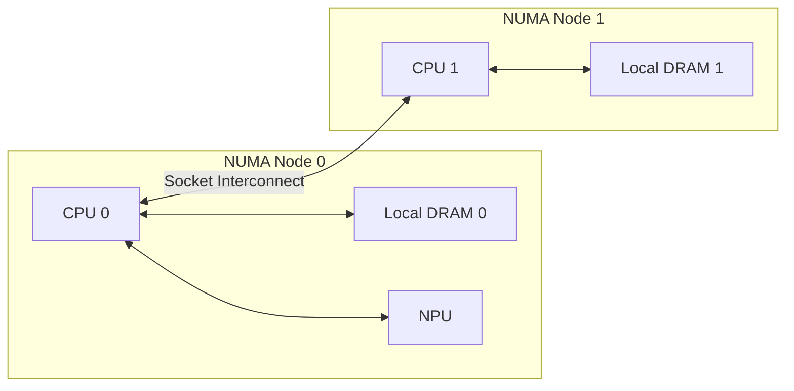

!!! info "中文版正在逐篇更新"

    英文优化版已完成。本页暂时保留原笔记，中文版优化正文正在编写。

# 内存、NUMA 与地址

数据搬运能否成功，不只取决于网络是否连通。内存类型、地址空间、映射关系、NUMA 位置和注册状态都可能
决定一条路径是否可达以及性能如何。

## 内存层次

| 名称 | 常见位置 | 特点 |
| --- | --- | --- |
| L0 / L1 / UB | AI Core 内部或附近 | 容量小、延迟低、带宽高，保存计算分块 |
| HBM / Device Memory | NPU 设备侧 | 保存权重、激活、KV Cache 和计算结果 |
| Host DRAM | CPU Host 侧 | 容量通常更大，可作为加载、卸载或中转空间 |
| Remote DRAM | 其他服务器 | 通过网络和通信协议访问 |
| SSD / 存储系统 | 本地或远端存储 | 持久化、容量大、访问延迟更高 |

!!! note "同名概念"

    AI Core 的 L1 Buffer 是硬件存储层次；推理框架或缓存系统中的 L1 Cache 通常是软件定义的缓存层级。
    两者不能因为名称相同就视为同一资源。

## NUMA 是什么

NUMA (Non-Uniform Memory Access) 表示不同 CPU 访问不同内存节点的成本不完全一致。在多路服务器中，
NPU 通常更靠近某一个 CPU Socket 或 NUMA Node。

如果 NPU 挂在 NUMA Node 0 附近，使用 Node 1 的 Host Memory 可能多经过一跳 CPU 互联。实际影响需要通过
拓扑和基准测试确认，不能只凭编号推断。

## 常见地址概念

| 术语 | 全称 | 含义 |
| --- | --- | --- |
| VA | Virtual Address | 进程或设备看到的虚拟地址 |
| PA | Physical Address | 物理内存地址 |
| IOVA | I/O Virtual Address | I/O 设备进行 DMA 时使用的虚拟地址 |
| MMU | Memory Management Unit | 完成处理器侧地址转换与权限检查 |
| IOMMU | I/O Memory Management Unit | 完成 I/O 地址转换、隔离与权限控制 |
| SVM | Shared Virtual Memory | Host 与 Device 共享或协调虚拟地址空间的机制 |
| GVA | 依实现而定 | 某些系统中表示 Global Virtual Address，必须结合上下文 |
| MR | Memory Region | 向通信引擎注册并授权访问的一段内存 |

## 映射、注册和导入

- **分配**决定内存资源是否存在以及位于哪里。
- **映射**决定当前进程或设备如何通过地址访问资源。
- **注册**把内存范围和权限交给通信引擎，并产生访问所需的句柄或 Key。
- **导入**让另一个进程、设备或节点使用已导出的内存描述。

## 常见故障思路

日志出现 `no mapping`、`RegisterMemory failed` 或 `invalid memory type` 时，应先检查：

1. 地址属于 Host、Device 还是统一虚拟地址空间？
2. 内存是否已经分配、映射并保持有效？
3. 注册长度、边界和访问权限是否与实际操作一致？
4. 当前设备或通信引擎是否支持这种内存类型？
5. 远端使用的句柄、Key 和地址是否来自同一条连接和同一次注册？

这类错误不一定是物理网络故障。先确认地址与内存生命周期，再检查链路和远端状态。
