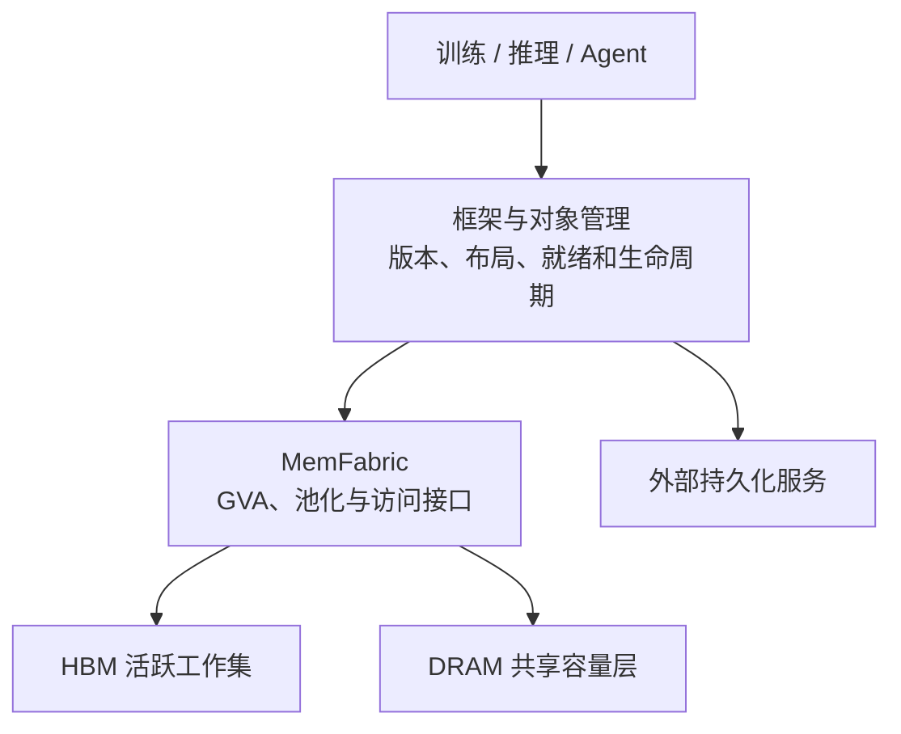

# 🧵 内存 Fabric：五种模式与模型状态

读懂[GVA 统一编址](gva-unified-addressing.md)后，可以进一步追踪：一份模型数据由谁产生、
放在哪里、由谁消费、什么时候回收？这些问题把寻址、传输和应用调度连接起来。

本文以 MemFabric 为实现入口，归纳五种可组合的应用模式。
框架集成与下面的设计例子分别说明；统一地址不会自动建立所有业务对象服务。

## 🧠 先认识要管理的数据

| 数据对象 | 产生与使用 | 适合研究的优化 |
| --- | --- | --- |
| Parameter | Learner 更新，训练和推理读取 | 版本发布、分片传输、共享权重源 |
| Activation | Forward 产生，Backward 稍后使用 | 卸载、预取、重计算取舍 |
| Optimizer State | 优化器持续更新动量等状态 | 分片驻留与读写调度 |
| KV Cache | Prefill/Decode 产生，后续 Attention 使用 | 前缀复用、交接、分层取数 |
| Trajectory | Actor 产生，Learner 消费 | 生产消费解耦、样本版本管理 |
| Feature | Encoder 产生，Backbone 或其他任务使用 | 数据流解耦与兼容特征复用 |

HBM 适合活跃计算工作集，Host DRAM 提供容量与共享空间，文件系统或对象存储承担持久化。
分层设计需要同时考虑大小、读写频率、复用程度与下一次使用时间，而不只是数据名称。

## 🏗️ 三层职责



Object ID 表示业务身份，例如“版本 V10 的权重分片 3”；GVA 描述池内的访问位置。
迁移后可以更新两者的关联，但任意迁移后原 GVA 是否有效取决于实现，不能仅凭对象身份推断。
对象管理可以是框架已有的目录、队列或块表，不要求额外建设一个集中式服务。

| 接口 | 集成起点 | 主要用途 |
| --- | --- | --- |
| BM | 创建池化内存并取得 GVA | 多节点 DRAM/HBM 空间和数据访问 |
| TRANS | 注册应用已有内存 | 跨节点读写与批量异步传输 |
| SHM | 共享空间与设备侧访问上下文 | 自定义通信算子、细粒度访问 |
| Acc Offload | 本地或共享 DRAM 池 | 批量稀疏拷贝、KV 卸载与共享权重 |

参见[MemFabric 项目说明][mf]及[SHM 接口定义][shm]。
接口与后端组合受硬件、内存类型和软件版本限制。

## 1. 全局数据共享

把多个进程需要访问的数据组织为共享对象，消费者通过相应地址和访问接口读取。
只读权重和兼容的公共前缀比较容易明确共享边界；可变数据需要定义写入归属和版本。

例如，[Engram 案例][engram]说明跨实例共享 Host 权重，并支持不同 rank 贡献不同容量。
它证明的是特定部署下的共享访问能力；不意味着任意张量都能直接跨实例复用。

收益应观察重复驻留字节数和避免的重复计算，还要计入本地计算缓存和传输缓冲区。

## 2. 生产者与消费者解耦

生产者按块写入并发布就绪信息，消费者按需读取，完成后归还引用或容量。
Prefill/Decode、Actor/Learner、Encoder/Backbone 都具有这种关系，但数据语义各不相同。

地址发布、传输提交、传输完成和业务可消费是不同事件。
消费者比生产者慢时，还需要背压或容量限制，避免共享池被尚未消费的数据填满。

[FlowTrain][flowtrain]通过统一内存池组织 Encoder 与 Backbone 的生产消费数据流，
并结合异构并行分配和动态打包调度。其论文性能属于整体框架结果。

## 3. 异构内存池化与分层

将完整数据或较冷状态保留在 DRAM，将当前需要的 Layer、Tile 或 Block 送到 HBM。
选择预取和淘汰策略时，应比较容量收益与额外访问成本。

Activation Offload 利用 Forward 到 Backward 之间的时间窗口；KV Offload 利用按层或按块取数。
两者可以复用搬移基础，但不能直接复用全部生命周期和计算调度逻辑。
参见[Acc Offload 示例][offload]和[推理缓存框架](serving-frameworks.md)。

DRAM 中的暂存数据要经过独立持久化过程，才能作为故障恢复所需的可靠 Checkpoint。

## 4. 状态迁移与动态重映射

当 Worker、并行布局或专家位置变化时，重新组织对象与分片的位置及访问描述。
需要确定目标分片、传输范围、新版本提交时机和旧资源回收条件。

[TensorRTL][trtl]提供张量布局与重分布能力，并有 RL 和 EPLB 适配示例。
Reshard 处理分片布局转换；BM 的 Join/Leave 处理池成员变化。
它们不能单独完成 Agent 恢复、权重版本事务或任意业务对象迁移。

具体的分片交集例子见[Actor/Learner 数据流](../ml/llm/alignment/actor-learner-dataflow.md)。

## 5. 池化驱动的通算融合流水

围绕共享数据联合安排筛选、地址计算、传输、计算和同步。
例如，计算当前 KV 块时预取下一块，或围绕目标 Expert 窗口组织 Token 传输。
可优化的是中间 Buffer、重复读写与整批等待。

[ZBAL][zbal]提供 MoE Dispatch/Combine 等算子；[池化 HBM 的 MoE 研究][moe]
讨论目标专家窗口访问。专家权重管理与 Token Dispatch/Combine 应作为两条数据路径分别分析。

五种模式可以组合：共享 KV 使用模式一，P/D 交接使用模式二，DRAM/HBM 驻留使用模式三，
Worker 接管涉及模式四，Attention 预取流水涉及模式五。
每一种组合都需要核对算法、同步协议和可用的硬件路径。

## 🧮 算一个理想流水例子

假设有 4 块数据，每块传输 2 ms、计算 3 ms；两个阶段各有独立资源，允许双缓冲并忽略同步开销。

$$
T_{serial}=N(t_m+t_c),\qquad
T_{pipe}=t_m+t_c+(N-1)\max(t_m,t_c).
$$

```python
# runnable-example
blocks, move_ms, compute_ms = 4, 2, 3
serial_ms = blocks * (move_ms + compute_ms)
pipeline_ms = move_ms + compute_ms + (blocks - 1) * max(move_ms, compute_ms)
assert serial_ms == 20
assert pipeline_ms == 14
```

搬移字节数没有改变，理想耗时却从 20 ms 降至 14 ms，因为部分传输时间被计算覆盖。
真实流水还受共享带宽、缓冲区数量、同步、调度和算子资源竞争影响。
异步调用本身不能证明硬件实现了重叠。

## 🚦 发布与回收也是数据路径

```text
分配 → 写入中 → 所需传输完成且可见 → 发布 READY → 消费 → 允许回收
```

READY 是应用协议的示意状态，不是一个通用 MemFabric API 名称。
它必须关联对象版本与本轮写入，消费者按协议确认可见性后才能读。
Lease 或引用计数用于保护使用中的数据；传输超时也不能直接证明在途访问已经停止。
完整边界参见[端到端传输](end-to-end-transfer.md)。

## 📊 从内存指标连接到应用收益

| 要证明的变化 | 数据路径观察 | 应用观察 |
| --- | --- | --- |
| 少存了数据 | 权威副本、重复字节、HBM/DRAM 峰值 | 可支持并发与序列长度 |
| 少交接了数据 | 有效载荷、缓冲区持有时间、序列化 | Refit 停顿、数据可见延迟 |
| 隐藏了等待 | 时间线、传输计算重叠、就绪队列 | Step Time、TTFT、TPOT |
| 减少了中间整理 | Relay/Reorder 字节与算子耗时 | 端到端吞吐和尾延迟 |

对比时固定模型、设备预算、请求分布与 SLO。Goodput 指满足约束的有效吞吐；
MFU 指按明确统计口径计算的模型算力利用率。它们都不能由一条链路的峰值带宽直接推出。
实验方法见[性能工具](performance-tools.md)。

**练习。** 把一份 KV 从 HBM 移到远端 DRAM 后，容量下降了多少，是否还需要本地缓存？
每个 Decode Step 要取回多少字节，链路能否持续供给？继续阅读[共享推理状态池](../ml/llm/inference/shared-state-pools.md)。

## 📚 实现入口与资料

实现入口核对至 2026-11-28；本文中的组合方案与通用设计例子不构成所有场景已经完成集成的声明。

[mf]: https://gitcode.com/Ascend/memfabric_hybrid
[shm]: https://gitcode.com/Ascend/memfabric_hybrid/blob/master/src/smem/include/host/smem_shm.h
[engram]: https://gitcode.com/Ascend/memfabric_hybrid/tree/master/docs/zh/wiki/user_guide/examples/engram-offload
[offload]: https://gitcode.com/Ascend/memfabric_hybrid/tree/master/examples/kv_offload
[trtl]: https://gitcode.com/Ascend/memfabric_hybrid/tree/master/app/tensorRTL
[zbal]: https://gitcode.com/Ascend/memfabric_hybrid/tree/master/app/zbal
[flowtrain]: https://aclanthology.org/2026.emnlp-industry.101/
[moe]: https://arxiv.org/abs/2605.06055
