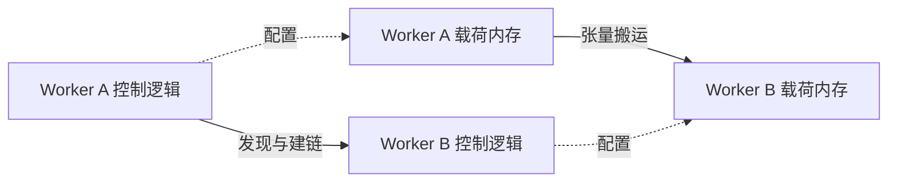

# 🌐 网络平面：区分流量用途与实现职责

基础设施讨论中的“面”有不同含义。参数面描述网络承载什么流量，控制面描述软件在做什么。这两种分类可以重叠，不能放在一个扁平列表里当作互斥选项。

## 🏗️ 按用途划分网络

| 网络用途 | 典型流量 | 部署时要问 |
| --- | --- | --- |
| 参数面 / AI 通信 | 梯度、模型并行激活、集合通信 | 对带宽、延迟和拥塞有什么要求？ |
| 存储面 / 样本面 | 数据集、权重、Checkpoint、结果 | 数据加载是否与训练或推理争用？ |
| 业务面 / 管理面 | 任务提交、部署、监控、服务访问 | 哪些服务与故障域共享网络？ |
| 带外管理面 | BMC 与硬件维护 | Host 操作系统不可用时还能否管理硬件？ |

不同部署的名称会变化。KV Cache 传输可能使用高性能 AI 网络、独立网络，也可能共享其他路径。要查明实际放置，不能仅凭“数据网络”这个名字推断。

## 🧩 按职责划分软件

控制面发现对端、交换 Endpoint、准备资源、管理状态。数据面搬运载荷并处理高频传输操作。两者可能使用不同物理网络，也可能共享同一个网络，但使用不同协议和流量类别。

发现对端成功，只证明控制路径可用，并不证明载荷端点可达、内存已经注册或完成状态得到处理。反过来，即使数据路径已建立，控制租约或资源生命周期失效后仍可能发生错误。

## 📌 出框口是什么

“出框口”通常指跨越指定框体边界的物理端口。先确认这里的框体是机箱、服务器、机柜，还是其他产品域。它不是协议名称，跨框也不普遍等于跨服务器。

拓扑图应标出内部链路、出框口、交换器件、上行链路及共享带宽。区分标称端口速率、协商出的链路速率、载荷吞吐和双向总带宽。两个很快的端点仍可能争用较慢的共享上行链路。

## ⚠️ 一个具体排障场景

假设 SSH 和节点发现都正常，但缓存传输超时。分别记录控制端点和载荷端点的地址，确认接口、路由、适用的 MTU 与协议配置，再检查权限、内存注册、队列进度、完成处理和物理计数器。不要因为 SSH 成功就认定“网络没问题”，也不要因注册失败就直接认定“网络坏了”。

练习：将同一张部署图标注两遍，第一遍标流量用途，第二遍标控制与数据职责。仍然含糊的链路，就是需要核查配置的位置。继续阅读[互联](interconnects.md)和[性能工具](performance-tools.md)。
