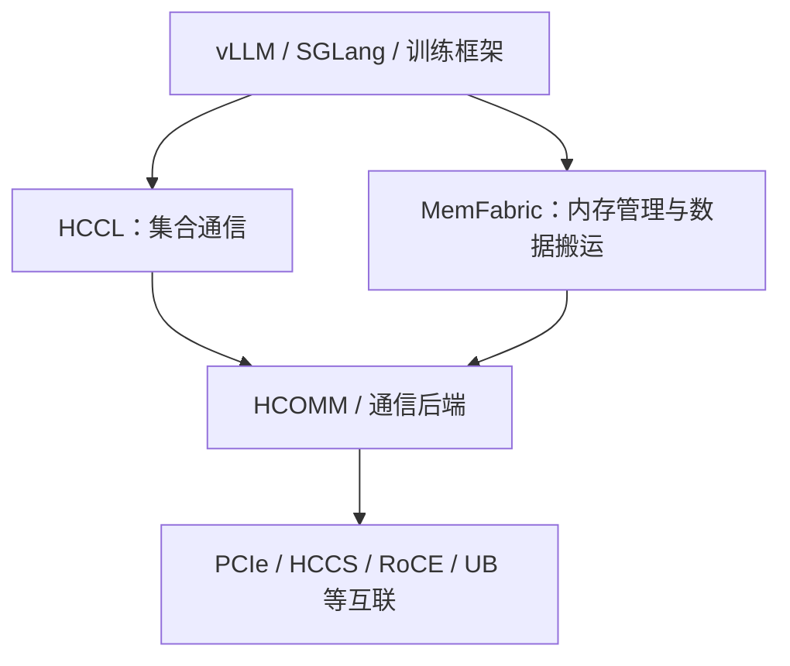

# 互联、协议与通信软件

PCIe、HCCS、RoCE、RDMA、URMA、HCCL 和 MemFabric 经常出现在同一段讨论中，但它们不属于同一层次。
先分类，再比较。

## 三个抽象层次

| 层次 | 例子 | 回答的问题 |
| --- | --- | --- |
| 物理链路与承载 | PCIe、HCCS、Ethernet | 比特通过什么硬件路径传输？ |
| 访问与传输语义 | DMA、RDMA、URMA | 软件如何描述读、写、发送和完成？ |
| 通信软件 | HCCL、HCOMM、MemFabric | 谁管理资源、编排通信并向业务提供接口？ |

“基于 RoCE 的 RDMA 通信”和“通过 PCIe 完成 H2D”分别组合了不同层次的信息，因此比单说“走 RDMA”更准确。

## 常见互联与通信技术

| 技术 | 简明解释 | 常见用途 |
| --- | --- | --- |
| PCIe | 高速外设互联总线 | CPU 与 NPU、NIC 或其他 PCIe 设备互联 |
| HCCS | 昇腾系统中的高速一致性互联称呼 | 特定产品形态下的 NPU 间高速通信 |
| Ethernet | 通用以太网 | 服务器、交换机和存储网络互联 |
| RoCE | RDMA over Converged Ethernet | 在以太网基础设施上承载 RDMA |
| RDMA | Remote Direct Memory Access | 跨节点直接访问已注册内存 |
| UB | Unified Bus | 昇腾新一代统一互联体系中的概念 |
| URMA | UB Remote Memory Access | UB 体系中的远程内存访问机制 |
| UBoE | UB over Ethernet | 在以太网基础设施上承载 UB 通信 |

!!! warning "产品相关"

    HCCS、UB、URMA 和 UBoE 的具体能力与产品型号、软件版本和部署形态相关。不能从名称推断某台机器一定
    支持某种路径，也不能假设每个通信引擎都支持所有协议。

## RDMA 与 URMA

RDMA 更像一类远程直接内存访问技术和语义的统称。URMA 则是 UB 体系中的远程内存访问机制，涉及专门的
资源对象、内存注册、远端读写和完成通知。阅读代码或日志时可以重点识别下列对象：

| 概念 | 含义 |
| --- | --- |
| Endpoint | 通信端点 |
| EID | Endpoint Identifier，端点标识 |
| Memory Region | 注册后允许通信引擎访问的内存区域 |
| Remote Read | 从远端内存读取数据 |
| Remote Write | 向远端内存写入数据 |
| Completion | 一次通信操作的完成状态 |
| Notify | 用于同步或通知对端的机制 |

## HCCL、HCOMM 与 MemFabric

这是一张职责示意图，不表示所有实现都具有固定的上下级关系。

- **HCCL** 主要提供 AllReduce、AllGather、Broadcast 等多设备集合通信操作。
- **HCOMM** 提供底层通信资源和通信操作能力，具体边界以版本和接口为准。
- **MemFabric** 关注内存资源、数据存储位置，以及跨设备和跨节点的数据搬运。
- 更上层的缓存系统可以继续管理 KV Cache 等对象的生命周期、存取和复用。

## 看懂一条通信路径

遇到“这次传输走什么协议”时，建议按下面顺序记录：

1. 源和目标分别是哪台节点、哪个 Device、哪类内存？
2. 控制面使用哪个地址和接口完成发现、建链与资源交换？
3. 数据面使用什么读写语义，是否需要内存注册？
4. 物理路径经过 PCIe、设备互联、NIC 和几级交换机中的哪些部分？
5. 完成状态由谁产生，业务在何处等待或轮询？

## 参考资料

- [昇腾文档中心](https://www.hiascend.com/document)：HCCL、HCOMM 和产品通信接口文档。
- [昇腾 C 文档](https://asc.gitcode.com/)：AI Core 与异构编程模型。
