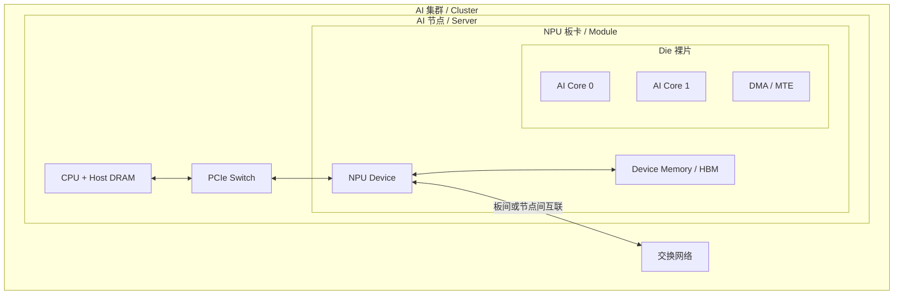

# NPU 硬件与层级

## CPU、GPU 和 NPU

| 处理器 | 主要特点 | 常见角色 |
| --- | --- | --- |
| CPU | 通用计算和复杂控制能力强 | 操作系统、任务调度、Host 侧资源管理 |
| GPU | 大规模并行计算能力强 | 图形、矩阵和通用并行计算 |
| NPU | 面向神经网络和张量工作负载优化 | 训练、推理和相关数据处理 |

在典型昇腾服务器中，CPU 负责启动和管理任务，NPU 负责主要的模型计算。CPU 和 NPU 的职责不是完全固定的，
实际边界取决于运行时、算子实现和产品形态。

## 从硅片到集群

这张图不是某一型号的精确框图，而是定位术语的通用模型。

## 五个容易混淆的层级

| 层级 | 含义 | 不应直接等同于 |
| --- | --- | --- |
| Die（裸片） | 从晶圆切割得到的一块硅；一个封装中可能包含一个或多个 die | 板卡、服务器 |
| Chip / Package（芯片封装） | 可安装到基板或板卡上的封装器件 | 一定只有一个 die |
| Card / Module（板卡/模组） | 包含芯片、供电、连接器，可能还包含板载内存和网络器件 | 单个 AI Core |
| Device（设备） | 软件运行时暴露的可管理加速设备 | 永远与物理芯片一一对应 |
| AI Core（计算核） | NPU 内执行矩阵、向量或标量工作的计算单元 | 整张 NPU 卡 |

虚拟化、双 die 封装或多芯片板卡都会打破“一个编号就是一颗物理芯片”的直觉。排障时要明确编号来自哪一层：
操作系统 PCIe BDF、运行时 Device ID、物理 Chip ID、Die ID 还是通信 Rank ID。

## Host 和 Device

- **Host** 通常指运行控制程序的 CPU 一侧，包括 CPU 和 Host DRAM。
- **Device** 通常指 NPU 一侧，包括 Device Memory、计算核和设备侧执行资源。
- Host 负责资源管理、内存准备和任务下发；Device 负责执行计算密集型任务。
- Host 与 Device 往往有独立地址空间，因此需要显式搬运或由统一内存机制维护映射与一致性。

## AI Core 内部的通用结构

- **Scalar 单元**：处理地址计算、循环、分支和指令调度。
- **Vector 单元**：处理逐元素、向量和部分归约运算。
- **Cube / Matrix 单元**：处理矩阵乘加等高密度张量运算。
- **Local Memory**：靠近计算单元的片上存储，容量小但带宽高、延迟低。
- **DMA / MTE**：在 Device Global Memory 与各级 Local Memory 之间搬运数据。

## AI Core、AICPU 和内存

| 术语 | 含义 | 典型作用 |
| --- | --- | --- |
| AI Core | AI 计算核心 | 执行矩阵、向量和标量计算 |
| Cube | 矩阵计算单元 | 高效执行矩阵乘加等稠密计算 |
| Vector | 向量计算单元 | 执行逐元素、向量和部分归约运算 |
| AICPU | 设备侧辅助处理器 | 执行控制、调度或特定算子任务 |
| HBM | High Bandwidth Memory | 保存权重、激活、KV Cache 等设备数据 |
| SRAM / Local Memory | 片上高速存储 | 保存计算分块和中间结果 |

典型优化目标不是只让计算单元更快，而是让“搬运、计算、写回”形成流水，尽量隐藏数据移动延迟。

## 参考资料

- [昇腾 C 文档](https://asc.gitcode.com/)：《异构系统和编程模型》。
- [昇腾文档中心](https://www.hiascend.com/document)：《AI Core 抽象硬件架构》。
