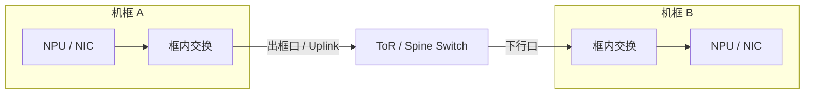

# 网络平面与出框口

## 为什么要划分网络平面

AI 集群中的流量目标不同：有的追求极低延迟和稳定带宽，有的强调大吞吐，有的更重视可靠管理。
“网络平面”是把用途、地址、VLAN、QoS、交换网络或物理端口按设计进行隔离或分组的方式。

| 平面 | 典型流量 | 主要关注点 |
| --- | --- | --- |
| 参数面 | 梯度、权重、激活或并行切分后的张量交换 | 低延迟、高带宽、低抖动、集合通信效率 |
| 存储面/样本面 | 数据集、模型文件、Checkpoint、日志 | 吞吐、容量、突发流量、存储并发 |
| 业务面 | 推理请求、训练任务输入输出、服务调用 | 可用性、隔离、东西向/南北向流量 |
| 管理面 | SSH、监控、部署、带外管理 | 可靠、安全、可维护，带宽通常不是第一目标 |

这些平面可以物理隔离，也可以共享网卡和交换机后通过 VLAN、子网、QoS 等逻辑隔离。名称和边界并非行业统一标准。

## 控制面与数据面

控制面/数据面描述的是**功能角色**：

- 控制面负责发现、配置、建链、路由选择、内存注册、资源创建和状态维护。
- 数据面负责高频发送、接收、读写或复制实际载荷。
- 典型生命周期是“控制面建链一次，数据面执行很多次，控制面最后销毁资源”。

不要把“数据面”自动等同于“存储面”。例如 AllReduce 的梯度流量属于参数面网络，同时也是通信系统的数据面载荷。

## 什么是“出框口”

“出框口”通常是设备或网络运维中的口语，不是统一的协议术语。它一般指流量离开当前物理边界时使用的端口：

- 在服务器视角，可能是连接到 ToR 交换机的网卡上行口。
- 在机框视角，可能是框内交换模块通向框外交换机的端口。
- 在 Pod 或机柜视角，可能是通向上一级 Spine/Core 的上行端口。



听到“走出框口”时，至少追问四件事：当前的“框”是哪一级物理边界、端口属于 NPU/NIC 还是交换模块、
链路速率与聚合方式是什么、流量会经过几级交换。

## 参数同步路径示例

```text
AI Core
  → Device Memory
  → NPU 通信引擎或 NIC
  → 框内链路
  → 出框口
  → ToR / Spine
  → 对端出框口
  → 对端 NPU
```

路径是否经过 Host、PCIe、专用互联或 RoCE 网络取决于产品形态和通信算法。定位性能问题时应画出实际路径，
并在每一跳标注理论带宽、实测带宽、端口利用率、丢包/重传和 NUMA 位置。

## 快速判断瓶颈属于哪一层

| 现象 | 优先检查 |
| --- | --- |
| 单机 H2D 慢 | Host 内存、NUMA、PCIe 链路宽度/速率、复制粒度 |
| 单机多卡快，跨机慢 | 出框口、RoCE 配置、交换网络、路由与拥塞 |
| 小消息慢，大消息正常 | 软件提交、同步、网络时延、集合通信算法 |
| 多任务同时运行才变慢 | 共享 PCIe/网口上行、交换机拥塞、QoS 和带宽隔离 |
| 建链失败但端口有流量 | 控制面地址/VLAN/路由、Rank 配置、内存注册与权限 |

## 参考资料

- [昇腾文档中心](https://www.hiascend.com/document)：《HCCL 网络系统架构》。
- [昇腾文档中心](https://www.hiascend.com/document)：《点对点通信》。
