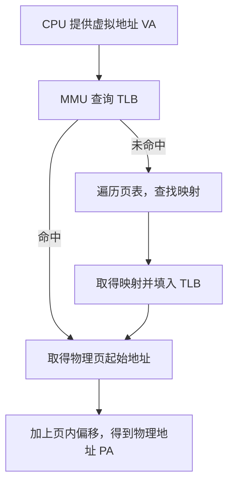
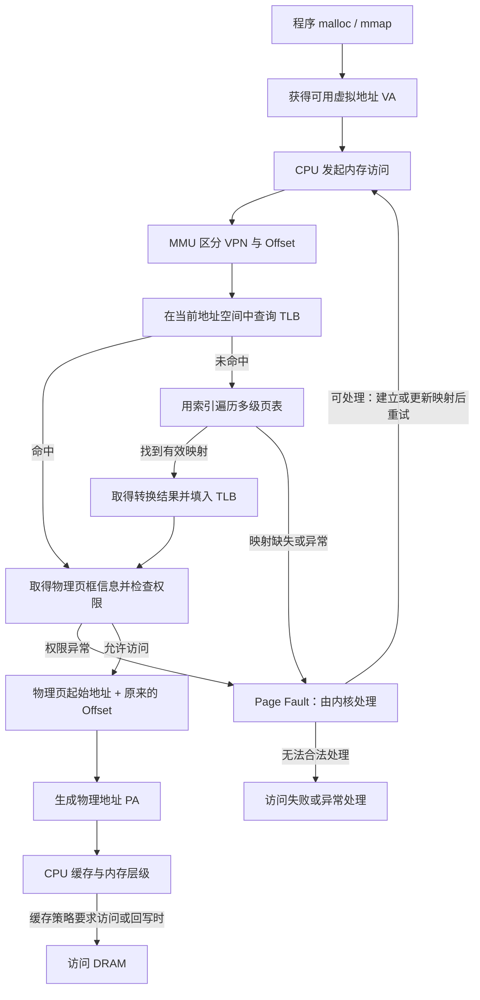

# 🗂️ 页表、PTE、大页与地址转换

程序使用虚拟地址，内存中的字节却位于物理地址。要理解一次内存访问，先弄清楚“映射由谁记录、由谁执行”，再把地址拆成“页号与页内偏移”，最后观察页大小怎样影响映射数量与 TLB 的覆盖范围。

本章接续[内存与地址](memory-addressing.md)，以 4KB 普通页、2MB 大页和 1GB 大页为例。为保持常见页大小的写法，全文的 KB、MB、GB 按二进制容量理解，分别对应 KiB、MiB、GiB：$1\text{KB}=2^{10}$ 字节、$1\text{MB}=2^{20}$ 字节、$1\text{GB}=2^{30}$ 字节。具体支持哪些页大小，取决于处理器和操作系统。

下文的 TB 也按二进制容量理解，即 TiB，$1\text{TB}=2^{40}$ 字节。多级页表的具体推导以**典型 x86-64 四级分页**为例，先理解地址的划分，再追踪各级页表项怎样完成映射。

## 1. 先理解基本概念与核心公式 {#1}

程序使用的是**虚拟地址（Virtual Address，VA）**，CPU 访问物理内存需要将它转换为**物理地址（Physical Address，PA）**。先把地址、页号、映射记录和硬件的职责放到同一张表中：

| 概念 | 全称 | 作用 | 如何理解 |
| --- | --- | --- | --- |
| VA | Virtual Address | 程序使用的虚拟地址 | 程序发起访问时使用的地址 |
| PA | Physical Address | 转换得到的物理地址 | 用来定位物理地址空间中的目标 |
| VPN | Virtual Page Number | 虚拟页号 | 虚拟地址中用于确定映射的部分 |
| PFN | Page Frame Number | 物理页框号 | 与页大小结合得到物理页起始地址 |
| PTE | Page Table Entry | 页表中的一条记录；最终映射项描述对应的物理页及权限等信息 | 表里的一项，而不是被映射的数据页本身 |
| Page Table | 页表（Page Table） | 记录虚拟地址到物理地址的映射关系 | 地址转换的映射表，通常组织成多级结构 |
| MMU | Memory Management Unit（内存管理单元） | 负责执行虚拟地址到物理地址的转换，并检查访问权限 | 执行转换的硬件 |
| TLB | Translation Lookaside Buffer（快表） | 缓存地址映射关系，避免频繁查询页表 | 保存近期使用的转换结果的缓存 |
| Offset | 页内偏移 | 确定页内的具体字节位置 | 分页转换过程中保持不变 |

三条核心关系是：

$$
\boxed{\mathrm{VA}=\mathrm{VPN}\mathbin{\Vert}\mathrm{Offset}}
$$

$$
\boxed{\mathrm{VPN}\xrightarrow{\text{页表}}\mathrm{PFN}}
$$

$$
\boxed{\mathrm{PA}=\mathrm{PhysicalPageBase}+\mathrm{Offset}}
$$

第一条也常写成 `VA = VPN + Offset`，其中“+”表示**字段拼接**，不是把未移位的两个数直接相加；上式用 $\Vert$ 明确表示拼接。后面的“物理页起始地址 + Offset”才是数值加法。对于页大小 $S=2^n$，对应数值关系为 $\mathrm{VA}=\mathrm{VPN}\times S+\mathrm{Offset}$。

先用下面的流程理解一次转换。这里假设映射有效且权限允许，并以硬件执行页表遍历的常见系统为例：



**TLB Miss 不等于缺页异常。** TLB Miss 只表示缓存里没有这条转换；页表中仍可能存在有效映射。缺页异常则涉及映射尚未建立、页面不在内存或访问权限等情况。页表层级、权限与转换缓存的关系可参见 [Linux 页表文档](https://docs.kernel.org/mm/page_tables.html)。

## 2. 完整流程：从 malloc 到一次物理内存访问 {#malloc-to-physical-address}

先看一段突出申请与首次写入的 C 代码片段：

```c
char* p = (char*)malloc(4096);
p[0] = 1;
```

实际程序应检查分配是否成功，并在最后一次使用后调用 `free`。这里讨论应用确实发起的内存访问，采用典型 x86-64 四级页表、4KB 普通页。

为了完整演算，下面固定一个**示例访问地址** `VA = 0x12345678`。它可以是分配区域内部某个字节的位置，并不是说一次真实 `malloc` 必须返回这个数值；真实返回值还要满足分配器的对齐保证。`malloc(4096)` 也不保证起点按 4KB 对齐或恰好只占一个虚拟页，例如从页内偏移 `0x678` 开始的连续 4096 字节会跨两个 4KB 页。`malloc` 返回值与分配方式见 [Linux malloc 手册](https://man7.org/linux/man-pages/man3/malloc.3.html)，`mmap` 的页对齐映射语义见 [Linux mmap 手册](https://man7.org/linux/man-pages/man2/mmap.2.html)。

### 2.1. 第一步：malloc 让程序取得可用虚拟地址

```c
char* p = (char*)malloc(4096);
```

内存分配器为程序提供一段可用的虚拟地址范围；它可能复用已经管理的堆空间，也可能向操作系统取得更多空间。因此，不是每次 `malloc` 都要新建映射，也不是返回一个地址就代表此刻刚分配了等量物理内存。

对于按需分配的页面，第一次访问可能触发 **Page Fault（缺页异常）**。如果地址属于合法区域，内核可以分配物理页、建立或更新映射，再让访问重新执行。分配器也可能已经触碰过页面，因此“第一次写 `p[0]`”不保证一定缺页；无法合法处理的访问也不会自动变成成功的物理内存访问。缺页原因与处理见 [Linux 页表与缺页说明](https://docs.kernel.org/mm/page_tables.html#mmu-tlb-and-page-faults)。

### 2.2. 第二步：把 VA 分成 VPN 和 Offset

对于 4KB 页，$4\text{KB}=2^{12}$ 字节，所以最低 12 bit 是页内偏移，其余有效地址位组成 VPN：

```text
VA             = 0x12345678
页大小         = 0x1000
VPN            = VA >> 12         = 0x12345
Offset         = VA & 0xFFF        = 0x678
还原虚拟地址   = 0x12345 × 0x1000 + 0x678 = 0x12345678
```

**VPN 用于确定页映射，Offset 用于定位页内字节。** 这是解释地址位用途的逻辑划分，不要求硬件把这些步骤逐个串行执行。

### 2.3. 第三步：先检查 TLB 是否已有转换结果

TLB 可以理解为 MMU 使用的地址转换缓存。例如，在当前地址空间、按 4KB 页表示的简化示意中：

```text
TLB
┌──────────────┬──────────────┐
│ VPN          │ PFN          │
├──────────────┼──────────────┤
│ 0x12345      │ 0xABCDE      │
│ 0x12346      │ 0x98765      │
└──────────────┴──────────────┘
```

- **命中且权限允许：**取得物理页框信息，不必为此次访问重新遍历页表，可以转到生成 PA 的步骤。
- **未命中：**进入页表遍历；找到有效映射后，可将转换结果填入 TLB，供后续访问使用。

表中只画出 VPN 与 PFN，实际转换还要区分当前地址空间、页大小及访问权限，不能把不同进程中的同一个 VPN 自动当成同一块物理内存。

### 2.4. 第四步：TLB 未命中时逐级查页表

48 bit 有效地址按 `PGD(9) + PUD(9) + PMD(9) + PTE(9) + Offset(12)` 划分。MMU 从当前地址空间的页表根开始，用不同的 9 bit 索引逐级定位：

```text
PGD：按 PGD 索引选表项 → 取得 PUD 表的位置
 ↓
PUD：按 PUD 索引选表项 → 取得 PMD 表的位置
 ↓
PMD：按 PMD 索引选表项 → 取得 PTE 表的位置
 ↓
PTE：按 PTE 索引选表项 → 取得物理页框号及权限
 ↓
PFN
```

对本例 `0x12345678`，四级索引的具体取值是：

```text
PGD 索引 = (VA >> 39) & 0x1FF = 0x000
PUD 索引 = (VA >> 30) & 0x1FF = 0x000
PMD 索引 = (VA >> 21) & 0x1FF = 0x091
PTE 索引 = (VA >> 12) & 0x1FF = 0x145
```

这里有三个关键点：

1. **非叶级页表项**记录下一级页表的位置，以及相应控制信息。
2. **叶级页表项**直接描述物理页框及权限等，不再指向下一张表。
3. **VPN 通常由整条索引路径确定，不需要在 PTE 中再次保存完整 VPN。** 一个表项位于哪张表、哪个位置，本身就是映射关系的一部分。

### 2.5. 第五步：从 PFN 得到物理页起始地址

假设最终映射如下，且页面存在、此次访问权限有效：

```text
VPN = 0x12345
        ↓
叶级 PTE 记录的 PFN = 0xABCDE
```

按本例 4KB 的页框单位：

$$
0xABCDE\times0x1000=0xABCDE000
$$

`0x1000` 就是 4KB 的十六进制表示。这里的 PFN 是从页表项中解析出的页框信息，不能把含有权限等标志位的整个 PTE 数值直接当成物理页地址。

### 2.6. 第六步：保留 Offset，生成最终 PA

```text
物理页起始地址：0xABCDE000
页内偏移：      0x00000678
────────────────────────
最终物理地址：  0xABCDE678
```

整个转换中，**Offset 仍是 `0x678`，真正被映射的是 VPN `0x12345` 到 PFN `0xABCDE`**。转换得到的 PA 用来定位本例中由 DRAM 提供后端存储的字节。

还要区分**地址转换**与**实际访问 DRAM 的时机**：CPU 数据缓存命中时可以由缓存满足访问；在常见写回缓存策略下，写入也可能先更新缓存，之后才回写内存。`p[0] = 1` 不意味着指令执行时立即把该字节写到 DRAM。TLB 缓存的是地址转换，数据缓存保存的是数据，两者作用不同；缓存写回可参见 [Intel 官方说明](https://edc.intel.com/content/www/us/en/design/ipla/software-development-platforms/client/platforms/alder-lake-desktop/12th-generation-intel-core-processors-datasheet-volume-1-of-2/001/cache-line-write-back/)。

## 3. 多级页表：地址划分、按需分配与覆盖范围 {#3}

假设采用 **48 bit 虚拟地址**。这里讨论参与转换的 48 位有效地址，不代表所有处理器都采用相同地址宽度。

### 3.1. 先分成虚拟页号与页内偏移 {#31}

| 页大小 | 虚拟页号 VPN | 页内偏移 Offset |
| --- | --- | --- |
| 4KB | 36 bit | 12 bit |
| 2MB | 27 bit | 21 bit |
| 1GB | 18 bit | 30 bit |

每一行都满足“虚拟页号位数 + 页内偏移位数 = 48”：

```text
4KB 页：[            VPN：36 bit            ][Offset：12 bit]
2MB 页：[         VPN：27 bit         ][    Offset：21 bit    ]
1GB 页：[      VPN：18 bit      ][         Offset：30 bit         ]
```

将转换过程写出来：

```text
虚拟地址 = 虚拟页号 + 页内偏移

虚拟页号 → 查页表 → 物理页框号

物理地址 = 物理页起始地址 + 页内偏移
```

第一行的“+”表示**位字段拼接**，不能把没有移位的 VPN 与 Offset 直接做数值相加。设页大小为 $S=2^n$ 字节，数值关系是：

$$
\mathrm{VA}=\mathrm{VPN}\times S+\mathrm{Offset}
$$

$$
\mathrm{PA}=\mathrm{PFN}\times S+\mathrm{Offset}
$$

其中 PFN 表示**按本次映射页大小 $S$ 编号**的物理页框号，$\mathrm{PFN}\times S$ 就是物理页起始地址。操作系统接口中的 PFN 也可能统一按基础页大小编号，读源码时要确认其单位。多级页表会进一步把 VPN 拆成各级索引，并非要求整段 VPN 只查询一张平铺的大表。

在这种分页映射中，转换改变的是页所在的位置，**页内偏移保持不变**。页越大，页内偏移占用的 bit 越多，虚拟页号占用的 bit 越少。

### 3.2. 48 bit 与四级页表的关系 {#32-48-bit}

在典型的 **x86-64 四级页表机制**中，48 bit 有效虚拟地址可以表示 $2^{48}$ 个字节位置，即 **256TB（256TiB）虚拟地址空间**。这是虚拟地址容量，不是已安装物理内存的容量，也不意味着这些地址都已经建立映射；参见 [Linux 四级与五级分页说明](https://docs.kernel.org/arch/x86/x86_64/5level-paging.html)。

使用 4KB 普通页时，前面的 36 bit VPN 进一步拆成四个 9 bit 索引：

```text
48 bit 虚拟地址
┌────────┬────────┬────────┬────────┬──────────┐
│  PGD   │  PUD   │  PMD   │  PTE   │ 页内偏移 │
│ 9 bit  │ 9 bit  │ 9 bit  │ 9 bit  │  12 bit  │
└────────┴────────┴────────┴────────┴──────────┘

位范围： [47:39]  [38:30]  [29:21]  [20:12]   [11:0]
```

- **PGD、PUD、PMD、PTE 索引**：分别在不同层级的页表中选择一个表项；9 bit 是索引宽度，不是整个页表项的大小。
- **页内偏移**：定位物理页中的具体字节。4KB 页有 $2^{12}$ 个字节位置，因此需要 12 bit。
- **这 48 bit 始终属于虚拟地址，不包含物理地址。** 物理页位置来自查到的页表项；物理地址宽度也不必等于虚拟地址宽度。

**层级命名说明：**这里沿用 Linux 的 PGD、PUD、PMD、PTE 层级名称。四级分页时，它们对应硬件的 PML4、PDPT、PD、PT；图中的“PTE”字段是用于索引最底层 PT 的地址位，不是表项内容。Linux 的通用接口还包含 P4D 层，在四级分页时该层被折叠，并不增加一次独立的页表查找。层级与折叠机制见 [Linux 页表文档](https://docs.kernel.org/mm/page_tables.html)。

**48 bit 有效地址与 64 bit 指针如何共存？** 在常规 x86-64 四级分页的规范地址（canonical address）形式中，64 bit 地址的高 16 bit 必须复制 bit 47。有效地址分布为低端 128TiB 和高端 128TiB，两部分合计 256TiB，中间存在非规范地址空洞。因此，不能把 256TiB 理解成从 0 开始的一整段连续地址，也不能据此认为一个用户进程可自由使用全部容量；见 [Linux x86-64 虚拟内存布局](https://docs.kernel.org/arch/x86/x86_64/mm.html)。

### 3.3. 为什么单级页表可能需要 512GiB？ {#why-multilevel-page-tables}

48 bit 地址空间按 4KB 分页时，虚拟页总数为：

$$
\frac{2^{48}}{2^{12}}=2^{36}=68{,}719{,}476{,}736
$$

也就是约 **687 亿个虚拟页**。如果为所有虚拟页预先准备一张完整的单级页表，每个表项 8 Bytes，则仅这些表项就需要：

$$
2^{36}\times8=2^{39}\text{ Bytes}=512\text{ GiB}
$$

多数程序不会使用整个地址空间，为全部潜在页面预先准备表项会浪费大量内存。**多级页表可以按需建立下级页表**：某段虚拟地址尚未映射时，对应下层分支可以不存在，而不必为它分配一整片最底层表项。

### 3.4. 单张页表本身有多大？ {#page-table-size}

在上述 x86-64 分页机制中：

- 每级索引占 **9 bit**，可以选择 $2^9=512$ 个表项。
- 每个页表项占 **8 Bytes（64 bit）**。
- 因此，**单张页表大小为 $512\times8=4096$ Bytes，即 4KB**。

```text
一个索引：  9 bit → 512 种取值 → 选择当前表中的一个表项
一个表项：  8 Bytes → 保存下一级页表地址或物理页映射信息，以及标志位
一张页表：  512 个表项 × 8 Bytes = 4096 Bytes = 4KB
```

**页表本身的大小与页表项能够映射的内存范围，是两个不同概念。** 单张页表占用 4KB，并不意味着其中每一项都只能映射 4KB；同样，一项直接映射 1GB，也不意味着该表项占用 1GB。整个进程可能使用很多张这样的页表，整个多级页表结构也不只有 4KB。这里的大小限定于本章的 x86-64 示例，不应推广为所有体系结构的固定规则。表项类型、每表 512 项以及 PMD/PUD 的范围定义可对照 [Linux x86-64 页表定义](https://github.com/torvalds/linux/blob/master/arch/x86/include/asm/pgtable_64_types.h)。

### 3.5. 各级页表分别覆盖多大范围？ {#level-coverage}

在同一个四级分页示例中，单张表都是 512 个表项，但不同层级描述的虚拟范围不同：

| 层级 | 单个表项覆盖范围 | 整张表覆盖范围 |
| --- | --- | --- |
| PGD | 512GiB | 256TiB |
| PUD | 1GiB | 512GiB |
| PMD | 2MiB | 1GiB |
| PTE | 4KiB | 2MiB |

推导时从最底层向上乘 512：`4KiB × 512 = 2MiB`，再依次得到 `1GiB`、`512GiB` 和 `256TiB`。**覆盖范围不代表已经分配了相应大小的物理内存。**

对非叶级项，“覆盖”表示其下级子树能够描述的虚拟范围；它不是直接映射该大小物理页的承诺。例如 PGD 一项覆盖 512GiB，不表示本例支持 512GiB 大页。PTE 表覆盖的相邻虚拟页，也不要求对应的多个物理页彼此相邻。

## 4. 普通页和大页如何改变转换流程？ {#huge-pages}

### 4.1. 普通页和大页的区别 {#2}

核心区别是：**单条映射能覆盖的内存范围不同。** 将同样大小的内存切成更大的页，就只需要更少的页面和最终映射项。

| 对比项 | 4KB 普通页 | 2MB 大页 | 1GB 大页 |
| --- | --- | --- | --- |
| 单条映射范围 | 4KB | 2MB | 1GB |
| 映射 1GB 所需页面数 | 262144 | 512 | 1 |
| 页内偏移 | 12 bit | 21 bit | 30 bit |
| 十六进制页大小 | `0x1000` | `0x200000` | `0x40000000` |
| 页表遍历 | PGD → PUD → PMD → PTE | PGD → PUD → PMD | PGD → PUD |
| 物理内存连续性 | 每个 4KB 页连续且对齐；不同页可不相邻 | 每个 2MB 页连续且对齐 | 整个 1GB 连续且按 1GB 对齐 |

页面数可以直接计算。假设这 1GB 区域满足相应页大小的对齐要求，且全部使用同一种页大小映射：

```text
4KB 页：1GB / 4KB = 2^30 / 2^12 = 2^18 = 262144 页
2MB 页：1GB / 2MB = 2^30 / 2^21 = 2^9  = 512 页
1GB 页：1GB / 1GB = 2^30 / 2^30 = 1 页
```

这里统计的是数据页面数，也就是所需的**最终映射项数**，并未把多级页表中的上层目录项一起计入。

**PTE 本身并没有变成 1GB，改变的是单条映射覆盖的范围。** 页表项保存的是映射信息，数据仍位于被映射的物理页中。多级页表中，有些项指向下一级页表；有些项直接完成映射，称为叶子项。大页也可能由更高层级的页表项直接映射，因此不必一路走到最底层。阅读实现时，还要区分广义的“页表项”与特指最底层项的 PTE；见 [Linux 页表层级说明](https://docs.kernel.org/mm/page_tables.html)。

### 4.2. 多级页表如何映射普通页与大页？ {#leaf-levels}

**叶级页表项**指直接完成物理内存映射、不再指向下一级页表的表项。“叶级”描述的是这条映射在此结束，并不要求它一定出现在最底层 PTE 层。

在本章四级分页示例中，三种映射路径分别是：

```text
4KB 普通页：
PGD → PUD → PMD → PTE → 4KB 物理页

2MB 大页：
PGD → PUD → PMD ──────→ 2MB 物理页

1GB 大页：
PGD → PUD ────────────→ 1GB 物理页
```

把结束映射的层级、偏移位数和映射 1GB 所需的叶级映射项放在一起比较：

| 页大小 | 完成映射的层级 | 页内偏移 | 映射 1GB 所需叶级映射项 | 经过的页表层级数 |
| --- | --- | --- | --- | --- |
| 4KB | PTE | 12 bit | 262144 | 4 |
| 2MB | PMD | 21 bit | 512 | 3 |
| 1GB | PUD | 30 bit | 1 | 2 |

使用 2MB 大页时，PMD 项直接完成映射，不再为这条映射继续查 PTE 表；使用 1GB 大页时，PUD 项直接完成映射，不再继续查 PMD 和 PTE 表。这里说的是这条映射的逻辑遍历路径，实际延迟还受 TLB、页表遍历缓存和普通缓存命中情况影响；层级数不能直接当成实际 DRAM 访问次数。

### 4.3. 为什么 1GB 大页可以减少遍历层级？ {#huge-page-offset-bits}

对比地址划分，就能看到提前结束后那些位去了哪里。

使用 4KB 页：

```text
PGD(9) + PUD(9) + PMD(9) + PTE(9) + Offset(12) = 48 bit
```

使用 2MB 大页：

```text
PGD(9) + PUD(9) + PMD(9) + Offset(21) = 48 bit
21 bit = 9 bit + 12 bit
```

使用 1GB 大页：

```text
PGD(9) + PUD(9) + Offset(30) = 48 bit
30 bit = 9 bit + 9 bit + 12 bit
```

原本用于 **PMD、PTE 索引的 18 bit**，在 1GB 映射中成为页内偏移的一部分。类似地，2MB 映射把原本的 9 bit PTE 索引并入偏移，得到 21 bit 偏移。

因此，**1GB 大页不是删除了 18 bit，也不是改变虚拟地址的长度，而是让页表在 PUD 层提前结束映射**。地址仍然是本例的 48 bit 有效虚拟地址，变化的是其中哪些位负责查表、哪些位负责在物理页内定位。

### 4.4. 为什么大页能提高性能？ {#4}

结合前面的映射项数量和遍历路径，可以把优势分为三点：

1. **减少映射项数量，降低页表内存开销。** 映射相同的 1GB，4KB 页需要 262144 个叶级映射项，2MB 页需要 512 个，1GB 页只需 1 个；相应区域也可能不再需要下层页表。不过，“只需 1 个叶级映射项”不等于整个页表结构只占 8 Bytes，上层页表仍需存在或被复用。
2. **减少页表遍历层级。** 在本例中，1GB 大页可以在 PUD 层完成转换，2MB 大页在 PMD 层完成转换。
3. **减少 TLB Miss 和 TLB 压力。** 一条 TLB 映射记录能够覆盖更大范围的虚拟地址，适合的工作集因而可以用更少的条目覆盖。

**每次访问一个 4KB 页，并不是要依次遍历 262144 个 PTE。** 多级页表通过每级索引直接定位所需表项；TLB 又会缓存地址转换结果。262144 描述覆盖整个 1GB 区域需要多少个叶级映射项，不是一次地址转换要顺序检查多少项。

假设 TLB 能存储 **64 条映射**，并且为了对比，分别假设这 64 条记录都可以用于所讨论的页大小：

- **4KB 页：**覆盖 $64\times4\text{KB}=256\text{KB}$。
- **1GB 页：**覆盖 $64\times1\text{GB}=64\text{GB}$。

这是理论示例，实际 TLB 容量因硬件和页大小而异，不能据此推断真实处理器对所有页大小都提供相同条目数。

**大页不是让 TLB 存储更多条记录，而是让每条记录覆盖更多地址。** 在工作集与访问方式适合时，同样大小的数据只需要更少的映射，因此可以减少 TLB Miss 和页表遍历开销；使用更高层级的叶子项时，遍历也可能更早结束。

理解性能收益时，还要看分配代价：大页需要满足相应的连续物理内存和对齐要求，只使用其中一小部分时也可能浪费空间。大页并不保证每个程序都更快。支持的页大小及 HugeTLB 分配约束见 [Linux HugeTLB 文档](https://docs.kernel.org/admin-guide/mm/hugetlbpage.html)。

### 4.5. 配置 1GB 大页究竟改变了什么？ {#huge-page-configuration}

在本章的 x86-64 四级分页机制中，假设处理器支持 1GB 页、内存满足相应对齐与连续性要求，并且操作系统**实际为该区域建立了 1GB 大页映射**：

**配置并使用 1GB 大页，本质上是让操作系统使用 PUD 层的叶级页表项，直接建立 1GB 虚拟地址范围到 1GB 物理地址范围的映射。**

它不会改变本例中 48 bit 的有效虚拟地址长度，也不会改变整个系统的页表基本结构；改变的是**使用大页的内存区域的映射粒度和页表遍历深度**。不同区域可以同时使用 4KB、2MB、1GB 页，不能把某个区域使用 1GB 大页理解成全系统都只剩两级页表。仅仅提出大页请求，也不能代替确认实际建立的映射粒度。

核心效果是：**减少页表映射项数量、降低 TLB 压力，并减少地址转换开销。**

### 4.6. Linux 如何通过 HugeTLB 管理大页？ {#linux-hugetlb}

前文解释了大页的硬件映射方式；**HugeTLB 是 Linux 向应用提供显式大页分配与管理的机制**，通过按页大小区分的大页池提供资源。官方文档入口：[HugeTLB Pages（hugetlbpage）](https://cdn.kernel.org/doc/html/latest/admin-guide/mm/hugetlbpage.html)。

可以沿着“准备资源 → 建立映射 → 观察使用情况”理解：

1. **准备大页池。** 可在启动时预分配，或运行时调整。`/proc/sys/vm/nr_hugepages` 控制默认大页大小下的持久池页数；不同页大小的池可在 `/sys/kernel/mm/hugepages/` 查看。分配能否成功仍受连续物理内存与 NUMA 放置影响。
2. **应用显式申请映射。** 可使用 `mmap(..., MAP_HUGETLB, ...)`、映射 `hugetlbfs` 文件，或通过 `shmget` / `shmat` 使用共享内存。`MAP_HUGETLB` 不要求先挂载 `hugetlbfs`；在受支持的系统上可组合 `MAP_HUGE_1GB` 选择 1GB 页，映射、解除映射也需满足大页的对齐要求。接口细节见 [Linux mmap 手册](https://man7.org/linux/man-pages/man2/mmap.2.html)。
3. **理解资源生命周期。** HugeTLB 页不会被换出到 swap。持久大页被应用释放后回到池中，仍占用为大页池准备的内存，不能把“应用释放”直接当成“已还给内核普通页分配器”。

在 Linux 上，可以先只读查看：

```sh
cat /proc/meminfo
ls /sys/kernel/mm/hugepages/
```

重点区分以下统计；字段说明可同时查阅 [Linux proc_meminfo 手册](https://man7.org/linux/man-pages/man5/proc_meminfo.5.html)：

| 字段 | 应怎样理解 |
| --- | --- |
| `HugePages_Total` | 默认大页大小对应的池页数 |
| `HugePages_Free` | 池中尚未分配的页数 |
| `HugePages_Rsvd` | 已承诺给映射、但尚未在缺页时实际分配的页数 |
| `HugePages_Surp` | 超出持久池目标的 surplus 页数 |
| `Hugepagesize` | 默认大页大小，不是池的总容量 |
| `Hugetlb` | 所有 HugeTLB 页大小合计占用的容量，见上述内核指南 |

多种大页大小并存时，应结合相应 sysfs 子目录查看。**1GiB 的大页池容量，不代表正在使用一个 1GiB 页**：512 个 2MiB 页也有相同容量，但映射粒度不同。

**HugeTLB 与透明大页 THP 要分开理解。** THP 由内核按策略为符合条件的映射透明使用、合并或拆分大页，不依赖 HugeTLB 的预留池；普通 `malloc` 区域也可能受 THP 影响。因此，分配一块很大的缓冲区，并不等于显式申请 HugeTLB，更不保证使用 1GB 页。参见 [Linux Transparent Hugepage Support](https://cdn.kernel.org/doc/html/latest/admin-guide/mm/transhuge.html)。

HugeTLB 的不可换出属性，也不能代替[设备 DMA 所需的锁页、注册及映射准备](memory-addressing.md#host-memory-registration)。页大小、内存池管理和设备访问条件仍是不同层次的问题。

**CANN 实测补充：不可 swap 不等于 Runtime pinned。** 笔记中的 HugeTLB `aclrtMemcpyBatchAsync` 记录为调用约 3.5 ms、随后同步约 6 µs；`aclrtMallocHost` 对照为调用约 0.33 ms、同步约 2.67 ms；HugeTLB 的逐条 `aclrtMemcpyAsync` 路径则为调用约 3.5 ms、同步约 9 µs。这与前者主要在 API 内完成拷贝、后者提交后由 stream 异步推进的行为相符，不能把 HugeTLB 的驻留保证直接当成 Runtime 的 pinned 异步路径保证。完整数据、计时口径及推断边界见[数据搬运中的实测分析](data-movement.md#hugetlb-runtime-pinned)。

## 5. 页大小、十六进制与地址计算 {#page-address-arithmetic}

### 5.1. 为什么页大小用十六进制表示？ {#5}

因为：

$$
16=2^4
$$

所以 **1 位十六进制 = 4 bit**。十六进制便于观察二进制地址的位边界；它只是表示方式，不会改变页的实际大小。

例如，下面的数值都以字节为单位，`0x` 表示十六进制：

```text
0x10        = 2^4    = 16B
0x100       = 2^8    = 256B
0x1000      = 2^12   = 4KB
0x200000    = 2^21   = 2MB
0x40000000  = 2^30   = 1GB
```

`0x1000` 是 1 向左移动 12 bit；`0x200000` 是 $2\times16^5=2^{21}$；`0x40000000` 是 $4\times16^7=2^{30}$。因此，2MB 和 1GB 对应的偏移位数虽然不是 4 的整数倍，仍然可以用十六进制清楚地表示。

### 5.2. 为什么物理页起始地址会不同？ {#6}

因为**不同页大小对应不同的内存划分边界**。同一个物理地址，按不同页大小分组时，会落入起点不同的页面。这里是在比较两种划分方式，不是说同一次转换会同时使用两种页大小。

例如，同一个物理地址 `0x40001234`：

| 对比项 | 4KB 页 | 1GB 页 |
| --- | --- | --- |
| 页起始地址 | `0x40001000` | `0x40000000` |
| 页内偏移 | `0x234` | `0x1234` |
| 最终地址 | `0x40001234` | `0x40001234` |

计算公式：

$$
\text{页起始地址}=\left\lfloor\frac{\text{地址}}{\text{页大小}}\right\rfloor\times\text{页大小}
$$

$$
\text{页内偏移}=\text{地址}\bmod\text{页大小}
$$

分别代入就能验证：

```text
按 4KB 划分：
页大小     = 0x1000
页起始地址 = floor(0x40001234 / 0x1000) × 0x1000 = 0x40001000
页内偏移   = 0x40001234 mod 0x1000 = 0x234
最终地址   = 0x40001000 + 0x234 = 0x40001234

按 1GB 划分：
页大小     = 0x40000000
页起始地址 = floor(0x40001234 / 0x40000000) × 0x40000000 = 0x40000000
页内偏移   = 0x40001234 mod 0x40000000 = 0x1234
最终地址   = 0x40000000 + 0x1234 = 0x40001234
```

页起始地址必须是页大小的整数倍。4KB 页的起点低 12 bit 为 0；1GB 页的起点低 30 bit 为 0。起点和偏移虽然改变，两者之和始终还原同一个物理地址。

### 5.3. 页大小和偏移 bit 的关系 {#7-bit}

**页大小为 $2^n$ Bytes，就需要 $n$ bit 表示页内偏移。** 原因是一个页面内有 $2^n$ 个字节位置，编号从 0 开始，到 $2^n-1$ 结束。

| 页大小 | 偏移 bit | 最大偏移 |
| --- | --- | --- |
| 4KB | 12 bit | `0xFFF` |
| 2MB | 21 bit | `0x1FFFFF` |
| 1GB | 30 bit | `0x3FFFFFFF` |

例如 1GB：

- **页大小：**`0x40000000`（4 后面 7 个 0）。
- **最大偏移：**`0x3FFFFFFF`，也就是页大小减 1。
- **偏移范围：**0～1GB−1 字节，即 0～1,073,741,823。

不要把“页大小”误当成“页内最后一个字节的偏移”。偏移等于 `0x40000000` 时，已经到达下一个 1GB 页的起点。

## 6. 完整流程与后续联系 {#allocation-to-dram-summary}

将申请、正常转换、缺页处理和后续内存访问放到同一张图中：



这张图表达逻辑依赖，硬件不一定按图逐项串行运行。缺页分支只在内核能合法解决问题时重试，不保证任何地址都能被补出一个物理页。

需要强调三个核心结论：

1. **页表按页粒度记录映射。** 它不为每个虚拟字节地址单独保存一条完整映射，而是记录虚拟页到物理页的关系，再结合 Offset 定位字节。
2. **MMU 是执行转换的硬件，TLB 是加速转换的缓存，页表是保存映射信息的数据结构。** VPN 用来确定索引路径，PFN 用来构造物理页起始地址。
3. **1GB 大页让单条叶级映射覆盖连续的 1GB 虚拟范围和物理范围。** 不是让页表本身变成 1GB，也不是让一次普通页访问扫描 262144 个 PTE；收益来自映射覆盖率、更少的下级表和较短的转换路径。

这套机制是理解 Linux 虚拟内存的基础。后续学习 NPU 的 DVA、设备 MMU、[IOMMU 与 DMA 地址](memory-addressing.md)、[Pinned Memory](memory-addressing.md#host-pinned-memory)和 MemFabric 的 [GVA 统一编址](gva-unified-addressing.md)时，应分别确认地址空间、页粒度、访问权限与传输机制，不能直接套用本章的 x86-64 层级和页大小。

最后用一句话串起来：**CPU 使用虚拟地址，通过 TLB 或页表找到对应的物理页，再结合页内偏移得到物理地址；大页的核心优势是单条映射覆盖更大的内存范围，减少映射数量和 TLB 压力。**

接着阅读[GVA 统一编址原理](gva-unified-addressing.md)，可以把单个地址空间中的页表转换，与跨进程、跨设备、跨节点的资源寻址联系起来。

继续学习时，可以回到[内存与地址](memory-addressing.md)，把单次地址转换与虚拟空间预留、物理内存分配、映射及注册联系起来。
