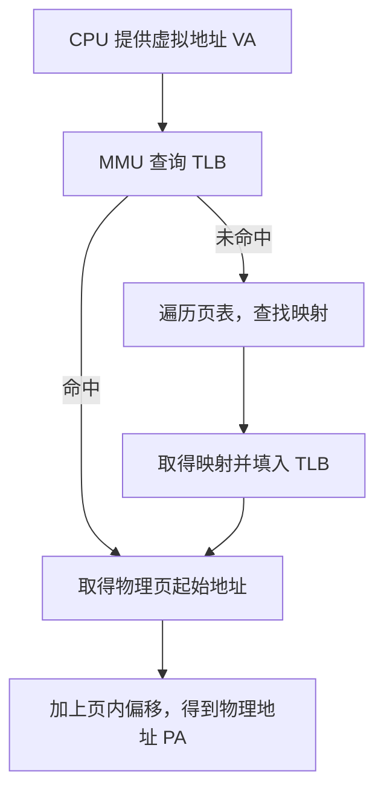

# 🗂️ 页表、PTE、大页与地址转换

程序使用虚拟地址，内存中的字节却位于物理地址。要理解一次内存访问，先弄清楚“映射由谁记录、由谁执行”，再把地址拆成“页号与页内偏移”，最后观察页大小怎样影响映射数量与 TLB 的覆盖范围。

本章接续[内存与地址](memory-addressing.md)，以 4KB 普通页、2MB 大页和 1GB 大页为例。为保持常见页大小的写法，全文的 KB、MB、GB 按二进制容量理解，分别对应 KiB、MiB、GiB：$1\text{KB}=2^{10}$ 字节、$1\text{MB}=2^{20}$ 字节、$1\text{GB}=2^{30}$ 字节。具体支持哪些页大小，取决于处理器和操作系统。

下文的 TB 也按二进制容量理解，即 TiB，$1\text{TB}=2^{40}$ 字节。多级页表的具体推导以**典型 x86-64 四级分页**为例，先理解地址的划分，再追踪各级页表项怎样完成映射。

## 1. 页表是什么？

程序使用的是**虚拟地址（Virtual Address，VA）**，CPU 访问物理内存需要将它转换为**物理地址（Physical Address，PA）**。下面四个概念各有职责：

| 概念 | 职责 | 如何理解 |
| --- | --- | --- |
| 页表（Page Table） | 记录虚拟地址到物理地址的映射关系 | 地址转换的映射表，通常组织成多级结构 |
| PTE（Page Table Entry） | 页表中的一条记录；最终映射项描述对应的物理页及权限等信息 | 表里的一项，而不是被映射的数据页本身 |
| MMU（Memory Management Unit，内存管理单元） | 负责执行虚拟地址到物理地址的转换，并检查访问权限 | 执行转换的硬件 |
| TLB（Translation Lookaside Buffer，快表） | 缓存地址映射关系，避免频繁查询页表 | 保存近期使用的转换结果的缓存 |

先用下面的流程理解一次转换。这里假设映射有效且权限允许，并以硬件执行页表遍历的常见系统为例：



**TLB Miss 不等于缺页异常。** TLB Miss 只表示缓存里没有这条转换；页表中仍可能存在有效映射。缺页异常则涉及映射尚未建立、页面不在内存或访问权限等情况。页表层级、权限与转换缓存的关系可参见 [Linux 页表文档](https://docs.kernel.org/mm/page_tables.html)。

## 2. 普通页和大页的区别

核心区别是：**单条映射能覆盖的内存范围不同。** 将同样大小的内存切成更大的页，就只需要更少的页面和最终映射项。

| 对比项 | 4KB 普通页 | 2MB 大页 | 1GB 大页 |
| --- | --- | --- | --- |
| 单条映射范围 | 4KB | 2MB | 1GB |
| 映射 1GB 所需页面数 | 262144 | 512 | 1 |
| 页内偏移 | 12 bit | 21 bit | 30 bit |
| 十六进制页大小 | `0x1000` | `0x200000` | `0x40000000` |

页面数可以直接计算。假设这 1GB 区域满足相应页大小的对齐要求，且全部使用同一种页大小映射：

```text
4KB 页：1GB / 4KB = 2^30 / 2^12 = 2^18 = 262144 页
2MB 页：1GB / 2MB = 2^30 / 2^21 = 2^9  = 512 页
1GB 页：1GB / 1GB = 2^30 / 2^30 = 1 页
```

这里统计的是数据页面数，也就是所需的**最终映射项数**，并未把多级页表中的上层目录项一起计入。

**PTE 本身并没有变成 1GB，改变的是单条映射覆盖的范围。** 页表项保存的是映射信息，数据仍位于被映射的物理页中。多级页表中，有些项指向下一级页表；有些项直接完成映射，称为叶子项。大页也可能由更高层级的页表项直接映射，因此不必一路走到最底层。阅读实现时，还要区分广义的“页表项”与特指最底层项的 PTE；见 [Linux 页表层级说明](https://docs.kernel.org/mm/page_tables.html)。

## 3. 虚拟地址如何划分？

假设采用 **48 bit 虚拟地址**。这里讨论参与转换的 48 位有效地址，不代表所有处理器都采用相同地址宽度。

### 3.1. 先分成虚拟页号与页内偏移

| 页大小 | 虚拟页号 VPN | 页内偏移 Offset |
| --- | --- | --- |
| 4KB | 36 bit | 12 bit |
| 2MB | 27 bit | 21 bit |
| 1GB | 18 bit | 30 bit |

每一行都满足“虚拟页号位数 + 页内偏移位数 = 48”：

```text
4KB 页：[            VPN：36 bit            ][Offset：12 bit]
2MB 页：[         VPN：27 bit         ][    Offset：21 bit    ]
1GB 页：[      VPN：18 bit      ][         Offset：30 bit         ]
```

将转换过程写出来：

```text
虚拟地址 = 虚拟页号 + 页内偏移

虚拟页号 → 查页表 → 物理页框号

物理地址 = 物理页起始地址 + 页内偏移
```

第一行的“+”表示**位字段拼接**，不能把没有移位的 VPN 与 Offset 直接做数值相加。设页大小为 $S=2^n$ 字节，数值关系是：

$$
\mathrm{VA}=\mathrm{VPN}\times S+\mathrm{Offset}
$$

$$
\mathrm{PA}=\mathrm{PFN}\times S+\mathrm{Offset}
$$

其中 PFN 表示**按本次映射页大小 $S$ 编号**的物理页框号，$\mathrm{PFN}\times S$ 就是物理页起始地址。操作系统接口中的 PFN 也可能统一按基础页大小编号，读源码时要确认其单位。多级页表会进一步把 VPN 拆成各级索引，并非要求整段 VPN 只查询一张平铺的大表。

在这种分页映射中，转换改变的是页所在的位置，**页内偏移保持不变**。页越大，页内偏移占用的 bit 越多，虚拟页号占用的 bit 越少。

### 3.2. 48 bit 与四级页表的关系

在典型的 **x86-64 四级页表机制**中，48 bit 有效虚拟地址可以表示 $2^{48}$ 个字节位置，即 **256TB（256TiB）虚拟地址空间**。这是虚拟地址容量，不是已安装物理内存的容量，也不意味着这些地址都已经建立映射；参见 [Linux 四级与五级分页说明](https://docs.kernel.org/arch/x86/x86_64/5level-paging.html)。

使用 4KB 普通页时，前面的 36 bit VPN 进一步拆成四个 9 bit 索引：

```text
48 bit 虚拟地址
┌────────┬────────┬────────┬────────┬──────────┐
│  PGD   │  PUD   │  PMD   │  PTE   │ 页内偏移 │
│ 9 bit  │ 9 bit  │ 9 bit  │ 9 bit  │  12 bit  │
└────────┴────────┴────────┴────────┴──────────┘

位范围： [47:39]  [38:30]  [29:21]  [20:12]   [11:0]
```

- **PGD、PUD、PMD、PTE 索引**：分别在不同层级的页表中选择一个表项；9 bit 是索引宽度，不是整个页表项的大小。
- **页内偏移**：定位物理页中的具体字节。4KB 页有 $2^{12}$ 个字节位置，因此需要 12 bit。
- **这 48 bit 始终属于虚拟地址，不包含物理地址。** 物理页位置来自查到的页表项；物理地址宽度也不必等于虚拟地址宽度。

**层级命名说明：**这里沿用 Linux 的 PGD、PUD、PMD、PTE 层级名称。四级分页时，它们对应硬件的 PML4、PDPT、PD、PT；图中的“PTE”字段是用于索引最底层 PT 的地址位，不是表项内容。Linux 的通用接口还包含 P4D 层，在四级分页时该层被折叠，并不增加一次独立的页表查找。层级与折叠机制见 [Linux 页表文档](https://docs.kernel.org/mm/page_tables.html)。

**48 bit 有效地址与 64 bit 指针如何共存？** 在常规 x86-64 四级分页的规范地址（canonical address）形式中，64 bit 地址的高 16 bit 必须复制 bit 47。有效地址分布为低端 128TiB 和高端 128TiB，两部分合计 256TiB，中间存在非规范地址空洞。因此，不能把 256TiB 理解成从 0 开始的一整段连续地址，也不能据此认为一个用户进程可自由使用全部容量；见 [Linux x86-64 虚拟内存布局](https://docs.kernel.org/arch/x86/x86_64/mm.html)。

## 4. 单张页表本身有多大？ {#page-table-size}

在上述 x86-64 分页机制中：

- 每级索引占 **9 bit**，可以选择 $2^9=512$ 个表项。
- 每个页表项占 **8 Bytes（64 bit）**。
- 因此，**单张页表大小为 $512\times8=4096$ Bytes，即 4KB**。

```text
一个索引：  9 bit → 512 种取值 → 选择当前表中的一个表项
一个表项：  8 Bytes → 保存下一级页表地址或物理页映射信息，以及标志位
一张页表：  512 个表项 × 8 Bytes = 4096 Bytes = 4KB
```

**页表本身的大小与页表项能够映射的内存范围，是两个不同概念。** 单张页表占用 4KB，并不意味着其中每一项都只能映射 4KB；同样，一项直接映射 1GB，也不意味着该表项占用 1GB。整个进程可能使用很多张这样的页表，整个多级页表结构也不只有 4KB。这里的大小限定于本章的 x86-64 示例，不应推广为所有体系结构的固定规则。表项类型、每表 512 项以及 PMD/PUD 的范围定义可对照 [Linux x86-64 页表定义](https://github.com/torvalds/linux/blob/master/arch/x86/include/asm/pgtable_64_types.h)。

## 5. 多级页表如何映射普通页与大页？ {#leaf-levels}

**叶级页表项**指直接完成物理内存映射、不再指向下一级页表的表项。“叶级”描述的是这条映射在此结束，并不要求它一定出现在最底层 PTE 层。

在本章四级分页示例中，三种映射路径分别是：

```text
4KB 普通页：
PGD → PUD → PMD → PTE → 4KB 物理页

2MB 大页：
PGD → PUD → PMD ──────→ 2MB 物理页

1GB 大页：
PGD → PUD ────────────→ 1GB 物理页
```

把结束映射的层级、偏移位数和映射 1GB 所需的叶级映射项放在一起比较：

| 页大小 | 完成映射的层级 | 页内偏移 | 映射 1GB 所需叶级映射项 | 经过的页表层级数 |
| --- | --- | --- | --- | --- |
| 4KB | PTE | 12 bit | 262144 | 4 |
| 2MB | PMD | 21 bit | 512 | 3 |
| 1GB | PUD | 30 bit | 1 | 2 |

使用 2MB 大页时，PMD 项直接完成映射，不再为这条映射继续查 PTE 表；使用 1GB 大页时，PUD 项直接完成映射，不再继续查 PMD 和 PTE 表。这里说的是这条映射的逻辑遍历路径，实际延迟还受 TLB、页表遍历缓存和普通缓存命中情况影响；层级数不能直接当成实际 DRAM 访问次数。

## 6. 为什么 1GB 大页可以减少遍历层级？ {#huge-page-offset-bits}

对比地址划分，就能看到提前结束后那些位去了哪里。

使用 4KB 页：

```text
PGD(9) + PUD(9) + PMD(9) + PTE(9) + Offset(12) = 48 bit
```

使用 2MB 大页：

```text
PGD(9) + PUD(9) + PMD(9) + Offset(21) = 48 bit
21 bit = 9 bit + 12 bit
```

使用 1GB 大页：

```text
PGD(9) + PUD(9) + Offset(30) = 48 bit
30 bit = 9 bit + 9 bit + 12 bit
```

原本用于 **PMD、PTE 索引的 18 bit**，在 1GB 映射中成为页内偏移的一部分。类似地，2MB 映射把原本的 9 bit PTE 索引并入偏移，得到 21 bit 偏移。

因此，**1GB 大页不是删除了 18 bit，也不是改变虚拟地址的长度，而是让页表在 PUD 层提前结束映射**。地址仍然是本例的 48 bit 有效虚拟地址，变化的是其中哪些位负责查表、哪些位负责在物理页内定位。

## 7. 为什么大页能提高性能？ {#4}

结合前面的映射项数量和遍历路径，可以把优势分为三点：

1. **减少映射项数量，降低页表内存开销。** 映射相同的 1GB，4KB 页需要 262144 个叶级映射项，2MB 页需要 512 个，1GB 页只需 1 个；相应区域也可能不再需要下层页表。不过，“只需 1 个叶级映射项”不等于整个页表结构只占 8 Bytes，上层页表仍需存在或被复用。
2. **减少页表遍历层级。** 在本例中，1GB 大页可以在 PUD 层完成转换，2MB 大页在 PMD 层完成转换。
3. **减少 TLB Miss 和 TLB 压力。** 一条 TLB 映射记录能够覆盖更大范围的虚拟地址，适合的工作集因而可以用更少的条目覆盖。

**每次访问一个 4KB 页，并不是要依次遍历 262144 个 PTE。** 多级页表通过每级索引直接定位所需表项；TLB 又会缓存地址转换结果。262144 描述覆盖整个 1GB 区域需要多少个叶级映射项，不是一次地址转换要顺序检查多少项。

假设 TLB 能存储 **64 条映射**，并且为了对比，分别假设这 64 条记录都可以用于所讨论的页大小：

- **4KB 页：**覆盖 $64\times4\text{KB}=256\text{KB}$。
- **1GB 页：**覆盖 $64\times1\text{GB}=64\text{GB}$。

这是理论示例，实际 TLB 容量因硬件和页大小而异，不能据此推断真实处理器对所有页大小都提供相同条目数。

**大页不是让 TLB 存储更多条记录，而是让每条记录覆盖更多地址。** 在工作集与访问方式适合时，同样大小的数据只需要更少的映射，因此可以减少 TLB Miss 和页表遍历开销；使用更高层级的叶子项时，遍历也可能更早结束。

理解性能收益时，还要看分配代价：大页需要满足相应的连续物理内存和对齐要求，只使用其中一小部分时也可能浪费空间。大页并不保证每个程序都更快。支持的页大小及 HugeTLB 分配约束见 [Linux HugeTLB 文档](https://docs.kernel.org/admin-guide/mm/hugetlbpage.html)。

## 8. 为什么页大小用十六进制表示？ {#5}

因为：

$$
16=2^4
$$

所以 **1 位十六进制 = 4 bit**。十六进制便于观察二进制地址的位边界；它只是表示方式，不会改变页的实际大小。

例如，下面的数值都以字节为单位，`0x` 表示十六进制：

```text
0x10        = 2^4    = 16B
0x100       = 2^8    = 256B
0x1000      = 2^12   = 4KB
0x200000    = 2^21   = 2MB
0x40000000  = 2^30   = 1GB
```

`0x1000` 是 1 向左移动 12 bit；`0x200000` 是 $2\times16^5=2^{21}$；`0x40000000` 是 $4\times16^7=2^{30}$。因此，2MB 和 1GB 对应的偏移位数虽然不是 4 的整数倍，仍然可以用十六进制清楚地表示。

## 9. 为什么物理页起始地址会不同？ {#6}

因为**不同页大小对应不同的内存划分边界**。同一个物理地址，按不同页大小分组时，会落入起点不同的页面。这里是在比较两种划分方式，不是说同一次转换会同时使用两种页大小。

例如，同一个物理地址 `0x40001234`：

| 对比项 | 4KB 页 | 1GB 页 |
| --- | --- | --- |
| 页起始地址 | `0x40001000` | `0x40000000` |
| 页内偏移 | `0x234` | `0x1234` |
| 最终地址 | `0x40001234` | `0x40001234` |

计算公式：

$$
\text{页起始地址}=\left\lfloor\frac{\text{地址}}{\text{页大小}}\right\rfloor\times\text{页大小}
$$

$$
\text{页内偏移}=\text{地址}\bmod\text{页大小}
$$

分别代入就能验证：

```text
按 4KB 划分：
页大小     = 0x1000
页起始地址 = floor(0x40001234 / 0x1000) × 0x1000 = 0x40001000
页内偏移   = 0x40001234 mod 0x1000 = 0x234
最终地址   = 0x40001000 + 0x234 = 0x40001234

按 1GB 划分：
页大小     = 0x40000000
页起始地址 = floor(0x40001234 / 0x40000000) × 0x40000000 = 0x40000000
页内偏移   = 0x40001234 mod 0x40000000 = 0x1234
最终地址   = 0x40000000 + 0x1234 = 0x40001234
```

页起始地址必须是页大小的整数倍。4KB 页的起点低 12 bit 为 0；1GB 页的起点低 30 bit 为 0。起点和偏移虽然改变，两者之和始终还原同一个物理地址。

## 10. 页大小和偏移 bit 的关系 {#7-bit}

**页大小为 $2^n$ Bytes，就需要 $n$ bit 表示页内偏移。** 原因是一个页面内有 $2^n$ 个字节位置，编号从 0 开始，到 $2^n-1$ 结束。

| 页大小 | 偏移 bit | 最大偏移 |
| --- | --- | --- |
| 4KB | 12 bit | `0xFFF` |
| 2MB | 21 bit | `0x1FFFFF` |
| 1GB | 30 bit | `0x3FFFFFFF` |

例如 1GB：

- **页大小：**`0x40000000`（4 后面 7 个 0）。
- **最大偏移：**`0x3FFFFFFF`，也就是页大小减 1。
- **偏移范围：**0～1GB−1 字节，即 0～1,073,741,823。

不要把“页大小”误当成“页内最后一个字节的偏移”。偏移等于 `0x40000000` 时，已经到达下一个 1GB 页的起点。

## 11. 配置 1GB 大页究竟改变了什么？ {#huge-page-configuration}

在本章的 x86-64 四级分页机制中，假设处理器支持 1GB 页、内存满足相应对齐与连续性要求，并且操作系统**实际为该区域建立了 1GB 大页映射**：

**配置并使用 1GB 大页，本质上是让操作系统使用 PUD 层的叶级页表项，直接建立 1GB 虚拟地址范围到 1GB 物理地址范围的映射。**

它不会改变本例中 48 bit 的有效虚拟地址长度，也不会改变整个系统的页表基本结构；改变的是**使用大页的内存区域的映射粒度和页表遍历深度**。不同区域可以同时使用 4KB、2MB、1GB 页，不能把某个区域使用 1GB 大页理解成全系统都只剩两级页表。仅仅提出大页请求，也不能代替确认实际建立的映射粒度。

核心效果是：**减少页表映射项数量、降低 TLB 压力，并减少地址转换开销。**

最后用一句话串起来：**CPU 使用虚拟地址，通过 TLB 或页表找到对应的物理页，再结合页内偏移得到物理地址；大页的核心优势是单条映射覆盖更大的内存范围，减少映射数量和 TLB 压力。**

接着阅读[GVA 统一编址原理](gva-unified-addressing.md)，可以把单个地址空间中的页表转换，与跨进程、跨设备、跨节点的资源寻址联系起来。

继续学习时，可以回到[内存与地址](memory-addressing.md)，把单次地址转换与虚拟空间预留、物理内存分配、映射及注册联系起来。
