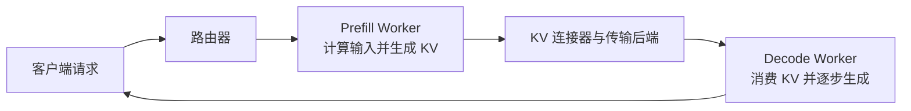

# 推理框架：vLLM、SGLang 与服务背后的内存管理

推理框架把请求变成模型计算：调度器决定哪些 Token 一起执行，内存管理器保证权重和 KV Cache 可用；如果 Prefill 与 Decode 分布在不同 Worker，传输连接器还要搬运缓存。理解这些职责，比记住某条部署命令更重要。下文用 **HBM** 表示加速器内存（受支持的 GPU/NPU 设备内存层级也可类比），用 **DRAM** 表示主机内存。

## 为什么要区分 Prefill 与 Decode？

**Prefill** 一次处理输入中的许多 Token，生成首个输出 Token 和输入的 KV Cache，通常更依赖算力及临时激活内存。**Decode** 每轮追加一个或少量 Token，反复读取权重与既有 KV，因而对缓存容量和内存带宽更敏感。把长 Prefill 批次与对延迟敏感的 Decode 混合调度，容易互相干扰。PD 分离让两阶段独立扩缩容与调参，但也带来 KV 传输、协调和故障处理成本；只有收益超过这些代价才值得使用。参见 [vLLM 的分离式 Prefill](https://docs.vllm.ai/en/latest/features/disagg_prefill/)与 [SGLang 的 PD 文档](https://docs.sglang.ai/backend/pd_disaggregation.html)。

## HBM 与 DRAM 分别放什么？

| 资源 | 常见位置 | 为什么重要 |
| --- | --- | --- |
| 模型权重 | 设备内存；可按配置卸载到 Host | 服务该模型的 Worker 都需要相应权重或分片，PD 分离不会消除这笔开销。 |
| 激活值、计算图及工作区缓冲 | 设备内存，Prefill 时尤为明显 | 权重和 KV 之外必须留出余量；峰值可能在平均占用不高时仍触发 OOM。 |
| 活跃 KV Cache | 设备内存，供 Attention 快速访问 | 随上下文和并发增长；块或页分配器负责复用容量。 |
| 调度元数据、输入 Token、传输描述 | Host DRAM | 它们负责协调，并不意味着默认在 Host 再保存所有 KV 的副本。 |
| 可选 KV 卸载或传输中转 | 配置并受支持时使用 Host DRAM 或外部存储 | 扩展容量或连接不同传输路径，但增加复制延迟、带宽压力及故障状态。 |

**vLLM** 用 `gpu_memory_utilization` 为模型执行器设定设备内存预算；也可以用 `kv_cache_memory_bytes` 显式指定 KV 容量。`cpu_offload_gb` 是单独的*权重*卸载设置，KV 卸载另有独立配置；不能把 CPU Offload 等同于“KV 会自动溢出到 DRAM”。参见 [vLLM 引擎参数](https://docs.vllm.ai/en/stable/api/vllm/)和 [KV 卸载文档](https://docs.vllm.ai/en/latest/features/kv_offloading_usage/)。

**SGLang** 的 `--mem-fraction-static` 控制权重及 KV 池占用的静态设备内存比例，动态激活仍需额外空间。RadixAttention 可以在缓存池中复用公共前缀 KV。启用 **HiCache** 后，还能把 KV 缓存扩展到 Host 内存与可选存储；这些是有搬运成本的不同层级，并非访问速度一致的统一内存。参见 [SGLang 调参文档](https://github.com/sgl-project/sglang/blob/main/docs/docs/advanced_features/hyperparameter_tuning.mdx)、[HiCache](https://github.com/sgl-project/sglang/blob/main/docs/docs/advanced_features/hicache.mdx)及 [PD 文档](https://docs.sglang.ai/backend/pd_disaggregation.html)。参数与后端能力要以具体版本和硬件为准。

### 先估算 KV，再决定内存池大小

普通全量 Attention 布局中，单序列 KV 载荷近似为：

$$B_{KV}=L\times 2\times H_{KV}\times D_{head}\times T\times b$$

其中 $L$ 是层数，$H_{KV}$ 是 KV 头数，$D_{head}$ 是头维度，$T$ 是保留的 Token 数，$b$ 是单元素字节数。取 32 层、8 个 KV 头、头维 128、2,048 个 Token、BF16（每元素 2 字节），得到 **268,435,456 字节，即 256 MiB**。假设一块 80 GiB 设备在扣除权重及其他预留后可给 KV 使用 30 GiB，简单相除得到理论上限 **120** 个这样的序列。实际并发还受块舍入、输出增长、碎片、激活峰值、并行切分和前缀复用影响。滑动窗口、MLA、量化 KV 等布局必须另算。把公式用于真实模型前，可先看 [KV Cache 基础](../ml/llm/inference/kv-cache.md)。

## 完整走一遍 PD 请求：共享系统提示词

假设两个请求使用同一段系统提示词，后续用户输入不同。P、D 两侧具有兼容的模型权重、Tokenizer 和 KV 布局，路由器知道请求的落点。以下描述的是逻辑流程；vLLM 的 KV Connector 与 SGLang 的 Mooncake、NIXL、Ascend 等后端在实现细节上并不相同。

1. **路由与准入。** 路由器选择 Prefill 和 Decode Worker，核对预期输入长度、KV 剩余容量与传输链路健康状态。若已有前缀缓存命中，可以少算部分 Prefill。
2. **准备目标。** D 为输入预留空闲 KV 块或页，向连接器提供目标块标识或访问描述。预留表示留出了位置，*字节此时尚不可用*。容量不足时，请求应按策略等待、重路由或失败。
3. **在 P 侧计算。** P 按双方一致的规则分词、执行 Prefill，把 KV 写进自己的 HBM 块。传输引擎读取前，要保证计算完成且数据可见；P 还需产出续接生成所需的交接信息。
4. **传输缓存。** 连接器协调控制消息，并通过受支持的设备直达或 Host 中转路径搬运 KV 字节。它跟踪请求身份、块与层、长度、布局、错误及超时。[端到端传输](end-to-end-transfer.md)进一步拆解这一边界。
5. **提交交接。** D 等待后端规定的完成与可见性条件，再把收到的块绑定到序列；Attention 内核只能在此后读取。P 应在协议确认接收方已取得所需数据后释放临时块；仅仅发生超时，并不能证明在途 DMA 已停止。
6. **Decode 与回收。** D 迭代生成 Token 并流式返回；每个新 Token 都会扩展活跃 KV。请求结束后，无引用的块回到池中，可复用的前缀块可能保留至被淘汰。故障清理要回收两侧预留与传输句柄，同时避开在途任务。

vLLM 的 [Ascend PD 设计](https://docs.vllm.ai/projects/ascend/en/main/developer_guide/Design_Documents/disaggregated_prefill.html)给出了连接器的具体过程：D 分配块、缓存传输、D 继续生成。SGLang 的 [PD 文档](https://docs.sglang.ai/backend/pd_disaggregation.html)展示独立 P/D 服务角色及可选传输后端，包括 Ascend 路径。这不表示所有 vLLM 或 SGLang 部署默认使用 MemFabric；实际路径由连接器和后端配置决定。

## 缓存复用同时是放置与身份问题

若第二个请求的 Token 前缀完全一致，且模型与缓存配置兼容，就可能直接复用此前的前缀 KV。**vLLM** 对完整缓存块及其前驱前缀计算哈希，必要时加入 Adapter、Cache Salt 等身份信息；缓存管理器维护引用并在空间不足时淘汰。**SGLang** 通过基于基数树的前缀缓存寻找公共路径；HiCache 可以把较冷的数据放在 DRAM 或存储中。命中是否划算，还要算上取回与传输开销。参见 [vLLM 前缀缓存设计](https://docs.vllm.ai/en/latest/design/prefix_caching/)和 [SGLang HiCache](https://github.com/sgl-project/sglang/blob/main/docs/docs/advanced_features/hicache.mdx)。

模型版本、分词结果、位置设置、KV 数据类型与布局、Adapter 或隔离域不兼容时，不应复用缓存。前缀匹配比较的是 *Token ID 与执行上下文*，不是文本看起来相似即可。PD 分离时，P 上已有的前缀不一定在选中的 D 上；缓存感知路由、放置和传输共同决定复用能否真正省时间。

## 测量完整请求

同时观察 **TTFT**（首 Token 延迟）、**ITL**（输出 Token 间延迟）、请求吞吐、缓存命中率、设备内存余量、KV 传输量与耗时、等待空闲块的时间及故障率。请求慢时，应拆分排队、Prefill 计算、KV 传输、Decode 调度与逐 Token 生成。若 D 正等待拥塞链路或空闲 KV 块，单纯加快 P 不会解决问题。再结合[内存与地址](memory-addressing.md)、[数据搬运](data-movement.md)和[性能工具](performance-tools.md)定位瓶颈。
