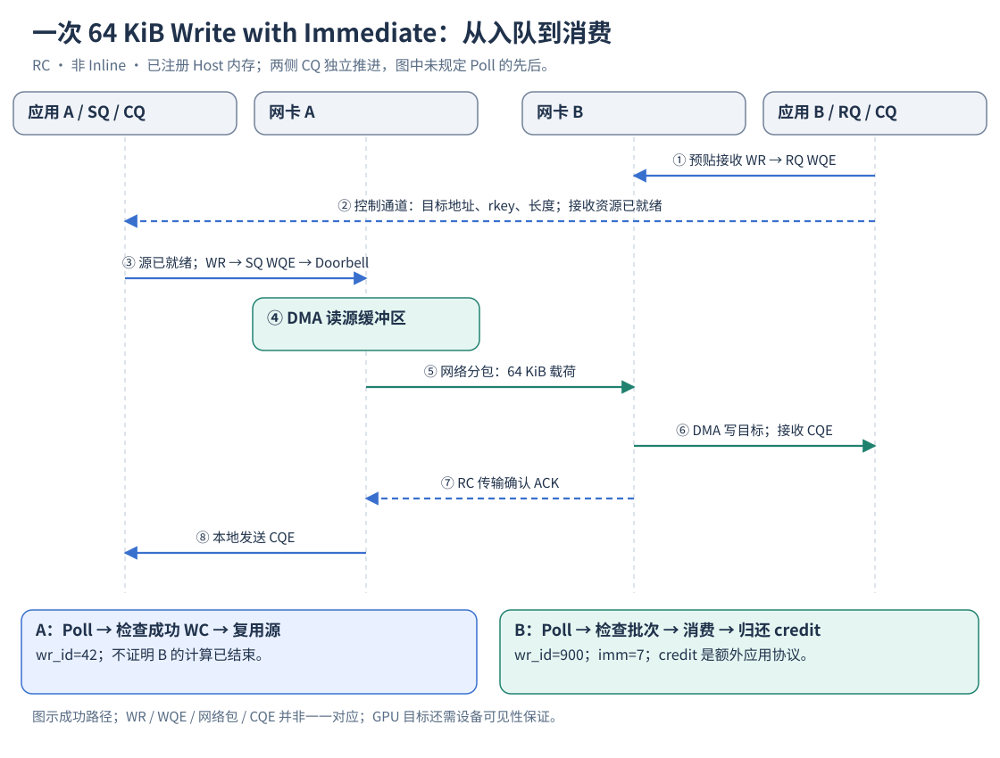
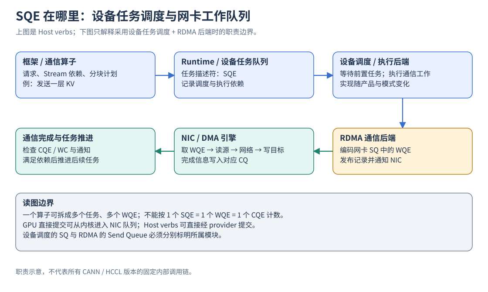

# 📬 从 WQE、SQE、CQE 到 Doorbell：任务怎样交给硬件

**A 把 64 KiB 数据写到 B：B 先提供目标内存和接收资源，A 把请求编码成 WQE 并通知网卡；网卡读源、发包、写目标，两侧分别检查完成。** A 能复用源缓冲区、B 能读取目标、B 已消费完，是三个不同的时间点。

本页以一次 **RC RDMA Write with Immediate** 为主线，把每个缩写放进真实提交与完成流程，再对比普通 Write、Send/Recv、GPU 和 NPU 的路径。

若正在看昇腾 UB 日志中的 **Jetty、JFS、JFR、JFC**，继续看[Jetty 与 Runtime 拷贝](jetty-runtime-copy.md)：那里单独画出两端资源、Direct WQE 的头 SQE 与后继数据槽，以及 Doorbell 模式，不能直接套用下面的 ibverbs 对象与字段。

<figure class="model-figure" markdown="1">

[](../../assets/transfer-diagrams/zh/write-with-immediate.svg)

<figcaption markdown="span">图：两侧 Poll 独立发生；RC ACK 不表示 B 的计算结束。虚线为元数据交接或传输确认。点击可放大。</figcaption>

</figure>

## 🧩 先说明是哪一种队列

| 名称 | 在 RDMA / 设备任务中的含义 | 需要区分的边界 |
| --- | --- | --- |
| WR（Work Request） | 应用提交给 verbs 的软件请求 | 不是网卡直接消费的硬件字节格式 |
| WQE（Work Queue Element） | 硬件工作队列中的任务描述符 | 可描述发送、接收、RDMA Read/Write 等；格式由设备定义 |
| SQ | RDMA 中通常是 Send Queue，承载主动发起的操作 | RDMA Read 也从本地 SQ 发起；并非只能“发送消息” |
| RQ | Receive Queue，提供接收缓冲区 | 常规 Send/Recv 的接收方要先提供接收资源 |
| QP | Queue Pair，关联发送/接收队列及传输状态 | 基础 RC verbs 模型中理解为一对 SQ/RQ；SRQ 等有不同组织方式 |
| CQ / CQE | Completion Queue / Completion Queue Entry，完成队列及其记录 | 多个 QP 可以使用同一 CQ；CQE 也可能报告失败 |
| WC（Work Completion） | `ibv_poll_cq` 交给应用的完成结果 | 是软件接口视图，不能直接等同于某款网卡 CQE 的结构 |
| SQE | Submission Queue Entry，或具体文档中 Send Queue 的 Entry | 必须先确认所属系统：设备调度队列、网卡发送队列和 io_uring 不能共用结构定义 |
| Doorbell / DBR | 通知硬件有新任务 / Doorbell Record | DBR 是部分实现使用的内存记录，不等于 MMIO 门铃寄存器 |

`ibv_post_send` 把软件 WR 列表提交到 QP 的 SQ；用户态 provider 将其编码为设备可消费的工作项。`ibv_poll_cq` 返回 WC。

应用通常通过库完成这些步骤。[rdma-core 提交接口](https://github.com/linux-rdma/rdma-core/blob/master/libibverbs/man/ibv_post_send.3)、[完成接口](https://github.com/linux-rdma/rdma-core/blob/master/libibverbs/man/ibv_poll_cq.3)分别定义这两个边界。

在昇腾日志中看到 SQE 时，要先判断它属于 Runtime/任务调度还是通信引擎。HCCL 的[重执行说明](https://www.hiascend.com/document/detail/en/CANNCommunityEdition/910/commlib/hcclug/docs/en/user_guide/hccl_env/HCCL_OP_RETRY_ENABLE.md)分别提到重新下发 SQE 与 WQE，因此不能把二者视为统一格式；具体字段和队列映射需查对应版本实现。

一个逻辑 Stream 也不能未经验证就等同于一个硬件 SQ 或 RDMA QP。

## 🔄 完整走一笔 64 KiB Write with Immediate

为把队列机制讲清楚，先使用**已注册的 Host 内存**、一条已建立的 RC QP 连接、非 Inline 写，以及两侧各自的发送/接收 CQ。后文再替换成 HBM。这是教学示例，不是硬件实测。

| 对象 | 本例约定 | 含义 |
| --- | --- | --- |
| A 源内存 | `src`、`65536` 字节、`src_mr->lkey` | A 网卡读取的已注册内存 |
| B 目标内存 | `dst_addr`、容量至少 `65536`、`dst_rkey` | B 授权远端写入的内存；地址按其 MR 寻址约定解释 |
| A 发送 WR | `wr_id=42` | A 在发送 WC 中找回自己的请求 |
| B 接收 WR | `wr_id=900` | B 在接收 WC 中找回自己的接收资源 |
| 本次批次 | `generation=7` | 通过 32 位 immediate 传给 B；实际协议需处理回绕和旧消息 |

### ① 建链与注册：准备通路，还没有发送载荷

双方选择 NIC/端口，创建 PD、CQ、QP，完成 RC 连接配置并使发送侧可发送。A 注册源 MR；B 注册带远端写权限的目标 MR，交换连接与内存访问描述。

这些初始化资源通常复用。每次传输仍要确认目标槽位归属、容量和句柄有效期。注册只是准备访问条件，**不会把源数据发出去**。[MR 注册接口](https://github.com/linux-rdma/rdma-core/blob/master/libibverbs/man/ibv_reg_mr.3)定义权限和密钥。

### ② B 预贴接收：为这一次通知准备 RQ 资源

B 调用 `ibv_post_recv`，provider 将接收资源发布到 B 的 RQ。本例可贴一个 **`num_sge=0` 的接收 WR**：它供 Write with Immediate 产生接收通知，64 KiB 载荷写到 `dst_addr`，不写入这个 WR 的 SGE。

B 再经已有控制通道告诉 A：“目标槽位可用，接收资源已贴好”。缺少 RQ 资源时，RC Write with Immediate 可能遇到 RNR 并重试，最终可能超出重试限制。参见[接收接口](https://github.com/linux-rdma/rdma-core/blob/master/libibverbs/man/ibv_post_recv.3)、[操作语义](https://networking-docs.nvidia.com/doca/archive/3-5-0/rdma-aware-networks-programming-guide)和 [Write with Immediate 接收资源说明](https://docs.nvidia.com/doca/archive/doca-v2.2.1/rdma-programming-guide/index.html)。

### ③ A 生产数据，再提交软件 WR

A 等到 `src` 内容生产完成，填写以下请求并调用 `ibv_post_send`：

| 字段 | 本例填写 | 用途 |
| --- | --- | --- |
| `opcode` | `IBV_WR_RDMA_WRITE_WITH_IMM` | 写远端目标并产生接收通知 |
| 本地 SGE | `src`、`65536`、`src_mr->lkey` | 从哪里读、读多少、本地访问密钥 |
| `wr.rdma.remote_addr / rkey` | `dst_addr / dst_rkey` | 写 B 的哪里、使用什么远端权限 |
| `send_flags` | `IBV_SEND_SIGNALED` | 本例 `sq_sig_all=0`，要求报告本次成功发送完成 |
| `wr_id / imm_data` | `42 / htonl(7)` | A 的本地记账 / B 的批次通知 |

返回 `0` 表示请求被接受，**不是远端已经收到数据**。本例只有一条 WR；WR 链则可能在某条失败前已提交前面的部分。WR/SGE 软件结构在调用返回后可离开当前作用域，非 Inline 源载荷必须继续保留到满足完成条件。

### ④ Provider 写 WQE、发布进度，再通知网卡

provider 检查 SQ 容量，把 WR 编成网卡格式的 WQE，记录请求与完成的关联，然后按设备协议发布描述符、更新所需 DBR/索引并敲 Doorbell。

例如 mlx5 的 `post_send_db` 展示了 **写描述符 → `udma_to_device_barrier()` → 更新发送 DBR → MMIO/BlueFlame 写 → 刷出 MMIO 写**的顺序。部分描述符可通过 MMIO 推送；这不是所有网卡共用的 ABI。[provider 源码](https://github.com/linux-rdma/rdma-core/blob/master/providers/mlx5/qp.c)可直接对应到这些步骤。

网卡 WQE 与软件 WR 的内存格式不同；`wr_id` 也不必在硬件描述符里原样保存。**Doorbell 负责通知，不等于 CPU 把整个 64 KiB 张量写进网卡寄存器。**

### ⑤ A 网卡 DMA 读源、分包，B 网卡 DMA 写目标

A 网卡获得工作描述后，根据 SGE 与本地注册上下文读取 `src`，按连接和路径参数分包发送。B 网卡校验连接、地址、长度和远端访问权限，将载荷写到目标内存。

一条 WR 可以对应多个网络包。只按 4096 字节载荷分段计算，64 KiB 是 16 段；实际还涉及包头、确认和重试，**不能按一个网络包算一条 CQE**。`lkey` 用于本地访问，远端访问描述使用 `rkey`。

### ⑥ B 产生接收完成，A 获得 RC 传输完成

到达本次接收完成点时，B 消耗一份已贴接收资源，向对应接收 CQ 写入 CQE。Immediate 是通知里的 32 位值，不是写在 `dst` 尾部的 4 字节。

RC 的确认与必要重传由网卡处理；本次 signaled 写达到发送完成点后，A 网卡也向 A 的发送 CQ 写完成。**RC ACK 不是 B 的应用 ACK**：它不证明 B 已 Poll、Decode 已开始或目标槽位可被覆盖。两侧应用观察各自 CQ 的先后也没有统一时间线。

### ⑦ 双方 Poll：CQE 被解码成 WC，再决定能复用什么

| 哪一侧 | 本例成功 WC | 此后允许做什么 |
| --- | --- | --- |
| A | `wr_id=42`，`IBV_WC_RDMA_WRITE` | 按非 Inline 写完成规则复用源缓冲区 |
| B | `wr_id=900`，`IBV_WC_RECV_RDMA_WITH_IMM`，有 `IBV_WC_WITH_IMM`，`ntohl(imm_data)==7` | 在本例 Host 内存条件下消费对应目标数据 |

**A 的 `42` 不会自动变成 B 的 `wr_id`。** B 的 `900` 来自自己的接收 WR；跨机器传递的批次标识在这里是 immediate 中的 `7`。

`ibv_poll_cq` 返回 `0` 只是当前没有完成，负数是轮询接口失败。先检查 WC 的 `status`；报错时仅 `wr_id / status / qp_num / vendor_err` 保证有效，不能继续按成功结果解释其他字段。[WC 接口](https://github.com/linux-rdma/rdma-core/blob/master/libibverbs/man/ibv_poll_cq.3)定义了这些规则。

### ⑧ B 消费完再还 credit，下一次传输才能覆盖目标

B 读取或计算完成后，通过额外应用协议归还目标槽位 credit。A 获得 credit 后才可以覆盖这个槽位。归还可走控制通道或另一次通信，不能用本次 A 的发送 WC 代替。

B 还需为后续 Write with Immediate 补贴接收 WR。**补贴 RQ 资源和归还目标槽位是两种动作**：通知容量可用了，不表示计算仍在读取的目标块可被覆盖。

## 💻 把流程对应到 verbs 代码

以下是**已有 RC 连接上的核心片段**，不是独立可运行程序。QP/CQ/MR、远端描述与槽位交接由上下文提供；`check`、`require`、`fail_wc` 是应用错误处理。本例只保留一笔在途写，生产程序还需超时、共享 CQ 分派与清理。

### B：先贴接收，再宣布目标可用

```c
struct ibv_recv_wr recv = {
    .wr_id = 900,
    .sg_list = NULL,
    .num_sge = 0,  // Write-with-imm: payload goes to dst_addr
};
struct ibv_recv_wr *bad_recv = NULL;
check(ibv_post_recv(qp_b, &recv, &bad_recv));
// Now tell A: dst_addr/dst_rkey and receive resources are ready.
```

### A：生产完成后，只提交这笔 64 KiB 写

```c
// src is ready; B granted the destination slot.
struct ibv_sge sge = {
    .addr = (uintptr_t)src,
    .length = 65536,
    .lkey = src_mr->lkey,
};
struct ibv_send_wr send = {
    .wr_id = 42,
    .sg_list = &sge,
    .num_sge = 1,
    .opcode = IBV_WR_RDMA_WRITE_WITH_IMM,
    .send_flags = IBV_SEND_SIGNALED,
    .imm_data = htonl(7),
};
send.wr.rdma.remote_addr = dst_addr;
send.wr.rdma.rkey = dst_rkey;
struct ibv_send_wr *bad_send = NULL;
check(ibv_post_send(qp_a, &send, &bad_send));
// Keep src valid and unchanged until its successful send WC.
```

### A、B：各自在本机检查完成

```c
struct ibv_wc poll_one_checked(struct ibv_cq *cq) {
    struct ibv_wc wc;
    int n;
    do {
        n = ibv_poll_cq(cq, 1, &wc);  // Production: deadline / progress handling
    } while (n == 0);
    require(n == 1);
    if (wc.status != IBV_WC_SUCCESS) fail_wc(&wc);  // Must stop success path
    return wc;
}

// On A:
struct ibv_wc sent = poll_one_checked(send_cq_a);
require(sent.wr_id == 42 && sent.opcode == IBV_WC_RDMA_WRITE);
// Source reusable. Wait for B's credit before overwriting B's slot.

// On B, independently:
struct ibv_wc received = poll_one_checked(recv_cq_b);
require(received.wr_id == 900);
require(received.opcode == IBV_WC_RECV_RDMA_WITH_IMM);
require(received.wc_flags & IBV_WC_WITH_IMM);
require(ntohl(received.imm_data) == 7);
// Consume registered host dst; then return destination-slot credit.
// Repost receive resources before allowing the next notification.
```

## ⚖️ 换一种操作，哪些步骤会变

| 操作 | 载荷目标 | 远端是否要为每次操作贴接收 WR | 完成与通知 |
| --- | --- | --- | --- |
| 普通 RDMA Write | 请求指定的远端地址 | 不需要 | 发起方按策略完成；远端无自动接收 WC，需另设就绪协议 |
| Write with Immediate | 请求指定的远端地址 | 需要，提供通知资源 | 发起方发送完成；远端接收完成携带 immediate |
| Send/Recv | 接收 WR 的 SGE 指向的缓冲区 | 需要，容量必须足够 | 发送侧按策略完成；远端收到接收 WC |
| RDMA Read | 发起方 SGE 指向的本地缓冲区 | 不需要 | Read 也从本地 SQ 发起；远端无自动应用接收 WC |

因此不能给普通 Write 强加“先贴一个装载荷的 Recv”，也不能删掉 Write with Immediate 的接收资源准备。[操作语义](https://networking-docs.nvidia.com/doca/archive/3-5-0/rdma-aware-networks-programming-guide)决定这些差别。

## 🪜 SQE 在哪里，换成 GPU / NPU 又改什么

<figure class="model-figure" markdown="1">

[](../../assets/transfer-diagrams/zh/sqe-to-wqe.svg)

<figcaption markdown="span">图：采用设备任务调度和 RDMA 后端时，分别追踪调度层与网卡层；一个任务可展开成多个 WQE。</figcaption>

</figure>

昇腾 HCCL 的[执行说明](https://www.hiascend.com/doc_center/source/zh/canncommercial/81RC1/developmentguide/hccl/hcclug/hcclug_000001.html)描述了经 Runtime 向设备任务调度器下发编排与访存任务；[重执行说明](https://www.hiascend.com/doc_center/source/zh/CANNCommunityEdition/910beta1/API/hcclug/hcclenvref_07_0034.html)则分别提到 SQE 和 WQE。图示按这些职责划分，不是所有版本固定的内部调用链。

| 路径 | 谁决定要传 | 谁向网卡提交 | 主例中改变的部分 |
| --- | --- | --- | --- |
| Host verbs | CPU 应用/框架 | 用户态 provider | 就是上述主流程；稳态提交不必每次陷入内核 |
| Device 请求 + Host proxy | GPU/NPU 内核 | CPU 代理与通信库 | WQE 提交前增加设备请求发布与代理读取 |
| 支持的 GPU 直接提交 | GPU 内核 | 设备通信库 | WQE 发布、队列同步与通知移到设备侧；NIC 仍搬运载荷 |
| NPU 设备调度 + RDMA 后端 | 框架或受支持设备任务 | 随产品、CANN、执行模式与后端变化 | 追踪 Runtime SQE → 调度 → 通信 WQE → 完成/依赖推进 |

**Host verbs 不必先生成 NPU Runtime SQE。** SQ 必须标明所属模块；不能按 `1 SQE = 1 WQE = 1 CQE` 计数，也不能把本地 SDMA/MTE 拷贝一概画成 RDMA。

这也不表示 SQE 与 WQE 在物理内存中永远分开。CANN Runtime 的一个 Direct WQE 实现会把调度头和 WQE 数据连续放入 Runtime SQ；另一条路径先填 Jetty，再发 Doorbell SQE。两种实际布局见 [UB 拷贝模式对照](jetty-runtime-copy.md)。

如果支持设备内存直达，载荷可走 `HBM A → NIC A → 网络 → NIC B → HBM B`，CPU 仍可以负责提交。**载荷绕过 CPU 内存，不表示 GPU/NPU 亲自敲了 Doorbell。** GPU 直接提交的具体例子见 [NVSHMEM IBGDA](https://developer.nvidia.com/blog/improving-network-performance-of-hpc-systems-using-nvidia-magnum-io-nvshmem-and-gpudirect-async/)。

换成 HBM 后还要补齐两条设备依赖：

1. 源生产内核完成，且产出对 NIC 可见，再让 NIC 读源。
2. 远端写入及通知满足后端要求，建立设备可见性与执行依赖，再让消费内核读目标。

Host 收到 CQE 不会自动给任意正在运行的 GPU 内核建立内存顺序，见 [GPUDirect RDMA 同步规则](https://docs.nvidia.com/cuda/gpudirect-rdma/#synchronization-and-memory-ordering)。NPU 应使用对应后端的同步接口。进一步见[设备发起传输](device-initiated-transfer.md)和[逐层 KV 传输](../ml/llm/inference/layerwise-inference.md)。

## 🔔 Doorbell 为什么需要顺序保证

典型发布顺序是：`写好描述符 → 按平台规则建立可见性 → 更新所需记录/索引 → 通知硬件`。如果硬件先观察到通知，再读到尚未发布完整的描述符，就可能执行错误任务。

这里所需的 CPU/GPU 屏障、缓存操作和 MMIO 顺序由平台和库规定，C/C++ 的 `volatile` 不能替代这些保证。[DOCA DPA 编程指南](https://docs.nvidia.com/doca/archive/doca-v2.2.1/dpa-subsystem-programming-guide/index.html)给出了 WQE、DBR 与 Doorbell 之间的顺序要求。

门铃一般传递“哪个队列已有新工作、生产者推进到哪里”等控制信息，载荷仍由引擎读取。具体实现也可能通过 MMIO 推送部分描述符或内联数据，因此不要把“一次门铃永远只写一个固定整数”当作通用 ABI。

批量发布可以让一次门铃覆盖多个工作项；必须服从队列格式和 provider 的提交协议。

## ✅ CQE、完成通知和远端消费不是同一件事

| 观察到的现象 | 能推出什么 | 还缺什么 |
| --- | --- | --- |
| 提交 API 成功 | 请求被软件/队列接受 | 执行和传输完成 |
| 本地成功 WC | 该操作达到 verbs 定义的完成点 | 远端应用已经读取、模型已经消费 |
| 普通 RDMA Write 写入目标 | 有单边写入路径 | 通常不会自动生成远端应用可轮询的接收 WC |
| Send，或 Write with Immediate 的接收完成 | 可按协议通知接收方 | 接收资源、状态检查及设备侧消费所需可见性 |
| 应用级 ACK | 达到协议约定的交接点 | ACK 若只确认接收，不表示后续推理已经结束 |

在常规 verbs 中，Send/Recv 与 Write with Immediate 要考虑接收队列资源；普通 RDMA Write 不按消息一一消耗远端 RQ。

若使用 [GPUDirect RDMA](https://docs.nvidia.com/cuda/gpudirect-rdma/)，还要遵守 GPU 内存顺序规则，不能仅凭 Host 侧收到通知就让任意正在运行的 GPU 内核无序读取新数据。

操作语义可查 [RDMA 编程接口](https://docs.nvidia.com/networking/display/rdmaawareprogrammingv17/rdma+verbs+api)。

成功 CQE 也不是每个 WQE 都必有一条。选择性完成通知可以降低 CQ 压力；在满足同一 SQ 的操作顺序和完成保证时，可用后续 signaled 请求的成功完成回收此前一批操作。

跨 QP 没有这条隐含关系；遇到错误也要走相应回收流程。CQ 事件通知用于唤醒，应用仍需取出并检查 WC；轮询取出后该完成就被消费了。[CQ 接口说明](https://github.com/linux-rdma/rdma-core/blob/master/libibverbs/man/ibv_poll_cq.3)还指出 CQ 溢出会使 CQ 不可继续使用。

## 🧮 队列深度、回绕与背压

设软件记账中有 64 个可用提交槽位，已占用 60 个，下一批需要 8 个，就应先等待或分批提交；直接覆盖尚未完成的槽位会破坏在途任务。真实硬件可能按 WQE 基本块而非请求个数计容量，不能用“一个请求固定占一个槽位”推算所有设备。

环形队列会回绕。实现可能使用单调计数器、owner/phase 位等区分新旧内容；这些位是设备格式的一部分，不要从另一类队列复制约定。多个线程或 GPU warp 共享 SQ 时，还要保证槽位预留、描述符发布和门铃更新不会相互覆盖。

并发不足限制吞吐，盲目增加并发又会增加 CQ 压力、内存占用和尾延迟。

## 🔎 沿队列定位一次卡住的传输

依次检查：生产者是否推进 → 描述符是否完整可见 → Doorbell 是否按协议提交 → 引擎是否消费 → CQ 是否出现成功/错误结果 → 消费者是否取出结果 → 远端就绪协议是否完成。

记录 `request_id`、Rank、QP/队列号、批次、生产者/消费者进度与错误码；不要只记录“超时”。

若本地 CQ 已成功但远端仍等待，继续检查通知与设备可见性；若 SQ 已满且 CQ 无人轮询，问题可能在完成回收路径。错误 CQE 的原始状态码应按对应厂商和版本解释，不能把不同设备的数字直接互译。

继续阅读[设备发起传输](device-initiated-transfer.md)和[端到端 KV 传输](end-to-end-transfer.md)。
