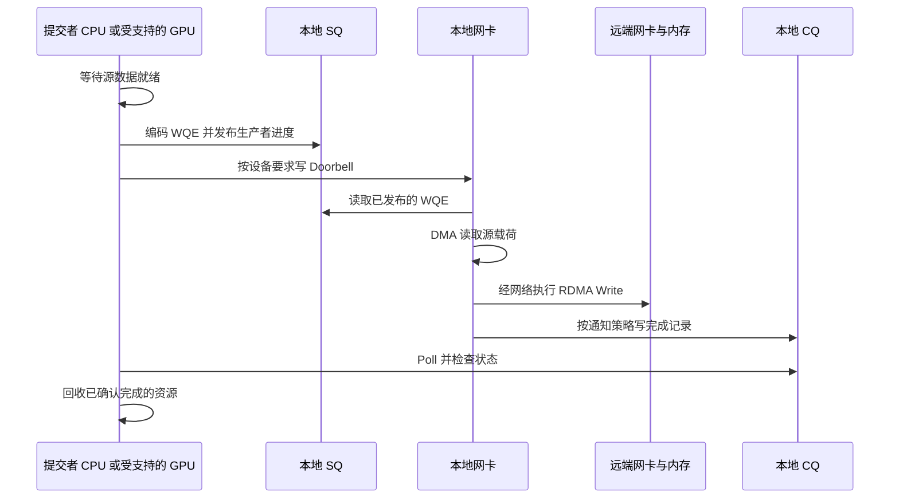

# 📬 从 WQE、SQE、CQE 到 Doorbell：任务怎样交给硬件

把“下发一次拷贝”拆开，会看到三个不同的对象：**描述要做什么的队列项、通知硬件取任务的 Doorbell、记录执行结果的完成项**。描述符通常只占少量字节，真正的张量载荷由后续引擎读取；把描述符写进队列，并不等于已经把张量发给远端。

## 🧩 先说明是哪一种队列

| 名称 | 在 RDMA / 设备任务中的含义 | 需要区分的边界 |
| --- | --- | --- |
| WR（Work Request） | 应用提交给 verbs 的软件请求 | 不是网卡直接消费的硬件字节格式 |
| WQE（Work Queue Element） | 硬件工作队列中的任务描述符 | 可描述发送、接收、RDMA Read/Write 等；格式由设备定义 |
| SQ | RDMA 中通常是 Send Queue，承载主动发起的操作 | RDMA Read 也从本地 SQ 发起；并非只能“发送消息” |
| RQ | Receive Queue，提供接收缓冲区 | 常规 Send/Recv 的接收方要先提供接收资源 |
| QP | Queue Pair，关联发送/接收队列及传输状态 | 基础 RC verbs 模型中理解为一对 SQ/RQ；SRQ 等有不同组织方式 |
| CQ / CQE | Completion Queue / Completion Queue Entry，完成队列及其记录 | 多个 QP 可以使用同一 CQ；CQE 也可能报告失败 |
| WC（Work Completion） | `ibv_poll_cq` 交给应用的完成结果 | 是软件接口视图，不能直接等同于某款网卡 CQE 的结构 |
| SQE | Submission Queue Entry，或具体文档中 Send Queue 的 Entry | 必须先确认所属系统：设备调度队列、网卡发送队列和 io_uring 不能共用结构定义 |
| Doorbell / DBR | 通知硬件有新任务 / Doorbell Record | DBR 是部分实现使用的内存记录，不等于 MMIO 门铃寄存器 |

`ibv_post_send` 把软件 WR 列表提交到 QP 的 SQ；用户态 provider 将其编码为设备可消费的工作项。`ibv_poll_cq` 返回 WC。应用通常通过库完成这些步骤。[rdma-core 提交接口](https://github.com/linux-rdma/rdma-core/blob/master/libibverbs/man/ibv_post_send.3)、[完成接口](https://github.com/linux-rdma/rdma-core/blob/master/libibverbs/man/ibv_poll_cq.3)分别定义这两个边界。

在昇腾日志中看到 SQE 时，要先判断它属于 Runtime/任务调度还是通信引擎。HCCL 的[重执行说明](https://www.hiascend.com/document/detail/en/CANNCommunityEdition/910/commlib/hcclug/docs/en/user_guide/hccl_env/HCCL_OP_RETRY_ENABLE.md)分别提到重新下发 SQE 与 WQE，因此不能把二者视为统一格式；具体字段和队列映射需查对应版本实现。一个逻辑 Stream 也不能未经验证就等同于一个硬件 SQ 或 RDMA QP。

## 🔄 一次主动 RDMA Write 的队列流程

以下采用普通、非 Inline 的 RC RDMA Write；初始化已完成，双方内存已注册并交换目标地址和访问凭据。

WQE 的概念字段包括操作类型、本地 SGE（地址、长度、`lkey`）、远端地址、`rkey` 和完成策略。SGE 可以描述多个不连续的本地片段；Inline 路径则可把小载荷内联到 WQE 中。`wr_id` 是应用用于关联请求和 WC 的标识，不应假设它在所有硬件 WQE 中原样保存。[verbs 定义](https://github.com/linux-rdma/rdma-core/blob/master/libibverbs/man/ibv_post_send.3)还规定了 Inline 的缓冲区复用例外。

## 🔔 Doorbell 为什么需要顺序保证

典型发布顺序是：`写好描述符 → 按平台规则建立可见性 → 更新所需记录/索引 → 通知硬件`。如果硬件先观察到通知，再读到尚未发布完整的描述符，就可能执行错误任务。这里所需的 CPU/GPU 屏障、缓存操作和 MMIO 顺序由平台和库规定，C/C++ 的 `volatile` 不能替代这些保证。[DOCA DPA 编程指南](https://docs.nvidia.com/doca/archive/doca-v2.2.1/dpa-subsystem-programming-guide/index.html)给出了 WQE、DBR 与 Doorbell 之间的顺序要求。

门铃一般传递“哪个队列已有新工作、生产者推进到哪里”等控制信息，载荷仍由引擎读取。具体实现也可能通过 MMIO 推送部分描述符或内联数据，因此不要把“一次门铃永远只写一个固定整数”当作通用 ABI。批量发布可以让一次门铃覆盖多个工作项；必须服从队列格式和 provider 的提交协议。

## ✅ CQE、完成通知和远端消费不是同一件事

| 观察到的现象 | 能推出什么 | 还缺什么 |
| --- | --- | --- |
| 提交 API 成功 | 请求被软件/队列接受 | 执行和传输完成 |
| 本地成功 WC | 该操作达到 verbs 定义的完成点 | 远端应用已经读取、模型已经消费 |
| 普通 RDMA Write 写入目标 | 有单边写入路径 | 通常不会自动生成远端应用可轮询的接收 WC |
| Send，或 Write with Immediate 的接收完成 | 可按协议通知接收方 | 接收资源、状态检查及设备侧消费所需可见性 |
| 应用级 ACK | 达到协议约定的交接点 | ACK 若只确认接收，不表示后续推理已经结束 |

在常规 verbs 中，Send/Recv 与 Write with Immediate 要考虑接收队列资源；普通 RDMA Write 不按消息一一消耗远端 RQ。若使用 [GPUDirect RDMA](https://docs.nvidia.com/cuda/gpudirect-rdma/)，还要遵守 GPU 内存顺序规则，不能仅凭 Host 侧收到通知就让任意正在运行的 GPU 内核无序读取新数据。操作语义可查 [RDMA 编程接口](https://docs.nvidia.com/networking/display/rdmaawareprogrammingv17/rdma+verbs+api)。

成功 CQE 也不是每个 WQE 都必有一条。选择性完成通知可以降低 CQ 压力；在满足同一 SQ 的操作顺序和完成保证时，可用后续 signaled 请求的成功完成回收此前一批操作。跨 QP 没有这条隐含关系；遇到错误也要走相应回收流程。CQ 事件通知用于唤醒，应用仍需取出并检查 WC；轮询取出后该完成就被消费了。[CQ 接口说明](https://github.com/linux-rdma/rdma-core/blob/master/libibverbs/man/ibv_poll_cq.3)还指出 CQ 溢出会使 CQ 不可继续使用。

## 🧮 队列深度、回绕与背压

设软件记账中有 64 个可用提交槽位，已占用 60 个，下一批需要 8 个，就应先等待或分批提交；直接覆盖尚未完成的槽位会破坏在途任务。真实硬件可能按 WQE 基本块而非请求个数计容量，不能用“一个请求固定占一个槽位”推算所有设备。

环形队列会回绕。实现可能使用单调计数器、owner/phase 位等区分新旧内容；这些位是设备格式的一部分，不要从另一类队列复制约定。多个线程或 GPU warp 共享 SQ 时，还要保证槽位预留、描述符发布和门铃更新不会相互覆盖。并发不足限制吞吐，盲目增加并发又会增加 CQ 压力、内存占用和尾延迟。

## 🔎 沿队列定位一次卡住的传输

依次检查：生产者是否推进 → 描述符是否完整可见 → Doorbell 是否按协议提交 → 引擎是否消费 → CQ 是否出现成功/错误结果 → 消费者是否取出结果 → 远端就绪协议是否完成。记录 `request_id`、Rank、QP/队列号、批次、生产者/消费者进度与错误码；不要只记录“超时”。

若本地 CQ 已成功但远端仍等待，继续检查通知与设备可见性；若 SQ 已满且 CQ 无人轮询，问题可能在完成回收路径。错误 CQE 的原始状态码应按对应厂商和版本解释，不能把不同设备的数字直接互译。继续阅读[设备发起传输](device-initiated-transfer.md)和[端到端 KV 传输](end-to-end-transfer.md)。
