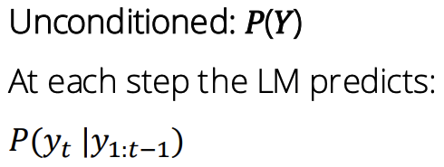

# Intro

# Unconditioned VS conditioned

# Tokenizing Text

A vocabulary is the list of all available tokens

# Turning Discrete Tokens into Continuous Vectors

# Encoder inputs and outputs

encoder takes vector representations as input

outputs a sequence of embeddings called **hidden states**

# Decoder inputs and outputs

decoder takes **hidden states** from encoder as well as **embeddings** for the tokens seen so far

decoder output should be close to the embedding of true next token

multiply embedding by vocab to get logits (score for each word)

then softmax

# Loss Function: Negative Log Likelihood

P()=The probability LLM assigns to the true t th word

I*: index of the true t th word

# How to do the generation?

To do generation, we need a sampling algorithm that selects a word given the predicted
probability distribution 𝑃(𝑌𝑡 = 𝑖|𝑦1:𝑡−1).

# How can we sample from (𝑃 𝑌𝑡 = 𝑖 𝐲1:𝑡−1 )?

**Option 1: Take argmax𝑖 𝑃(𝑌𝑡 = 𝑖|𝐲1:𝑡−1)
Option 2: Randomly sample from the distribution returned by the model.**

**Option 3: Randomly sample with temperature.**

**Option 4: Introduce sparsity by reassigning all probability mass to the 𝑘 most likely tokens. This is referred to as top-𝑘 sampling.**

**Option 5: Introduce sparsity by reassigning all probability mass to the kt tokens which form 𝑝% of the probability mass.
At each step, kt is chosen such that the total probability of the kt most likely tokens is no greater than the desired probability p.This is referred to as nucleus sampling.
Option 6: Use some version of beam search.**

Limitation for **Random sample**:
most token v P(Yt=v)≤0.01

Larger T, more uniformly distributed

**Beam search** is a search algorithm that approximates finding the overall most likely
sequence to generate.

# Decoding Strategy TradeOff

large T, large k, large p → diversity

# Other Parameter

**Frequency penalty**: Reduce the likelihood the model generates a token based on how often it has occurred already.

**Presence penalty**: Reduce the likelihood the model generates a token based on whether or not it has occurred already.

**Stopping criteria**
• Stop after generating k tokens.
• Stop when a certain token is generated (for example, a period or a newline).

# RNN

