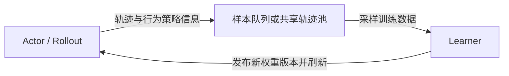

# 🔁 Actor/Learner：轨迹、权重刷新与 Reshard

[RLHF](rlhf.md)、[PPO](ppo.md)和[GRPO](grpo.md)解释优化目标。
本章转向分离式系统：生成样本的 Actor 与更新权重的 Learner 使用不同计算资源时，数据怎样交接？
先区分两个方向，再讨论共享池和分片映射。

## 🧭 两条方向相反的数据流



| 方向 | 主要数据 | 关键问题 |
| --- | --- | --- |
| Actor 到 Learner | Token、Mask、Logprob、Reward 与相关元数据 | 谁生成、何时生成、是否足够新鲜、谁已消费 |
| Learner 到 Actor | 模型权重分片、版本与布局描述 | 目标分片、刷新时机、版本一致性、旧版本回收 |

不同算法不一定使用相同字段：Value、Advantage 或 Reward 可以由流水中的不同角色计算。
轨迹应关联采样时的行为策略版本及所需概率信息，而不能只记录“当前最新模型”。

## 📦 共享 Experience Pool 怎样工作？

考虑一个概念设计：Actor 分配 Trajectory Block，写入 Token、Logprob 等字段，
等待所需传输完成后发布数据描述；Learner 依据长度、优先级和版本选择对象并读取。
消费完成后归还引用或容量。

控制消息只携带对象身份、地址或句柄、尺寸及状态，大块张量沿受支持的数据路径搬运。
这样可以减少控制节点转发大块数据的负担，但消费者仍需要访问到真实字节。
共享地址本身不会完成序列化消除、调度或回收。

| 阶段 | 要明确的协议 |
| --- | --- |
| 生产 | 对象归属、字段布局、行为策略版本 |
| 发布 | 数据完成与可见性、READY 对应哪一代写入 |
| 采样 | 新鲜度、重复采样、样本权重和算法约束 |
| 消费 | 哪些读者仍在使用、何时归还容量 |
| 背压 | 池满时等待、限制生产或按策略丢弃 |

异步执行会产生 Policy Lag。更快的共享访问可以缩短交接，但不能代替算法对陈旧样本的处理。
[重要性采样](importance-sampling.md)解释概率分布变化；具体能容忍多大滞后仍取决于算法和实现。

## 🧩 Refit 与 Reshard 的区别

Refit 表示刷新推理端权重；Reshard 表示把源布局转换成目标布局。
当训练端与 Actor 使用不同 TP、PP、EP 或副本组时，一次刷新可能包含多个 Tensor 的重分片。
基本并行概念见[推理并行策略](../inference/parallelism.md)。

先看一个没有副本、量化转换或转置的一维例子：

```text
源端：L0=[0,4)  L1=[4,8)  L2=[8,12)
目标：A0=[0,6)  A1=[6,12)

A0 需要 L0 的 [0,4) 和 L1 的 [4,6)
A1 需要 L1 的 [6,8) 和 L2 的 [8,12)
```

目标分片与源分片取交集，就能得到需要搬移的范围。
下例验证 12 个元素恰好被覆盖一次；区间采用左闭右开表示。

```python
# runnable-example
sources = [(0, 4), (4, 8), (8, 12)]
targets = [(0, 6), (6, 12)]
pieces = []
for dst, (d0, d1) in enumerate(targets):
    for src, (s0, s1) in enumerate(sources):
        lo, hi = max(d0, s0), min(d1, s1)
        if lo < hi:
            pieces.append((src, dst, lo, hi))
assert pieces == [(0, 0, 0, 4), (1, 0, 4, 6), (1, 1, 6, 8), (2, 1, 8, 12)]
assert sorted(i for _, _, lo, hi in pieces for i in range(lo, hi)) == list(range(12))
```

真实模型还可能存在复制、融合 Tensor、量化 Scale、参数名称映射和不同维度切分。
减少完整张量中间态不意味着消除必要的数据重组，也不能把一维区间算法直接当成完整模型实现。

## 🚦 权重切换要有版本边界

一个可设计的流程是：Learner 发布 V+1 的布局与分片，Actor 接收所需数据并校验，
在约定边界切换到 V+1；旧权重等到已有生成任务不再引用后回收。
如果允许按请求或批次切换，也要明确每条轨迹对应的策略版本。

GVA 能定位数据，但权重版本的原子发布、缓存失效和生成任务切换需要框架管理。
对象身份与地址的关系见[内存 Fabric 五种模式](../../../infra/memory-fabric-patterns.md)。

## 🛠️ 实现入口与扩展方向

[TensorRTL][trtl]包含张量重分布能力及[VeRL 适配示例][verl]。
核对其框架版本、补丁、通信后端与硬件要求后，再判断是否适合目标模型。
[NVIDIA Reshard Collective 说明][reshard]提供另一套布局转换设计参考；其测试结果属于该实现与平台。

Experience Pool 是上面的应用设计例子，不代表 BM 或 TRANS 已提供完整的 RL 样本服务。
其他训练状态可用相同问题分析，但应分别处理：

| 状态 | 生产消费关系 | 需要配套的机制 |
| --- | --- | --- |
| Activation | Forward 产生，Backward 稍后使用 | 计算图、预取、Offload 与重计算选择 |
| Optimizer State | Step 内更新并延续到下一步 | 分片驻留、读写顺序与一致性 |
| Checkpoint | 训练写入快照，恢复任务读取 | 一致快照、Manifest、持久化与拓扑映射 |
| 多模态 Feature | Encoder 产生，Backbone 消费 | 模块并行、微批次组装与背压 |

[FlowTrain][flowtrain]给出了统一内存池上 Encoder/Backbone 解耦的公开训练方案。
DRAM 暂存完成与 Checkpoint 持久化完成需要分别判断。

## 📊 怎样判断优化是否有效？

轨迹路径记录生产/消费吞吐、数据可见延迟、Policy Lag、积压和丢样率。
权重路径记录实际字节数、Refit 时间、Actor 停顿、切换失败及版本校验。
最后比较有效训练吞吐或目标质量下的训练成本，避免只优化搬运而增加样本陈旧度。

**练习。** Actor 写入速度翻倍、Learner 速度不变时，共享池多久会填满？
一个没有版本标记的样本，即使读取速度很快，Learner 能否正确处理其行为策略差异？

[trtl]: https://gitcode.com/Ascend/memfabric_hybrid/tree/master/app/tensorRTL
[verl]: https://gitcode.com/Ascend/memfabric_hybrid/tree/master/app/tensorRTL/examples/verl
[reshard]:
  https://developer.nvidia.com/blog/accelerating-reinforcement-learning-weight-refit-with-the-reshard-collective
[flowtrain]: https://aclanthology.org/2026.emnlp-industry.101/
