# ⚖️ PPO：在优化策略的同时控制更新量

Proximal Policy Optimization（PPO）是一类基于策略梯度的方法。裁剪代理函数被广泛使用，因为它可以重用一个批次进行多次更新，并抑制部分过大的动作概率变化。然而，裁剪并不是一个硬性保证，确保整个策略都保持在信任区域内部。

## 🧭 比率和优势

对于一个采样到的状态/动作对：

$$
r_t(\theta)=\frac{\pi_\theta(a_t\mid s_t)}{\pi_{old}(a_t\mid s_t)},\qquad
L^{clip}=\mathbb E_t\left[\min(r_tA_t,\operatorname{clip}(r_t,1-\epsilon,1+\epsilon)A_t)\right].
$$

这个值被最大化；一个最小化实现会将其取反。比率比较了在当前策略和旧策略下执行相同动作的概率比。优势 $A_t$ 估计了该动作的结果是否比该状态下基线更好。

对于 $A=2$，$r=1.4$，以及 $\epsilon=0.2$，目标使用 $\min(2.8,2.4)=2.4$，这消除了该项进一步增加比率的激励。对于负的优势，裁剪行为会反转。比率本身在最终策略中不会被强制限制。

## 🏗️ 回报、价值网络与 GAE

无折扣的返回是未来奖励的总和。带有折扣 $\gamma$：

$$
G_t=\sum_{k\ge0}\gamma^k r_{t+k}.
$$

一个简单的优势是 $G_t-V(s_t)$。广义优势估计使用时间差残差

$$
\delta_t=r_t+\gamma V(s_{t+1})-V(s_t),\quad
\hat A_t=\sum_{l\ge0}(\gamma\lambda)^l\delta_{t+l},
$$

计算时需要正确处理轨迹终止与价值自举。价值网络通常以平方误差拟合回报目标。价值损失系数、熵奖励和裁剪细节都是超参数；0.1 不是通用的价值损失权重。

## 🏗️ PPO在语言模型中的应用

用采样策略生成回答，计算奖励、价值估计和优势，再更新策略与价值网络。固定参考KL惩罚可以正则化行为以接近SFT模型。这与当前/旧策略的比率以及用于早期停止或更新控制的测量KL是分开的。

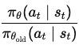

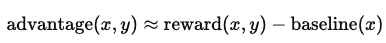

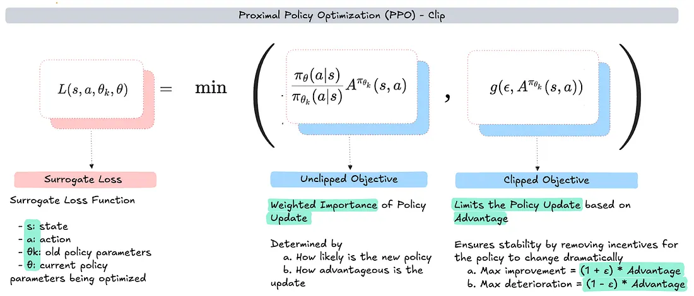

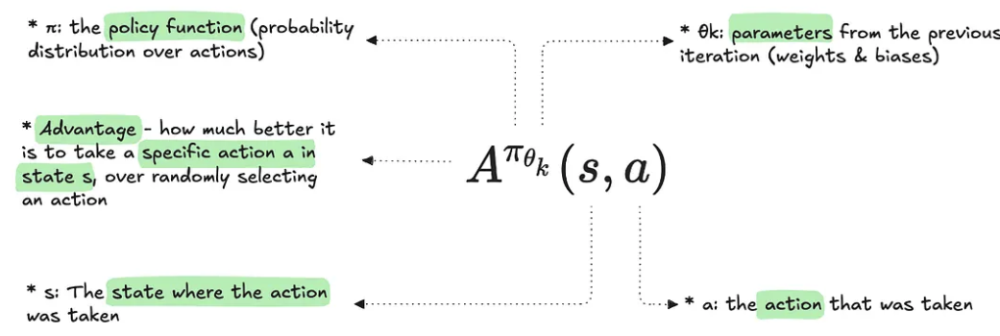

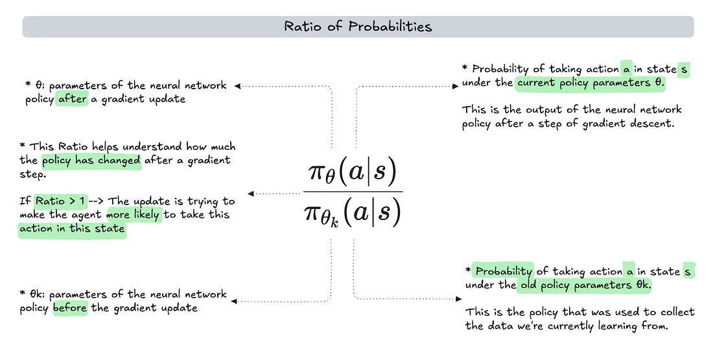

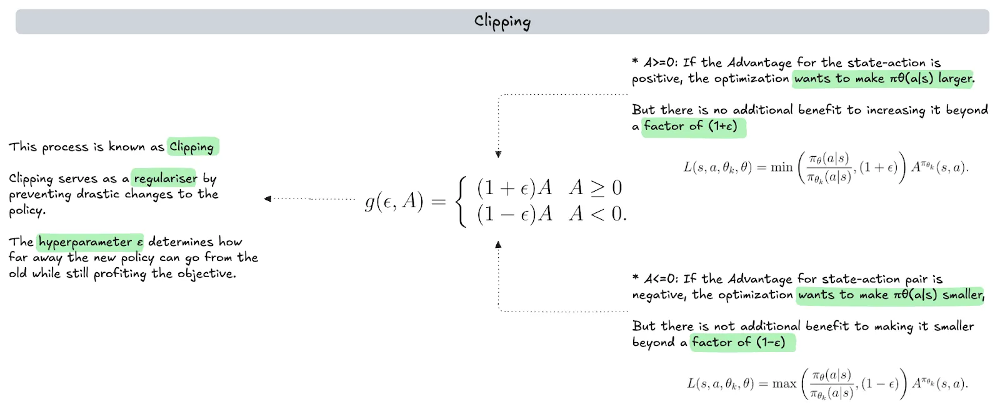

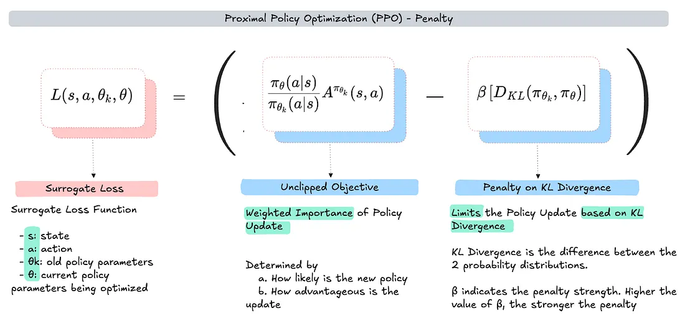

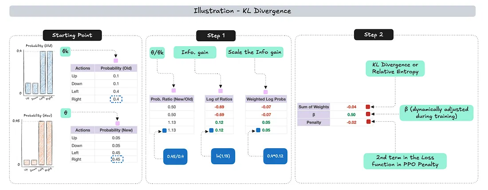

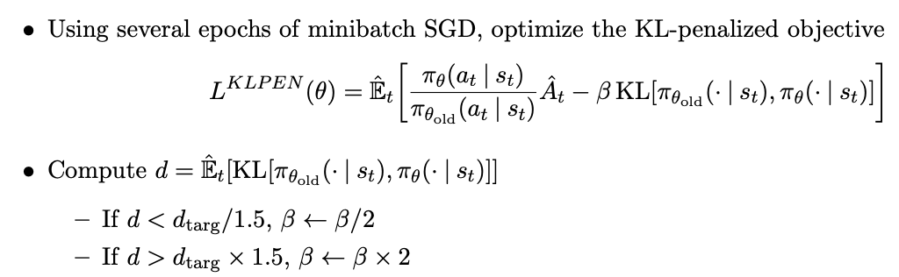

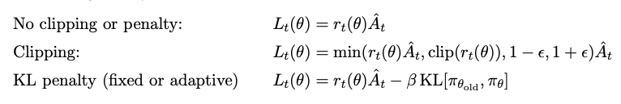

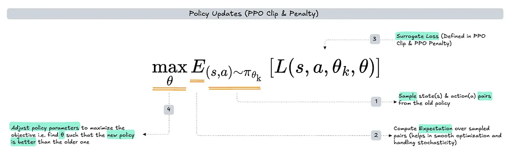

**图例说明。** 图1-2介绍新的到旧的策略比率和优势估计。图3-6扩展了裁剪代理函数；裁剪区间改变了采样动作的目标，而不是策略中每种概率。图7-9展示了KL惩罚变体和自适应惩罚强度；区分采样策略和固定参考策略在语言模型对齐中的区别。图 10 比较未裁剪、裁剪和 KL 惩罚目标。图 11 概括采样后的策略更新循环。几张幻灯片重复使用不同的下标符号，因此在转移公式之前跟踪每个分母。

*通过跟踪哪个策略出现在每个分母中来阅读原始方程。参考模型控制从基线的漂移；旧策略识别采样动作是如何收集的。*

## ⚠️ 实际中的失败模式

过多的更新轮次、不良的优势估计、奖励尺度的变化以及过时的展开数据可能会使训练不稳定。监控奖励、独立任务质量、KL、裁剪分数、熵、值误差和响应长度。单独的较低的策略网络损失并不能证明进展。

**练习。** 裁剪到1.2是否确保每个动作概率变化最多为20%？不是。共享参数也会影响未采样的动作，并且裁剪塑造了目标而不是强制执行全局约束。

参考：[PPO](https://arxiv.org/abs/1707.06347)，[GAE](https://arxiv.org/abs/1506.02438)。回顾 [重要性采样](importance-sampling.md)。
