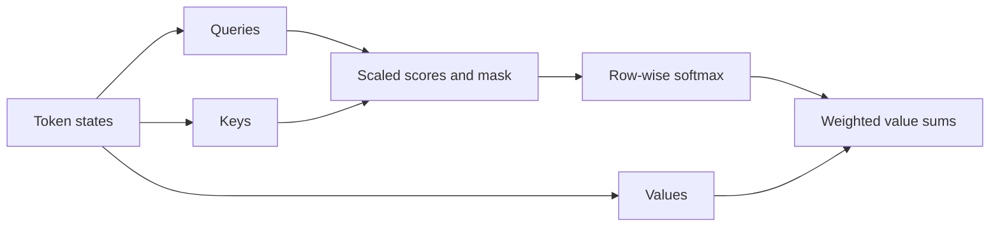

# 注意力：可学习的加权信息提取

固定向量不能方便地保留长句中的每一个细节。注意力让每个输出位置从输入中检索不同的信息。在翻译中，生成一个人的名字应该强调对应的源词；生成动词可能需要其他位置。

## 查询、键和值

查询描述了某个位置需要什么。键是用于匹配该查询的描述符。值包含要聚合的信息。这些是学习到的投影，而不是字面数据库字段：

$$
Q=XW_Q,\quad K=XW_K,\quad V=XW_V,\qquad
O=\operatorname{softmax}\left(\frac{QK^\top}{\sqrt{d_k}}+M\right)V.
$$

对于一个头部，$Q$ 的形状是 $n_q\times d_k$，$K$ 的形状是 $n_k\times d_k$，而 $V$ 的形状是 $n_k\times d_v$。得分矩阵的形状是 $n_q\times n_k$；softmax 在键上运行，因此每个查询会收到权重之和为一的权重。缩放控制随着点积维度增长而变化的得分方差。$M$ 是一个可加的 [掩码](attention-masks.md)。

如果两个键的得分是 $[0,\log 3]$，它们的权重是 $[0.25,0.75]$。值 $[2,10]$ 产生输出 $8$。输出是一个值的混合，而不是最大的得分或选择的标记 ID。

```python
# runnable-example
import math
scores = [0.0, math.log(3.0)]
weights = [math.exp(s) / sum(math.exp(t) for t in scores) for s in scores]
output = sum(w * v for w, v in zip(weights, [2.0, 10.0]))
assert abs(output - 8.0) < 1e-12
```

## 自注意力、交叉注意力和头部

自注意力从同一个序列中获取 Q、K 和 V。交叉注意力从接收序列中获取查询，并从另一个来源获取键/值。因此，文本解码器可以查询图像特征或编码状态。多个头部学习不同的投影，将它们的输出连接起来，并使用一个输出投影来混合它们。它们不一定能专门化为人类可读的语言角色。



## 超出第一个实现

密集注意力在序列长度上的得分大小是二次的。[FlashAttention](attention-variants.md) 在不近似数学注意力操作的情况下改变了内存流量。[KV 缓存](../inference/kv-cache.md) 重用生成过程中的过去键和值。两者都不移除正确位置和掩码的需求。

单独的注意力不能编码词序。[位置信息](position.md) 是必不可少的。注意力权重也不足以自己建立预测的因果解释：值、残差连接和后续层都起作用。

**检查你的理解。** 如果查询长度是 4，源长度是 7，得分形状是多少？它在每个头部中是 $4\times7$，与值向量宽度无关。

继续阅读：[完整的 Transformer 路径](../word2vec-to-transformer.md)。主要参考：[Attention Is All You Need](https://arxiv.org/abs/1706.03762)。
