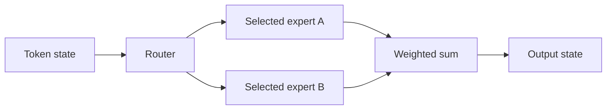
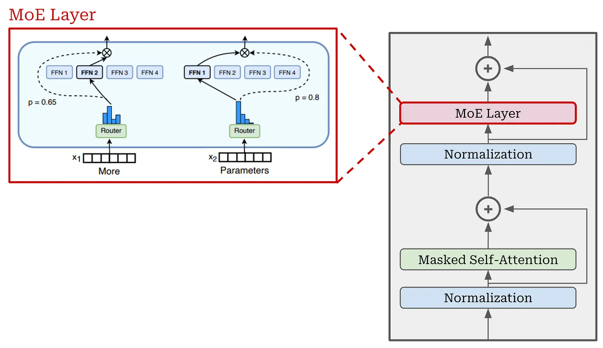
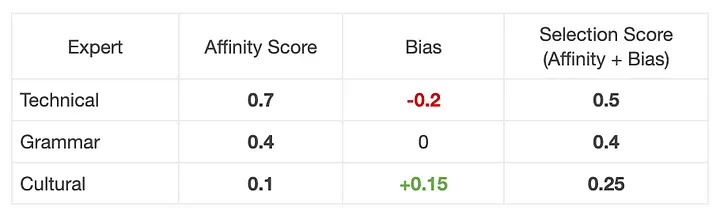
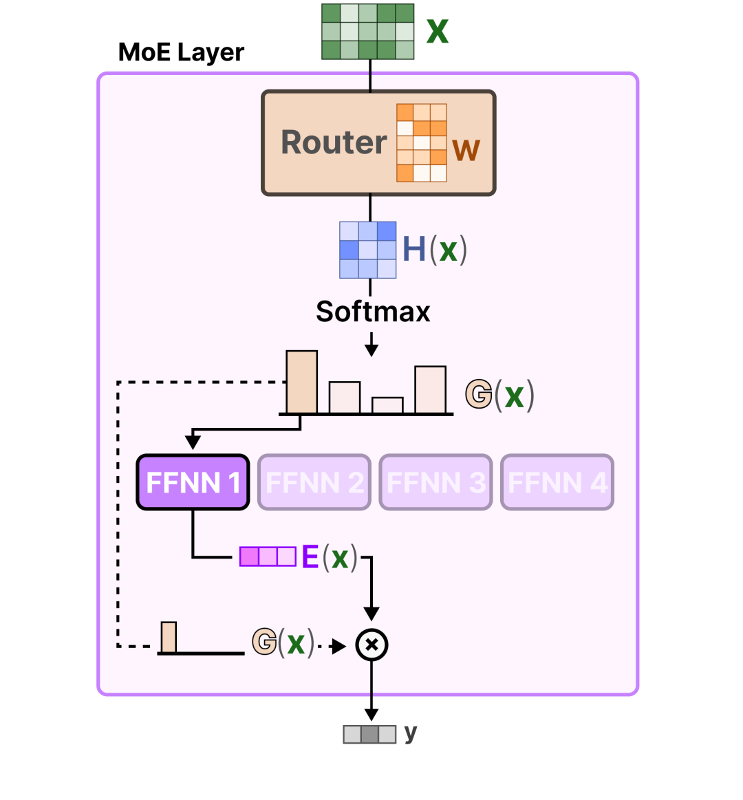
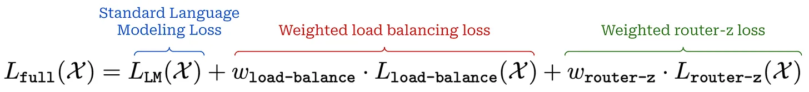
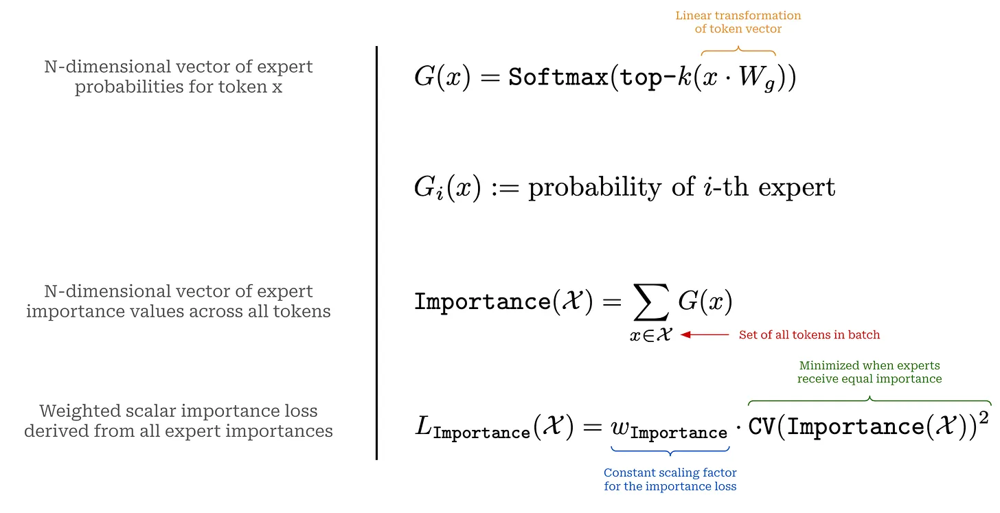
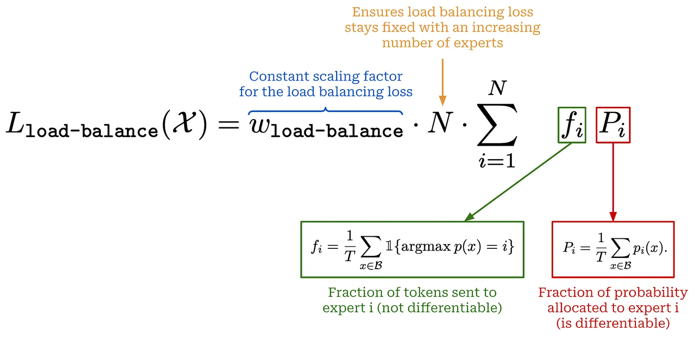
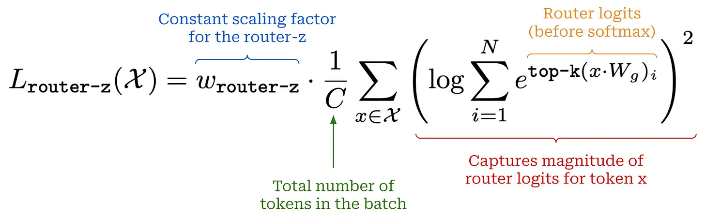

# 混合专家模型：用稀疏计算扩大容量

稀疏 MoE 用多个专家网络替换了一些密集的前馈层。路由器为每个标记选择一个小子集。模型可以在前向传播时激活部分参数，同时仍需要内存来存储在服务系统中驻留的专家。

## 跟随一个标记

对于标记状态 $x$，路由器计算分数，选择一个大小为 $k$ 的专家集合 $S(x)$，并将它们的输出结合起来：

$$
y=\sum_{i\in S(x)}g_i(x)E_i(x).
$$

选定权重的归一化是架构特定的。例如，权重 0.7 和 0.3 将两个专家输出组合为 $0.7E_1(x)+0.3E_2(x)$。专家不需要对应于“数学专家”或“法语专家”等干净的概念；专业化从训练中产生，并需要测量。

## 平衡的重要性

如果几乎所有的标记选择一个专家，那么那个专家就会成为通信/计算瓶颈，而其他专家则很少接受训练。重要性度量对软路由概率求和；负载衡量实际分配计数。这两者不同：许多小概率和少数大概率可以有相同的总和，但顶级 $k$ 流量却非常不同。

一个常见的辅助目标使用每个专家的分配分数与平均路由器概率的乘积作为辅助目标。其他公式惩罚重要性/负载的变化。路由器 z-loss 通过惩罚 logits 的 log-sum-exp 平方来控制数值尺度；它不仅仅是对概率的惩罚。

对于 $T$ 个标记、$E$ 个专家和顶级-$k$ 路由，每个专家的平均分配是 $kT/E$。容量因子保留了超过这个平均值的空间。根据系统不同，溢出标记可能会被丢弃、重新路由或使用动态容量处理。这些选择会影响质量和延迟。

## DeepSeek 风格的设计选择

细粒度的专家使用更窄的专家 FFN 和更多的可选组合。共享的专家处理每个标记以捕捉共同特征。DeepSeek 的后续辅助损失自由平衡通过根据负载调整专家选择偏差；那些偏差不需要进入组合权重。“无损失”不应被解读为“任何地方都没有训练损失”：整个架构可以保留其他正则化器，包括序列级别的平衡。

## 原始视觉笔记

**读图指南。** 图 1 和图 3 标出 Transformer 层中的路由器和被选中的前馈专家。图 2 用亲和度加偏置示意专家排序：用于选择的分数不一定等于组合专家输出时的权重。图 4–7 分别描述总损失、专家重要性统计、负载均衡统计和路由器 z-loss；它们的尺度与可微性不同，不能不加权重就直接相加。保留的第 8 张原图没有可辨认的说明内容，此处以公式和正文为准。

使用图表来区分专家层、路由器分布、平衡目标、z-loss 和容量限制。这些是独立的机制，不是同一个正则化的不同名称。

## 系统后果和检查

专家并行将标记发送到托管选定专家的设备上，通常需要全对全通信。总参数计数、激活参数计数、激活内存和通信量回答不同的成本问题。小批量即使每个标记的算术看起来很有吸引力，也可能未充分利用专家。

**练习。** 有 8 个专家、顶级-2 路由和 64 个标记时，会发生多少次分配以及平均负载是多少？有 128 次分配和每个专家 16 次；实际负载可以不均匀。

参考文献：[Switch Transformers](https://arxiv.org/abs/2101.03961)，[DeepSeekMoE](https://arxiv.org/abs/2401.06066)，[DeepSeek-V3](../models/deepseek-v3.md)。
