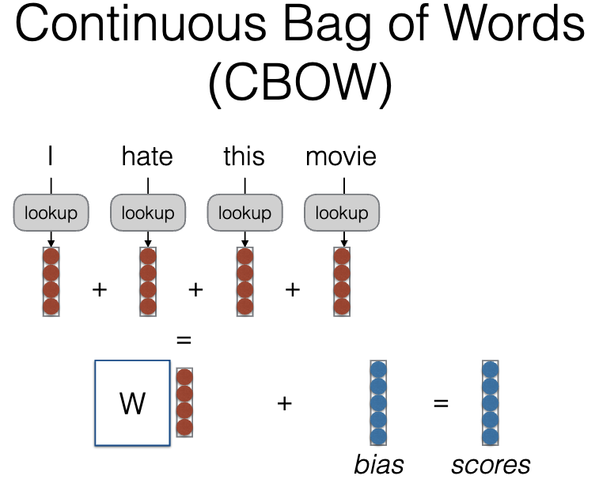
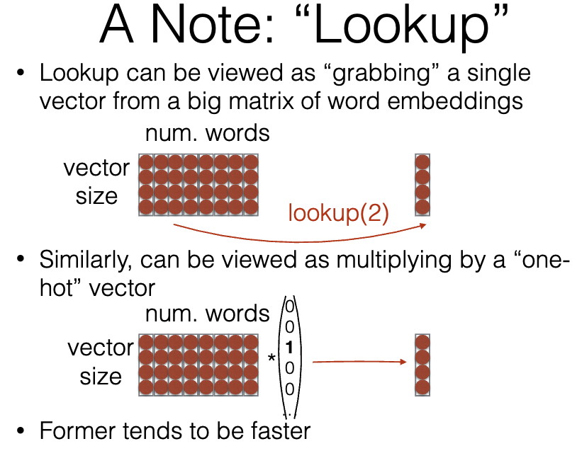

# 词表示：查表、CBOW 与上下文

单词必须转换为数值输入，才能让神经模型处理它们。嵌入表提供了一个紧凑的表示形式，同时允许模型学习在特定训练目标中哪些单词表现相似。

## 查找是矩阵乘法而无需浪费

设 $E$ 的形状为 $V \times d$。一个标记 ID 为 $i$ 的 one-hot 向量与 $E$ 相乘会选择行 $E_i$。嵌入查找直接执行这种选择，避免了长度为 $V$ 的密集向量。梯度更新所选的行，受优化器行为的影响。

CBOW 图查找上下文词向量、组合它们，再预测中心词。实际 CBOW 常对上下文向量取平均，而非只求和，以免上下文长度直接改变尺度。

查表图说明，选取一个词向量在数学上等价于与 one-hot 向量相乘，但直接索引避免了巨大稀疏矩阵乘法的浪费。

## 连续词袋模型

CBOW 从其周围的单词预测中心单词。一个简单的实现是平均上下文嵌入：

$$
h = \frac{1}{|C|} \sum_{c \in C} E_c, \qquad p(w \mid C) = \operatorname{softmax}(Uh)_w.
$$

对于 `the cat sat on the mat`，一个围绕 `sat` 的上下文可能包括 `cat` 和 `on`。跳字模型反转了方向：中心单词预测周围的单词。训练选择如窗口大小、下采样和负采样会影响向量所捕捉的关系。

## 相似性意味着什么

余弦相似性比较方向，而不是幅度。在相似上下文中使用的单词即使其含义相反也可能接近：`hot` 和 `cold` 在类似的语法环境中出现。因此，最近邻揭示了分布行为，而不是一个保证的同义词字典。类比算术是一种经验模式，并且可以编码语料库中的偏见。

静态表为每个标记 ID 提供一个向量。ELMo 和 Transformer 模型生成上下文状态，因此同一个单词在不同句子中可能有所不同。子词词汇表提高了覆盖率，但需要聚合以进行单词级别的任务。

**练习。** 当 $V=10{,}000$ 且 $d=128$ 时，有多少个表参数？1,280,000。增加句子长度会改变查找工作和激活，但不会改变表的参数数量。

参考：[Efficient Estimation of Word Representations](https://arxiv.org/abs/1301.3781)。继续阅读 [ELMo](../../models/elmo.md) 和 [Transformer 的进展](../../word2vec-to-transformer.md)。
