!!! info "中文版正在逐篇更新"

    英文优化版已完成。本页暂时保留原笔记，中文版优化正文正在编写。

# Architecture Advancement of Transformer

# FFN

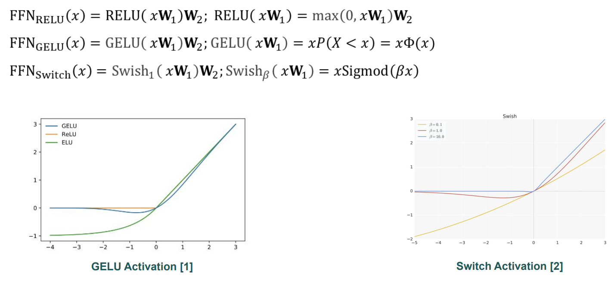

### Bilinear FFNs

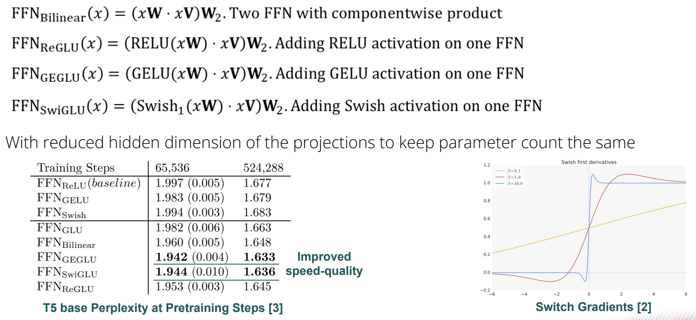

### Efficient Attention

**Grouped-Query Attention:**

Divide Q in G groups,

and share K, V in the same group

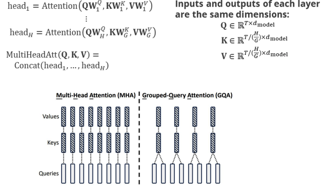

**Multi-Query Attention:**

Single K, V for all Q heads

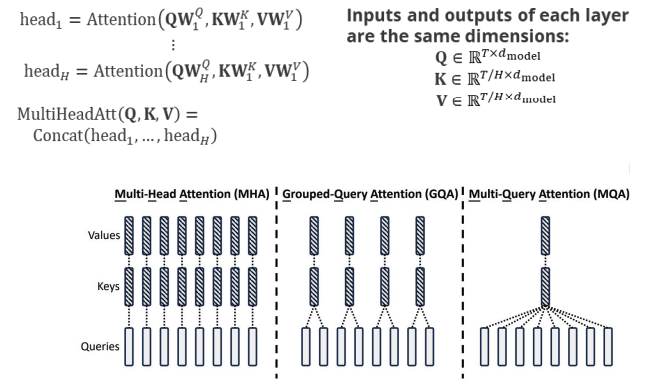

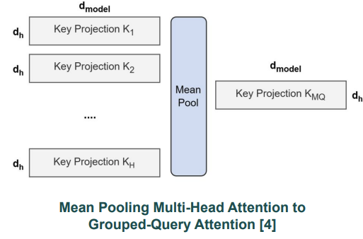

**Multi-Head Latent Attention:**

 Project K, V into a lower dimension latent vector

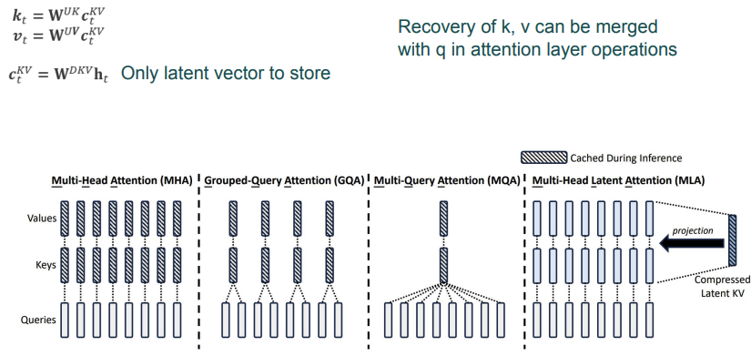

# Layer Norm

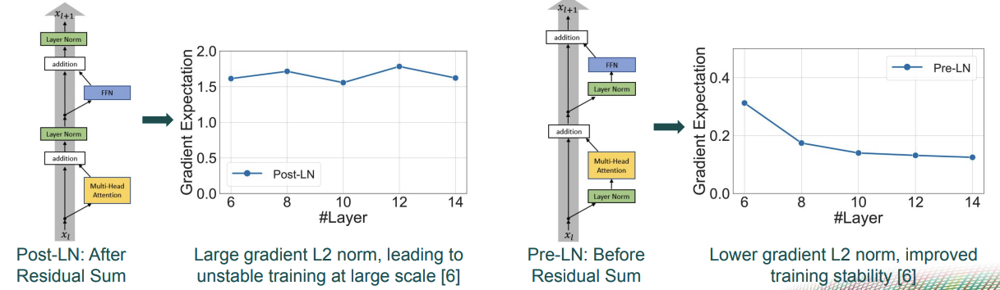

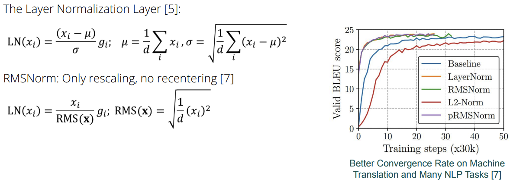

# Position Encoding

## relative position information

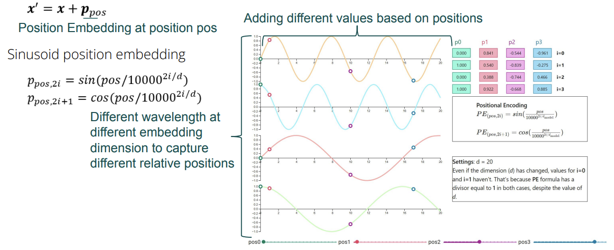

## rotational position embedding

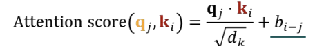

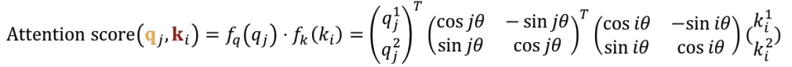

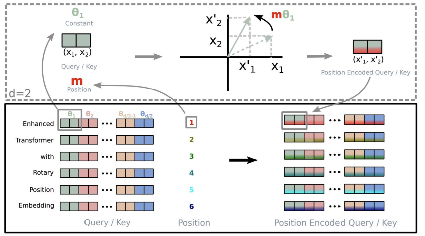
