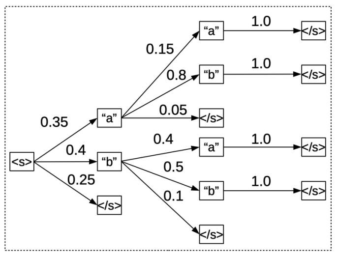
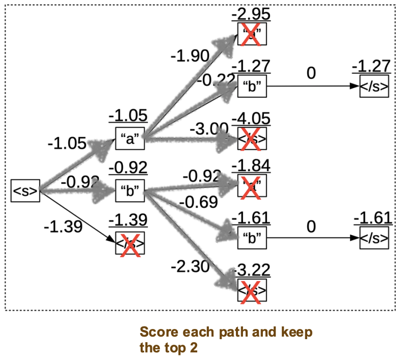
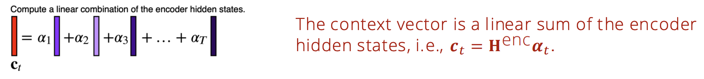
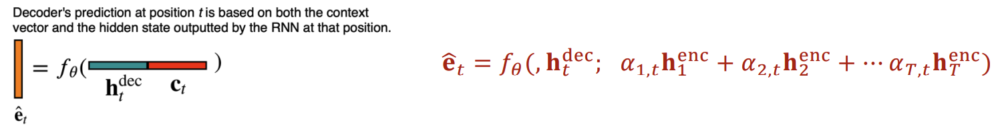
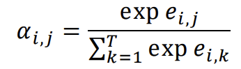
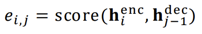
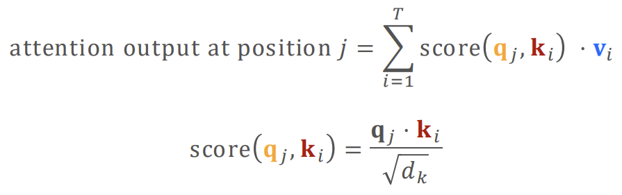
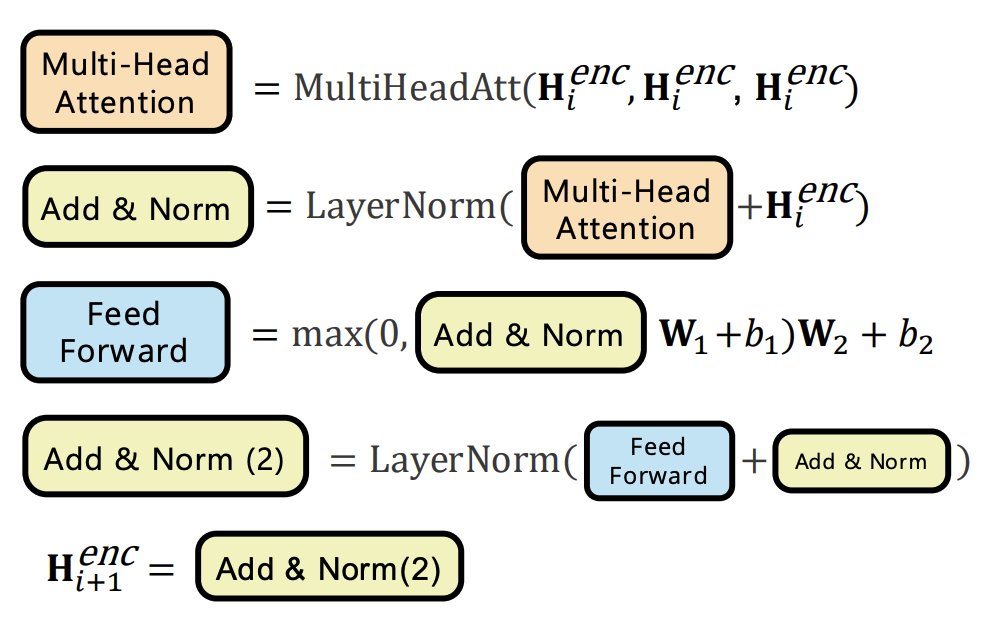
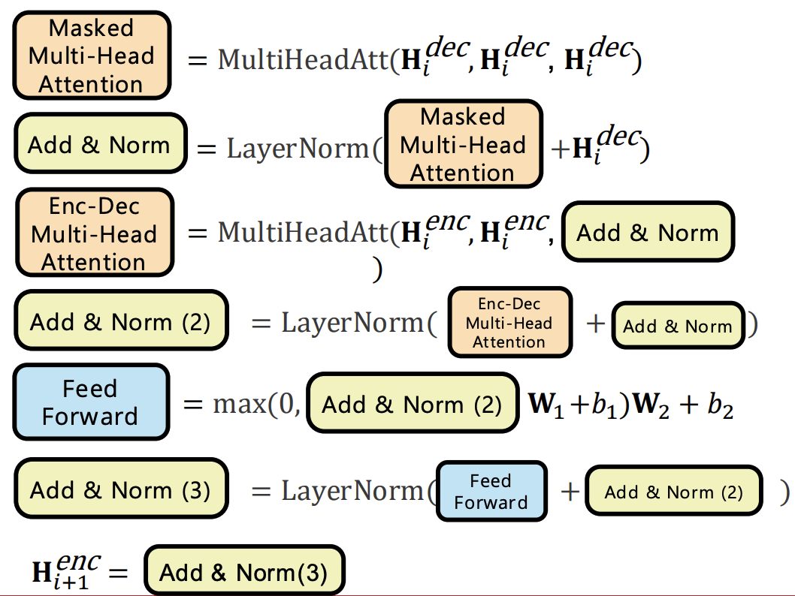
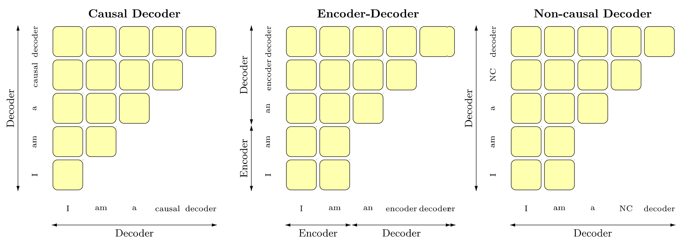

# 语言模型架构：从循环网络到 Transformer

架构指定信息如何在模型中流动。解码指定输出如何被选择。将它们分开可以防止混淆束搜索改进与网络本身的更改。

## 以序列搜索开始

*通过乘以边概率（或等价地加上对数概率）来评分路径。第二个图表修剪到两个前缀的束。*

在第一个图表中，贪婪选择从b开始，概率为0.4，但路径a→b的概率为$0.35\times0.8=0.28$，超过b→b的概率$0.4\times0.5=0.20$。这说明局部最优和序列级最优可以不同。束搜索仍然是近似值，因为修剪的前缀不能返回。

## 注意力消除了固定摘要的瓶颈

基于注意力的解码器从源状态形成一个上下文向量：

$$
c_j=\sum_i\alpha_{ji}h_i^{enc},\qquad
\alpha_{ji}=\frac{\exp(e_{ji})}{\sum_k\exp(e_{jk})}.
$$

求和在单个解码器查询上对源位置进行归一化。幻灯片中索引约定不同，因此在复制方程之前识别查询轴和键轴。

*上下文是加权的源状态之和；解码器将其与自身的状态结合。归一化分母必须覆盖可用的源位置。*

## 每个架构中的Q、K和V

在编码器自注意力中，所有三个都来自编码器状态。在解码器因果自注意力中，所有三个都来自带有因果掩码的解码器状态。在编码器-解码器交叉注意力中，**查询来自解码器；键和值来自编码器**。

*紧凑幻灯片显示原始缩放点积。标准缩放点积注意力在应用softmax之前对这些评分加权权重；省略它会改变操作。*

*这些块图使用残差连接、归一化和FFNs。函数参数顺序取决于表示法；跟踪Q/K/V来源而不是假设第一个显示的参数总是Q。*

## 可见性区分模型家族

*模式对比了因果解码、编码器-解码器流程和双向前缀/因果输出行为。按行读取位置为接收位置，按列读取位置为所选约定下的可见位置。*

RNNs具有顺序时间依赖关系；它们并不无法进行所有并行计算。Transformer在强制教师训练期间并行化了标记-位置计算，而普通自回归解码仍然顺序推进。

**练习。** 有12个源标记和5个解码查询时，交叉注意力评分的每个头部形状是什么？$5\times12$。

参考：[Transformer](https://arxiv.org/abs/1706.03762)。继续阅读 [架构进展](architecture-advances.md)。
