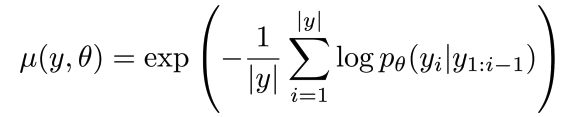
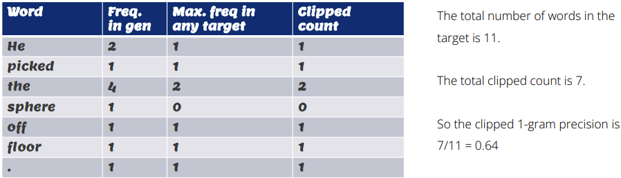
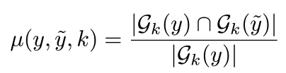
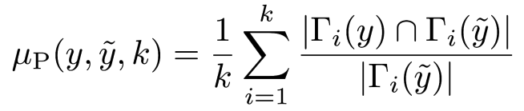
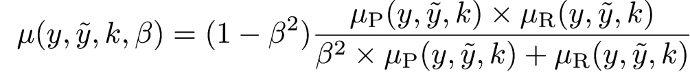
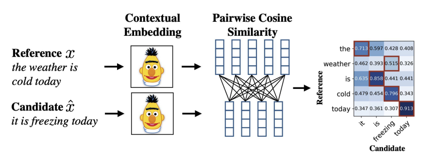
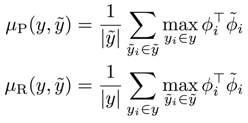
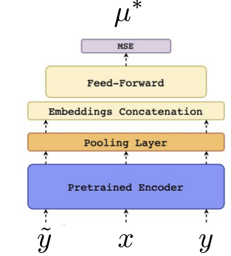
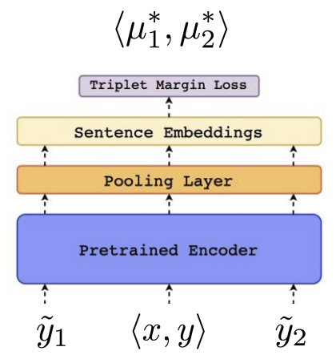

# 📊 自动评估：测量真正重要的能力

一个指标将行为压缩成一个数字。根据任务选择它，并陈述其约定，检查与预期结果不一致的示例。没有单一的指标可以同时衡量流畅性、事实准确性、推理能力和用户实用性。

## 🧭 预测拟合：困惑度

$$
\operatorname{PPL}=\exp\left(-\frac1N\sum_t\log p(y_t\mid y_{<t})\right).
$$

*困惑度是指数化的平均词负对数似然。在兼容的分词、掩码和数据条件下进行比较。*

一个覆盖四个选项的均匀模型的困惑度为4。较低的困惑度并不必然表明更好的指令遵循或事实可靠性。

## 🧩 词汇重叠

*BLEU将n-gram计数裁剪以避免奖励重复匹配，并包括长度惩罚。ROUGE变体测量重叠或最长公共子序列；许多实现报告精确度、召回率和F1，因此“ROUGE是召回”不完整。*

BLEU传统上几何地聚合修改后的n-gram精确度。语料库BLEU和句子BLEU在平滑时差异显著。ROUGE-N使用n-gram重叠；ROUGE-L使用最长公共子序列结构。两者都可能惩罚有效的同义句，并奖励共享单词但改变意义的文本。

*字符重叠可以捕捉形态学。原始chrF截图有一个符号错误：因子是$1+\beta^2$，而不是$1-\beta^2$。*

$$
F_\beta=(1+\beta^2)\frac{PR}{\beta^2P+R}.
$$

对于P=R=0.8，无论正向的β值是多少，F都是0.8。这个简单的检查揭示了截图中的错误。字符顺序、空白和n-gram设置应记录下来。

## 📊 上下文和学习指标

*BERTScore使用余弦相似性匹配上下文词嵌入，然后聚合类似于精确度/召回率的分数。它可以识别一些同义句，但可能会错过微妙的否定或数字错误。*

*COMET风格的图表使用学习表示和人类质量监督；回归和排名变体有不同的目标。指定确切的指标检查点和输入要求。*

学习指标继承训练偏差和领域限制。LLM评估者还需要校准评分标准、顺序控制和对冗长性或模型家族偏见的检查。人工审查在针对特定错误集时仍然有用。

## 📊 完整的评估记录

记录数据集/版本、分割、预处理、模型/检查点、提示/模板、解码、样本数量、指标实现和不确定性。对于代码，执行测试；对于提取，比较字段；对于RAG，检查答案正确性和引用支持。当变异影响决策时，使用自助法或重复运行间隔。

**练习。** “剂量是5”和“剂量是50”共享大部分文本。高重叠是否能建立正确性？不能。任务关键字段需要显式检查。

参考文献：[BLEU](https://aclanthology.org/P02-1040/), [chrF](https://aclanthology.org/W15-3049/), [BERTScore](https://arxiv.org/abs/1904.09675), [COMET](https://arxiv.org/abs/2009.09025).
