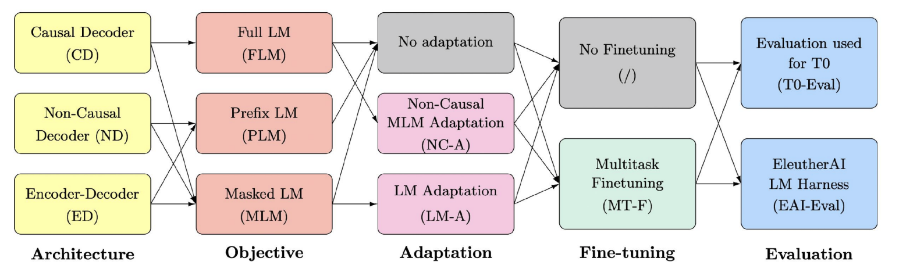
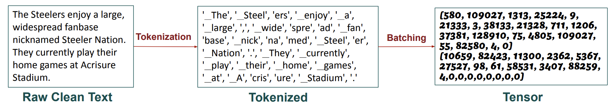
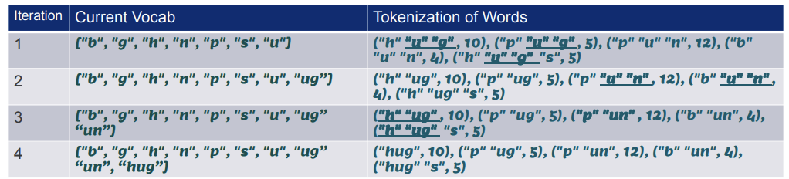
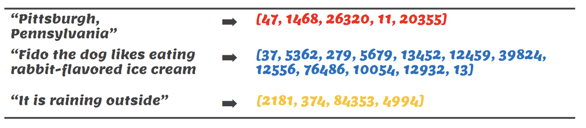
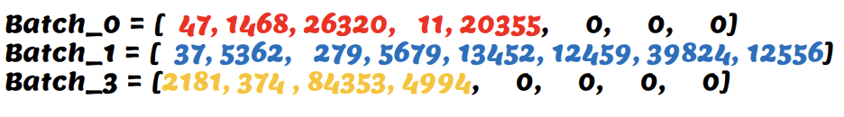
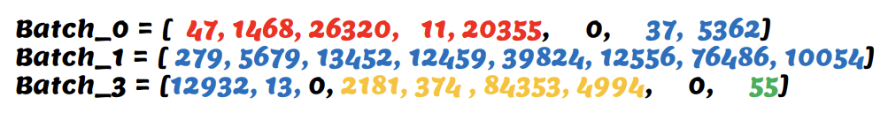

# 学习目标、分词和预训练数据

模型通过其数据管道学习由其创建的预测问题。架构、目标、分词、掩码和批处理必须一致；即使这些部分不匹配，正确的Transformer实现也可能仍然学习错误的任务。

## 目标和信息可见性

因果语言建模从早期的标记中预测下一个标记。遮蔽建模从可见上下文中重构选定的隐藏内容。前缀建模可以使用双向输入并产生因果输出。去噪目标定义了破坏和重建的目标。

*该图分别展示了架构、目标、适应性和评估。如果多个其他因素同时改变，结果不能归因于架构。*

## 从干净文本到子词

*分词将文本转换为ID；BPE学习频繁的对合并。然后固定训练词汇表和合并规则用于推理。*

经典BPE重复合并相邻单元。字节级别变体可以表示任意字节序列，避免了有限字符字母表中未知字符的问题。预分词和规范化是实现选择；并非每个子词分词器都需要相同的单词级分割。运行时复杂度取决于数据结构和实现，因此一个 blanket $O(n^2)$ 声明是不充分的。

词汇大小在序列长度与嵌入/输出表大小之间进行权衡。产生更多标记的语言的分词器会增加成本并减少上下文窗口中能容纳的文本量。通过语言/领域来评估覆盖率和压缩性。

## 填充与打包

*相同的文档可以单独填充或打包成固定大小的块。打包视图节省了空位，但引入了文档边界决策。*

填充需要注意力掩码，并且通常需要损失掩码。打包可能允许跨文档注意力或使用段边界来防止它；指定预期的目标。文档结束标记标识边界，但它们本身并不强制执行注意力隔离。截断可能会移除关键目标或将结构化示例拆分。

## 在规模之前的数据质量

去重近似内容、分离评估来源、记录数据来源并检查语言/领域平衡。避免在保留的评估数据上拟合预处理。污染可以在不提高泛化能力的情况下提高基准分数。重复低质量材料的更多标记并不等同于更多的有用证据。

**练习。** 如果一个打包批次没有填充，所有损失位置是否自动有效？不是。边界、仅提示或否则排除的位置可能仍然需要掩码。

参考文献：[神经翻译中的子词BPE](https://arxiv.org/abs/1508.07909)，[T5目标研究](https://arxiv.org/abs/1910.10683)。继续阅读 [微调](finetuning.md)。
