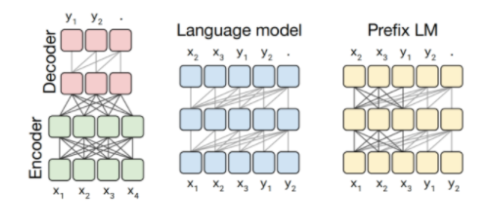
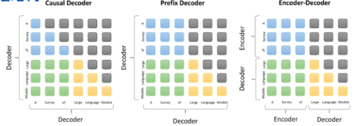
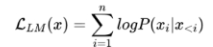
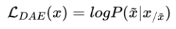

!!! info "中文版正在逐篇更新"

    英文优化版已完成。本页暂时保留原笔记，中文版优化正文正在编写。

# Basic

# **main open-source LLM architectures**

- **Prefix Decoder** (e.g., ChatGLM, U-PaLM): Bidirectional attention for input, unidirectional for output.
- **Causal Decoder** (e.g., LLaMA): Only left-to-right (unidirectional) attention.
- **Encoder-Decoder** (e.g., T5, BART): Bidirectional input attention, unidirectional output.

# **Differences among Prefix Decoder, Causal Decoder, and Encoder-Decoder**

- **Encoder-Decoder:**
    - Strong input understanding via bidirectional attention.
- **Causal Decoder:**
    - Purely autoregressive (predict next token based only on previous ones).
    - look at the whole sentence
- **Prefix Decoder:**
    - Only look at the prefix but not output

# Training Objective

- Predict the next token using **maximum likelihood estimation (MLE)**.
- For causal models, loss is computed on **all tokens**.
- Prefix models compute loss only on outputs.
- Some models (e.g., GLM-130B, T5) use **denoising autoencoding** —randomly masking/replacing parts of input to learn recovery.

# **Why are most large models “decoder-only”**

- **Decoder-only models** (e.g., GPT) work better in **zero-shot** settings without fine-tuning.
- **Encoder-Decoder models** usually require multitask fine-tuning.
- Decoder-only is:
    - More efficient to train
    - Easier to implement
    - Avoids theoretical issues like **low-rank limitations** in bidirectional attention
    - More parameter-efficient for generation tasks
