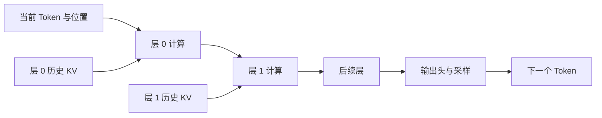
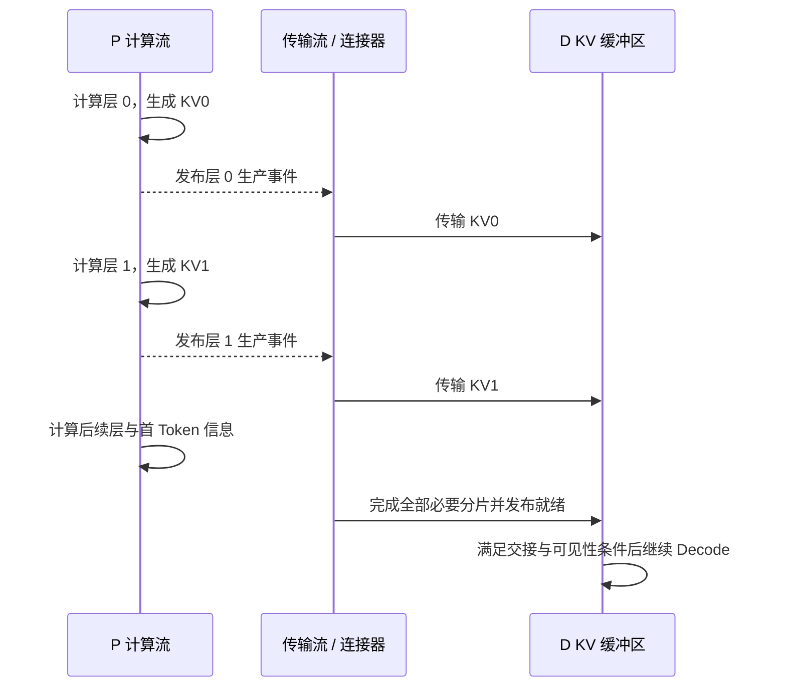

# 🪜 逐层推理：Layerwise 执行、KV 搬运与调度

Transformer 的第 $\ell$ 层消费隐藏状态 $h_\ell$，产生 $h_{\ell+1}$，并使用或更新**该层自己的 KV**。

这个依赖使“上一层已准备好”和“整个请求已准备好”成为不同事件。Layerwise 优化利用这些局部就绪点，把计算、加载或传输交错执行。

## 🧩 四种 layerwise 要分开

| 用法 | 分层的对象 | 带来的机会与代价 |
| --- | --- | --- |
| 逐层执行 | 当前 Token/批次经过模型层 | 明确计算依赖；层之间不能任意并发 |
| 逐层 KV 传输 | 一层的 KV 就绪后就搬走 | 可与后续层计算重叠；增加小任务和完成状态 |
| 逐层 KV 加载/卸载 | HBM、DRAM 或存储中的缓存 | 可降低部分驻留需求；消费前必须按时取回 |
| 逐层权重预取 | 下一层的权重分片 | 扩展模型容量；每轮重复加载可能受 Host 链路限制 |

它们与[层优先物理布局](layers-pages.md)也不同：布局决定哪些字节连续，调度决定何时执行。**PP** 把层放到不同 Stage；Layerwise 搬运即便在 PP=1 时也能使用。逐层量化校准又是另一类离线处理。

## 🔄 一个 Token 怎么走完所有层

对普通自回归 Decode，第 $\ell$ 层先得到当前 Token 的隐藏状态，投影出 Q/K/V，把新 K/V 写进该层缓存，再用 Q 访问该层历史及当前 K/V，执行后续投影、残差和 FFN。

完成全部层、最终归一化和输出头后，才得到采样所需 logits。实际层次顺序以模型架构为准。



因此“只拿到第 0 层 KV”不等于已能完成下一 Token。若实现支持逐层等待/加载，可以先进入已就绪的层，再在缺失层等待；是否这样调度要看连接器和执行器的合同。

普通调度器也可以等全部层就绪后才启动 Decode。计算与 KV 的基础关系见 [KV Cache](kv-cache.md)。

## 🚚 PD 分离里的逐层推送

P 每完成一层或该层的传输块，就建立生产完成事件；传输流等待该事件并提交搬运，同时计算流继续后续层。D 为对应请求、层、块和 TP 分片维护就绪状态。

这里的“推送”描述发起方向，并不证明由设备内核直接驱动 NIC；它也可能由 Host 连接器提交。



这是一种保守的“分层发送、完整交接”协议。vLLM Ascend 的 [PD 设计](https://docs.vllm.ai/projects/ascend/en/main/developer_guide/Design_Documents/disaggregated_prefill.html)描述了普通 Connector 的 D 拉取与 Layerwise Connector 的 P 分层推送；所引设计在全部层推送完成后通知 D 开始 Decode。

不要仅凭名称就承诺“传第一层时 D 已经开始生成”。

要接到设备侧提交机制，继续看 [NPU/GPU 发起传输](../../../infra/device-initiated-transfer.md)；完整请求还需遵守[服务交接流程](../../../infra/serving-frameworks.md)。

## ⏱️ 用递推式判断能隐藏多少传输

假设有 $L$ 层，单计算流水和单传输流水，各层 KV 在该层算完才可发送，忽略争用。设第 $\ell$ 层计算耗时为 $c_\ell$，传输耗时为 $x_\ell$：

$$C_\ell=\sum_{i=1}^{\ell}c_i,\qquad F_\ell=\max(C_\ell,F_{\ell-1})+x_\ell,\quad F_0=0.$$

全部 KV 到达时间为 $F_L$。若每层相同，有 $F_L=c+x+(L-1)\max(c,x)$。取 4 层、每层计算 2 ms、传输 1 ms，串行“先算完再传”需要 12 ms，分层重叠为 9 ms，隐藏了 3 ms。

若传输更慢，积压会增长，最后仍有排空尾巴。

这是教学模型，未包含 logits、采样、网络控制、重排、队列开销、TP/EP 通信和 HBM 争用。小块传输还要付出 $x_\ell\approx\alpha+S_\ell/B$ 的固定开销；合并相邻层/块可能比无限细分更好。

重叠成功需要独立推进能力及正确依赖，不能只看两个 API 都叫 Async。

## 🧠 分层卸载不能省略缓冲区生命周期

若只让少量层缓冲区常驻 HBM，应明确每个槽位的状态：

```text
空闲 → 预取/生产中 → 对计算或传输就绪 → 正在被使用
     → 所有计算与传输使用者完成 → 空闲（进入新 generation）
```

双缓冲可以让当前层使用槽位 A、下一层预取到 B，但 A 只有在全部使用者结束后才能复用。记录生产事件只保证“可以开始读”，不能保证异步传输已经不再读取；释放 Host 注册区、设备缓冲区或请求句柄时同样如此。

权重卸载与 KV 卸载要分别计带宽。例如假设一轮需串行加载 40 GB 权重、链路有效带宽 25 GB/s，仅加载就需约 1.6 s；批处理可让一份加载服务多个 Token，预取可重叠部分计算，但无法消除带宽预算。

这是示例估算，不是框架性能承诺。

## 📅 Continuous batching、Chunked Prefill 与 Layerwise

### Continuous batching

在迭代边界更新活跃请求，让新请求加入、结束请求退出；通常减少等待整个静态批次结束的空闲，但受 KV 容量和 Token 预算约束。

它不意味着任意内核执行中途都能插入请求。[Orca](https://www.usenix.org/conference/osdi22/presentation/yu)给出了迭代级调度的基础设计。

### Chunked Prefill

把长提示沿 Token 维分块，每块仍经过需要的所有模型层。它可以与 Decode 交错，减轻长 Prefill 对 ITL 的干扰；块大小也会影响 TTFT、吞吐和调度开销。

[SARATHI](https://arxiv.org/abs/2308.16369)讨论了这一设计及微批平衡。

### Layerwise

则沿模型层建立准备和搬运依赖。Token 分块、层分块、TP 分片和 KV 页是不同维度；若组合使用，进度标识至少应覆盖 `request / chunk / layer / shard / generation`。

执行顺序还必须满足注意力的因果依赖。

## 📊 该看哪些证据

记录每层计算起止、KV 生产事件、传输提交/完成、D 侧就绪与等待时间；同时看 TTFT、ITL、吞吐、峰值 HBM、在途字节和缓冲区复用等待。

并行组变化时重新检查 KV 重分片成本。最终要判断的是关键路径缩短了多少、内存是否下降，而非只看到时间线上两种颜色有重叠。

自测：Layer-first 布局是否必然启用 Layerwise 传输？PP=4 是否表示每层都跨网络？一层的生产事件是否允许复用源块？答案都是否定的：分别还缺调度协议、实际 Stage 边界和传输完成保证。
