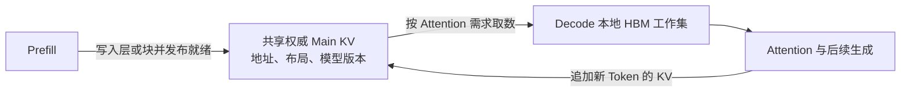

# 🗃️ 共享推理状态：KV、容量层与 Worker 解耦

[KV Cache](kv-cache.md)解释缓存内容，[推理框架](../../../infra/serving-frameworks.md)解释 P/D 交接。
本章进一步讨论：缓存对象能否独立于某个 Worker 存活？多个 Worker 怎样共享、取回和回收它？
以下共享 Main KV、Agent 等流程是应用设计，需要框架、Attention 和生命周期协议配合。

## 🧩 前缀复用、KV 交接与共享 Main KV

这三个概念关注不同的关系：

| 概念 | 共享或交接的范围 | 需要回答的问题 |
| --- | --- | --- |
| Prefix Cache | 兼容请求的公共前缀 | 是否避免重复 Prefill，命中数据在哪里 |
| P/D 交接 | 同一请求从 Prefill 转到 Decode | 谁分配目标块，何时完成，何时释放源 |
| 共享 Main KV | 请求持续使用的权威历史 KV | 数据由谁拥有，Decode 怎样取数，谁负责回收 |

已有 KV Pool 或传输连接器可以提供缓存和搬移基础，但仅凭部署了共享后端，
还不能判断是否消除了某个请求的完整 P/D 副本。
应追踪每一份实际分配的字节、用途和存活时间。调用链见[从 key 到拷贝地址](../../../infra/kv-pool-call-chain.md)。

## 🏗️ 一个共享 Main KV 设计



图中最后一条回写边很重要：P/D 交接后，Decode 会继续产生 KV。
设计必须明确新增 Block 的写入归属、完成与发布；不能只讨论 Prefill 的初始数据。
具体实现也可能先在本地追加，再分阶段发布，而不是每个 Token 都立即同步回写。

一次对象交接需要关联：请求身份、模型与 Adapter 版本、Token/位置、KV 数据类型、
布局与分片、层/块范围、就绪代次，以及仍在使用对象的读者。
普通地址和句柄本身不能表达全部语义。

### 容量收益如何算？

用一个教学假设：同一历史 KV 为 4 GiB。若某个设计同时保留 P、D 两份完整历史，载荷是 8 GiB；
若改为一份 4 GiB 权威数据，加 1 GiB 本地工作集，则对应载荷是 5 GiB。

```python
# runnable-example
main_kv_gib, local_cache_gib = 4, 1
two_full_copies_gib = 2 * main_kv_gib
shared_with_cache_gib = main_kv_gib + local_cache_gib
assert two_full_copies_gib == 8
assert shared_with_cache_gib == 5
```

这不是所有 P/D 部署的基线：有些实现会及时释放 P 侧块，本来就没有长期双副本。
真实内存还要加上传输中转、块舍入、计算工作区和可靠性副本。
单一权威对象也可以对应多个物理副本，应分别讨论语义与物理容量。

## 🧠 Dense 与 Sparse Decode 的取数成本

| 方式 | 需要读取什么 | 本地策略 |
| --- | --- | --- |
| Dense 全注意力 | 当前 Attention 范围内的完整历史 KV | 分层/分块读取、双缓冲、预取 |
| Sparse Attention | 算法选出的 Top-K 位置或 Block | Indexer、热点缓存、缺失块聚合取回 |

把历史 KV 移到 DRAM 可以节省 HBM，但 Decode 可能需要反复跨层取回它。
若每步都从容量层读取 4 GiB，目标为每秒 40 个 Token，仅载荷就要求每请求持续 160 GiB/s。
这个假设忽略本地命中、压缩、协议与计算，目的是说明容量方案还必须满足带宽供给。

Sparse 访问可以减少取数范围，但具体选取语义由模型和算法决定；内存池不会自动把 Dense Attention 变为 Sparse。
[HiSparse][hisparse]可作为分层稀疏 KV 管理的研究参考，其 CUDA 实现与平台实验不能直接视作昇腾上的集成结果。
MLA、滑动窗口、跨层共享或量化布局的字节数，应使用对应的[布局与模型结构](../model-structures/index.md)计算。

## 🚦 生产、可见与回收的边界

1. 为对象或下一代 Block 分配空间，记录写入方与布局。
2. 生产数据，等待访问后端规定的完成及可见性条件。
3. 发布本轮 READY/版本，消费者取得访问权后读取。
4. 消费完成后释放引用；取消或迁移时仍要处理在途访问。
5. 没有受保护的读者和在途任务后，再回收或复用。

这是协议示意，而不是一组固定 API。
传输完成、Attention 使用完成和请求结束，分别保护不同资源。
源端 Buffer 可以何时释放，也取决于共享的是对象引用，还是已经形成了接收端副本。

## 🗂️ 扩展到其他推理状态

| 场景 | 可以管理的对象 | 必须配套的业务语义 |
| --- | --- | --- |
| Agent Session | KV、任务游标、工具状态、中间结果 | Session 版本、权限、恢复与持久化 |
| 多模态 Feature Cache | Frame/Patch/Audio 特征 | Encoder 版本、预处理、时间范围、兼容消费方 |
| RAG / Embedding | 向量、文档块、Rerank 特征 | 索引版本、候选过滤、检索算法 |
| Model / LoRA Cache | 权重分片与 Adapter | 模型版本、加载时机、本地驻留和引用 |
| 推测解码 KV Tree | 公共 Prefix、候选分支增量 | 引用计数、写时复制、接受路径与回滚 |

这些是可基于内存访问能力构建的应用方向，不能据此认定已有统一跨业务对象服务。
例如，两个任务只有使用兼容的 Encoder 和预处理，才可能复用同一 Feature；
Agent 的工具调用副作用也不会因为保存了内存状态就自动获得事务或重放保证。

### MoE 的两条数据路径

专家权重池处理 Expert Weight 放在哪里、何时加载到本地 HBM，以及如何迁移布局。
Token Dispatch/Combine 则处理每批 Token 的路由、发送、专家计算与结果组合。
前者是权重容量和调度问题，后者是通信算子和同步问题；可组合优化，但要分别测量。
基础原理见[MoE](../components/moe.md)，应用组合见[内存 Fabric 五种模式](../../../infra/memory-fabric-patterns.md)。

## 📊 设计一个有说服力的对比

固定模型、上下文长度、请求分布、设备数量与 SLO；比较基线和共享方案的：

- 实际权威数据与物理副本、HBM/DRAM 峰值，以及中转 Buffer。
- 每 Token/请求跨容量层读取与写回的字节数、Cache 命中和数据等待。
- TTFT、ITL/TPOT、P99、满足 SLO 的 Goodput，以及取消和恢复正确性。

TTFT 是首 Token 延迟；ITL 是相邻输出 Token 的间隔；TPOT 的汇总方式需要明确。
减少内存占用而显著增加数据等待，不一定增加满足 SLO 的有效吞吐。

**练习。** 共享池有足够容量，但 Dense Decode 的目标带宽超过可用链路时，可以调整什么？
先区分本地缓存、布局/压缩、算法和并发策略；它们改变的成本与语义并不相同。

## 📚 参考与后续阅读

- [Hugging Face：KV Cache 工作原理][cache]。
- [vLLM 前缀缓存设计][prefix]。
- [MemFabric 项目及集成入口][mf]。具体硬件、版本与后端要求以对应实现为准。
- [逐层推理与传输](layerwise-inference.md)、[缓存布局](layers-pages.md)、[LoRA](../adaptation/lora.md)。

[cache]: https://huggingface.co/docs/transformers/main/cache_explanation
[prefix]: https://docs.vllm.ai/en/latest/design/prefix_caching/
[hisparse]: https://arxiv.org/abs/2608.07009
[mf]: https://gitcode.com/Ascend/memfabric_hybrid
