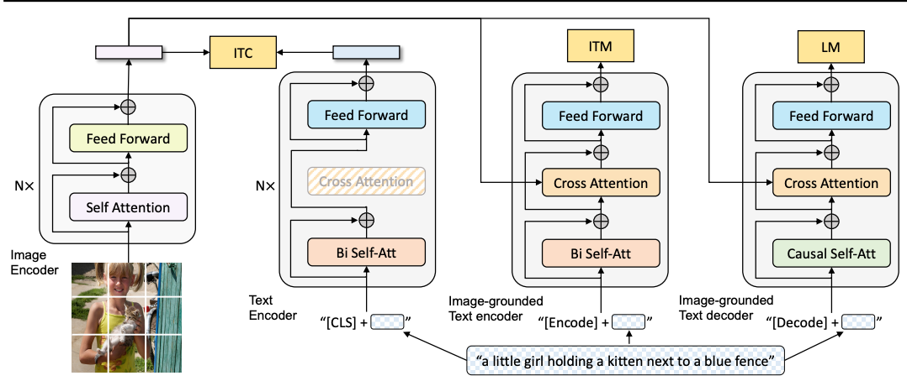
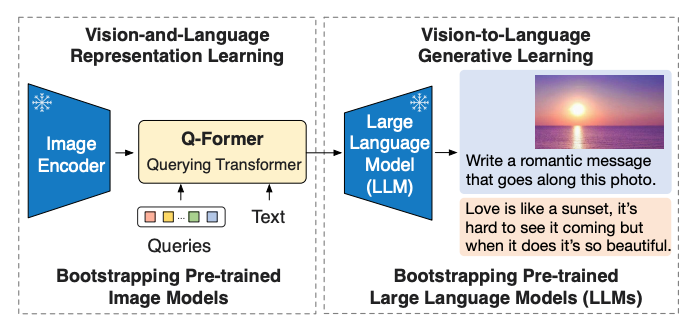
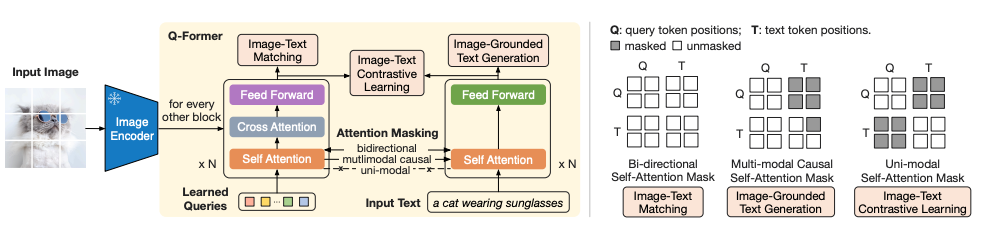
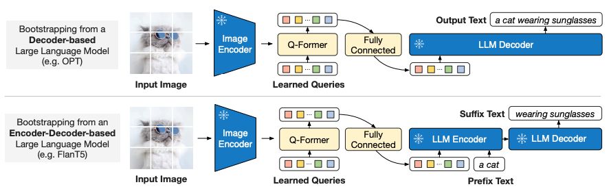

# BLIP 与 BLIP-2：理解和生成图文内容

BLIP 和 BLIP-2 是相关但不同的设计。BLIP 结合了视觉理解和文本生成，同时改进了噪声标题。BLIP-2 通过可训练的查询变换器（Q-Former）连接预训练的冻结视觉和语言模型。

## BLIP：三种操作模式

*BLIP 的对比编码器、图像导向匹配编码器和因果文本解码器共享一个共同的多模态设计，但使用不同的信息流。*

ITC 独立地对图像/文本表示进行编码对齐。ITM 使用交叉注意力来判断一对是否匹配，包括硬负样本。语言建模模式在图像特征上生成文本。CapFilt 数据处理程序生成合成标题并过滤噪声标题，使数据质量成为方法的一部分，而不是仅依赖于架构。

## BLIP-2 第一阶段：学习视觉表示接口

*两阶段桥梁保持大型图像编码器和语言模型冻结，同时学习接口。*

一组固定的查询向量（论文设计中为32个）跨注意力到图像特征。它们的输出形成一个紧凑的视觉表示。查询是参数，不是用户提供的单词，每张图像会产生不同的输出查询状态。

第一阶段使用图像-文本对比学习、图像-文本匹配和基于图像的文本生成来训练 Q-Former。这些目标使用不同的注意力掩码：

- ITC 在相似性计算之前将查询和文本流分开。
- ITM 允许双向查询/文本交互。
- 基于图像的生成允许文本读取查询和前文，同时防止未来文本泄漏。

*遮罩图显示为什么改变目标需要改变允许的查询/文本交互。*

## BLIP-2 第二阶段：连接到冻结的语言模型

一个学习的线性投影将查询输出映射到 LLM 的输入宽度。这些视觉前缀嵌入条件一个冻结的仅解码器或编码器-解码器语言模型，并且生成目标训练桥梁。这与第一阶段的三个表示学习目标是分开的；将它们合并成一个不分化的训练阶段会模糊方法。

*上路径条件一个仅解码器LM；下路径连接到一个编码器-解码器LM。两者都使用投影后的视觉查询输出。*

## 为什么压缩视觉特征？

如果视觉编码器发出数百个补丁状态，固定查询集可以减少接口序列长度。这节省了下游工作，但引入了一个瓶颈：小文本或几个小物体可能需要更多的视觉细节。仅压缩不是知识蒸馏；蒸馏需要一个教师推导的学习目标。

视频扩展需要时间信息、帧选择、视觉标记预算和时间任务的训练。仅仅添加帧位置不能保证时间理解。

**练习。** 梯度能否通过冻结的LLM训练桥梁？可以。冻结权重防止它们更新；通过LLM进行微分仍然可以将梯度传递给其输入嵌入和桥梁。

参考文献：[BLIP](https://arxiv.org/abs/2201.12086)，[BLIP-2](https://arxiv.org/abs/2301.12597)。比较 [Flamingo](flamingo.md) 和 [LLaVA](llava.md)。
