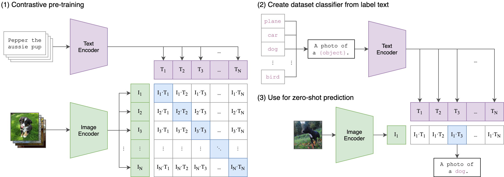
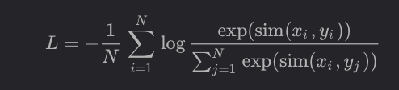

!!! info "中文版正在逐篇更新"

    英文优化版已完成。本页暂时保留原笔记，中文版优化正文正在编写。

# CLIP (Contrastive Language-Image Pre-training)

2 Encoder turns Image/Text into embedding

same length embedding

## Resnet

Extracted Feature → flatten → attention pooling (like attention)

# InfoNCE

compute similarity between image and text

compute cross-entropy of 2 direction

average 2
